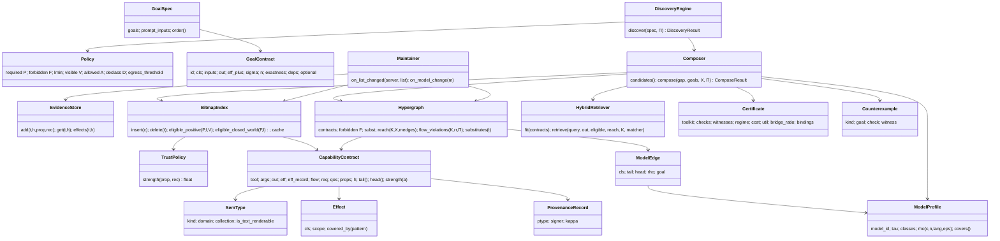

# Architecture

Paper-to-code planning artefacts: module map, class diagram (interface contract between modules)
and the request-path sequence. Section numbers refer to the paper.

## Module map (dependency order)

```
types.py, effects.py            Θ, <:, τ; scoped effects E, labels L, flow transformers      (§5)
provenance.py, policy.py        λ = (π, σ, κ), θ_a, evidence store W[(t,h)]; Π = (P,ℓmin,V,A,D)  (§4, §5)
data/registries.py              Table 1 registries, tasks, definition hash h(t)               (§2.2)
contracts.py                    capability contracts c(t) and their extraction                (Def. 4, §6.1)
bitmap_index.py                 E_a^(ℓ) bitmaps, Eqs. 2–3, Lemma 1, Prop. 3 cache              (§5)
model_profile.py                ρ_LLM, isotonic fit, rules 1–4                                (Def. 6)
hypergraph.py                   H, reach, bridges, F, ∼, flow check (L)                       (Defs. 2, 5)
goals.py                        goal contracts, Algorithm 1                                   (Def. 1, §6.2)
retrieval.py                    BM25 + dense + structural, RRF                                (Eqs. 4–5)
certificate.py                  checks S C P E L V M B, counterexamples χ1–χ5                 (Def. 3)
composer.py                     Algorithm 2: closure, cost, utility, B&B, greedy              (§6.3, Eqs. 6–7)
refinement.py                   Algorithm 3A, split on flow                                   (§6.4)
maintenance.py                  Algorithm 3B, toolkit cache                                   (§6.4)
manifest.py                     sanitised manifest, pattern repository R                      (§6.3, §6.4)
llm/backends.py                 analyst / assistant roles: replay, Anthropic, heuristic       (§6)
engine.py                       the discovery layer (Fig. 5)
baselines.py, scenarios.py      Table 2 baselines; Figs. 1–3 scenarios
realreg.py, simulation.py       569-tool registry with silver ground truth; verifier & attacks
```

## Class diagram



## Request path

```mermaid
sequenceDiagram
    participant A as Analyst LLM (role)
    participant E as DiscoveryEngine
    participant G as Alg.1 gap_analysis
    participant I as BitmapIndex
    participant R as HybridRetriever
    participant C as Composer (Alg.2)
    participant F as refine (Alg.3A)
    A->>E: goal contracts G, σ, ≺ (JSON)
    E->>G: validate σ against ρ_LLM(c, n, lang, ε)
    G-->>E: Γ, Δ or CLARIFY
    E->>C: compose(Γ, G, in(x), Π)
    C->>I: Elig = ⋂ E_a^(ℓmin) ∩ V
    C->>R: top-K per gap goal (typed), backward closure
    C->>C: B&B on Σcost (|T| ≤ Nmax) or greedy; checks F, A, (L), (C), (P)
    alt valid
        C-->>E: K + certificate C
    else counterexample χ
        C-->>F: χ1..χ5
        F->>C: repaired goals / candidates / split, blocking clauses
        F-->>E: K + C, or ABSTAIN(χ)
    end
    E-->>A: sanitised manifest, suggested order
```
