# Figures

Generated by `experiments/plot.py` from `results/*.json` (no experiment is run). Each figure is in `results/figures/` as PNG (300 dpi) and PDF (vector). Captions are generated from the same JSON. Colours: validated reference palette (categorical slots in fixed order; one-hue ordinal ramps for ordered series); identity is also carried by marker shape or direct labels, and every number is tabulated in [RESULTS.md](RESULTS.md).

## Figure 1 — H2 — eligibility under forged and missing metadata

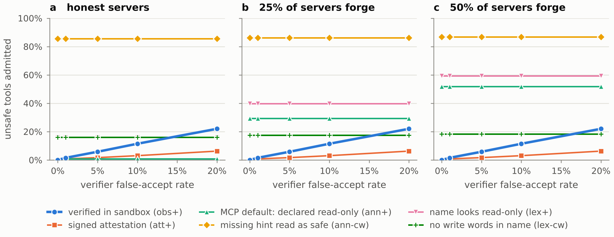

Share of truly unsafe tools (silver labels) admitted by a read-only policy, 569-tool registry, 5 seeds. MCP's default reading (ann+) admits 0.8% with honest servers and 52% when half the servers forge `readOnlyHint`; reading a missing hint as safe (ann-cw) admits 85%. Verified evidence (obs+) admits 0% at a perfect verifier for every forgery rate, rising with the false-accept rate (5.8% at 5%, 22% at 20%). Source: results/e2_eligibility.json.

Files: `results/figures/h2_exposure.png`, `results/figures/h2_exposure.pdf`

## Figure 2 — H3 — toolkit size against gold-tool recall

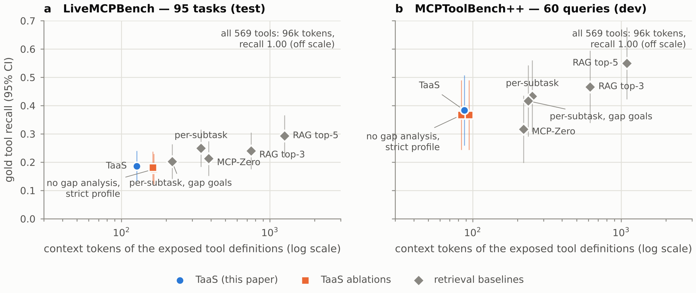

Mean context tokens of the exposed tool definitions against gold-tool recall; recorded Claude Sonnet analyst, 569-tool registry. On LiveMCPBench TaaS exposes 126 tokens for recall 0.186; per-subtask retrieval 343 tokens for 0.249; RAG top-5 1252 tokens for 0.293. Without gap analysis TaaS uses 1.96 tools instead of 1.42. Source: results/e3_gap_sonnet.json.

Files: `results/figures/h3_tokens_vs_recall.png`, `results/figures/h3_tokens_vs_recall.pdf`

## Figure 3 — H4 — injected actions and Property 1

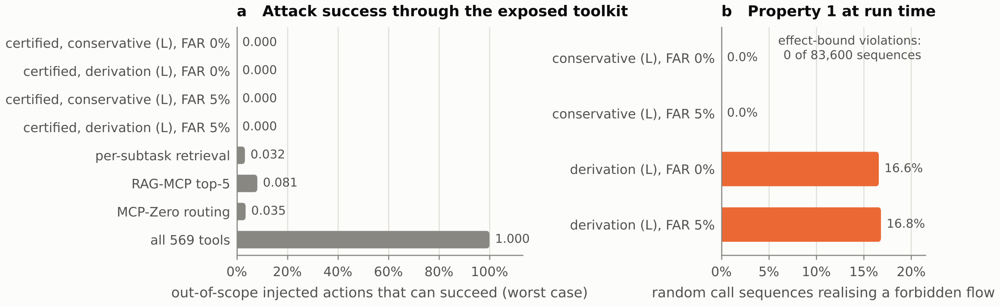

(a) Share of injected actions outside the task's needed effect classes (exfiltrate, destroy, execute, pay, tamper) that some exposed tool can truly realise; least-privilege policy per task, evidence at least obs, 3 verifier seeds. Certified toolkits: 0.000; RAG-MCP top-5 0.081; all tools 1.000. (b) Random call sequences over certified toolkits with true effects: no effect-bound violation in 83,600 sequences; certifying (L) along derivations only lets 16.6%–16.8% of sequences realise a forbidden flow, the conservative reading none. Source: results/e4_injection.json.

Files: `results/figures/h4_injection.png`, `results/figures/h4_injection.pdf`

## Figure 4 — Measured reliability profiles ρ_LLM

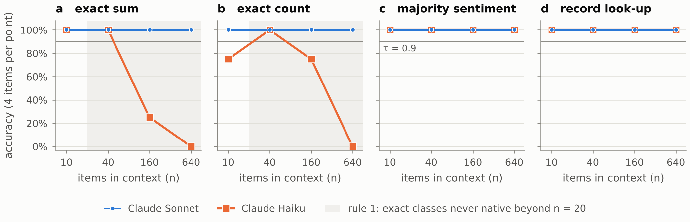

Accuracy answering by reading alone, per class and input size; 4 items per point, answered by session sub-agents with the Read tool only. Claude Sonnet is exact at every size; Claude Haiku's exact sum falls from 100% at n = 40 to 25% at n = 160 and 0% at n = 640. The shaded band is where rule 1 forbids native exact classes whatever was measured. Source: results/calibration_table.json.

Files: `results/figures/rho_calibration.png`, `results/figures/rho_calibration.pdf`

## Figure 5 — Relevance term in the cost (dev-split tuning)

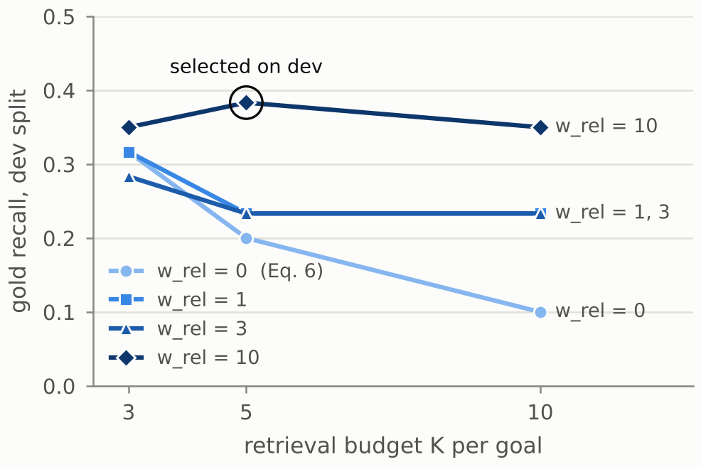

Gold recall on the MCPToolBench++ dev sample (60 queries) for retrieval budget K and relevance weight w_rel added to Eq. 6. Under pure Eq. 6 recall falls as K grows (0.32 → 0.10), because the cheapest type-compatible tool wins. Selected: K = 5, w_rel = 10. On the test split pure Eq. 6 gives recall 0.082 against 0.186 with the selected setting. Source: results/e3_tune.json.

Files: `results/figures/tune_relevance.png`, `results/figures/tune_relevance.pdf`

## Figure 6 — Eligibility cost and exactness (RQ4)

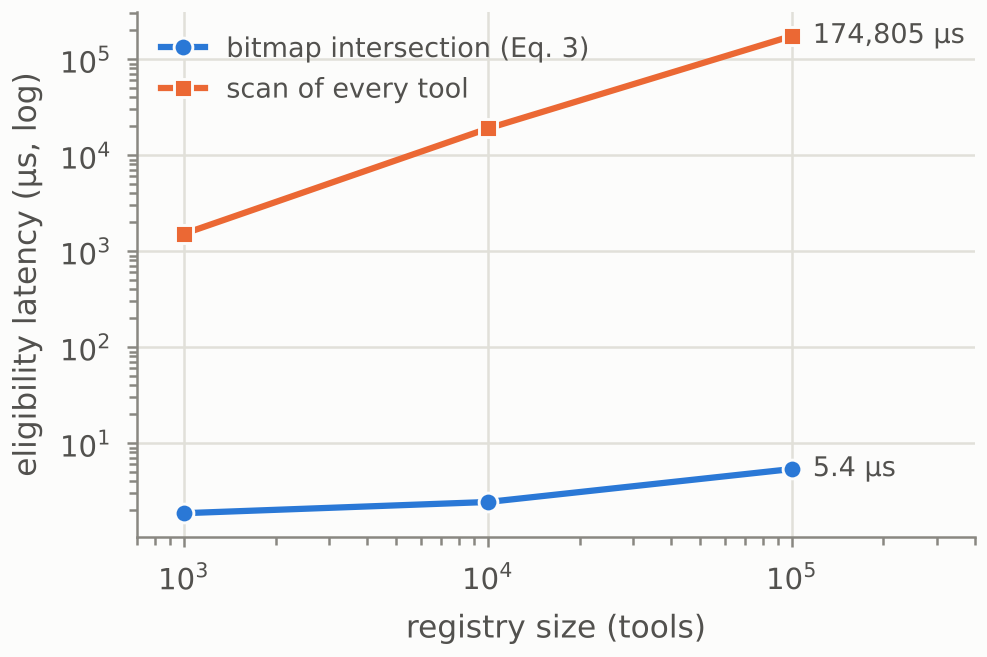

Time to compute the eligible set for three properties. At 100,000 tools the bitmap answers in 5.4 µs against 175 ms for a scan (×32,527); the two return identical sets. Proposition 3 over 9,600 (event, cache entry) checks: 0 stale entries kept, 0 needless invalidations. Wall-clock, one run on 2 CPUs. Source: results/e7_scalability.json.

Files: `results/figures/eligibility_latency.png`, `results/figures/eligibility_latency.pdf`

## Figure 7 — Composition on synthetic typed registries (RQ3)

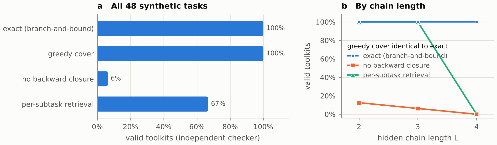

Hidden typed chains with five kinds of distractor; validity graded by an independent checker, optimum by brute force. Exact and greedy regimes: 100% valid and 100% optimal; without backward closure 6.2%; per-subtask retrieval 66.7%. Source: results/e5_synthetic.json.

Files: `results/figures/e5_composition.png`, `results/figures/e5_composition.pdf`

## Figure 8 — Request-path ablations

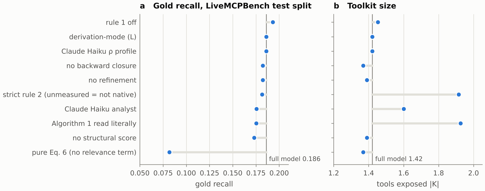

Each variant changes one component of the dev-tuned system (vertical line); recorded Claude Sonnet analyst unless stated, 95 LiveMCPBench tasks. Removing the relevance term (pure Eq. 6) cuts recall from 0.186 to 0.082; reading Algorithm 1 literally or treating unmeasured classes as non-native (strict rule 2) leaves recall close but raises |K| to 1.93 and 1.92. Source: results/e6_ablations.json.

Files: `results/figures/e6_ablations.png`, `results/figures/e6_ablations.pdf`

## Figure 9 — Retrieval components

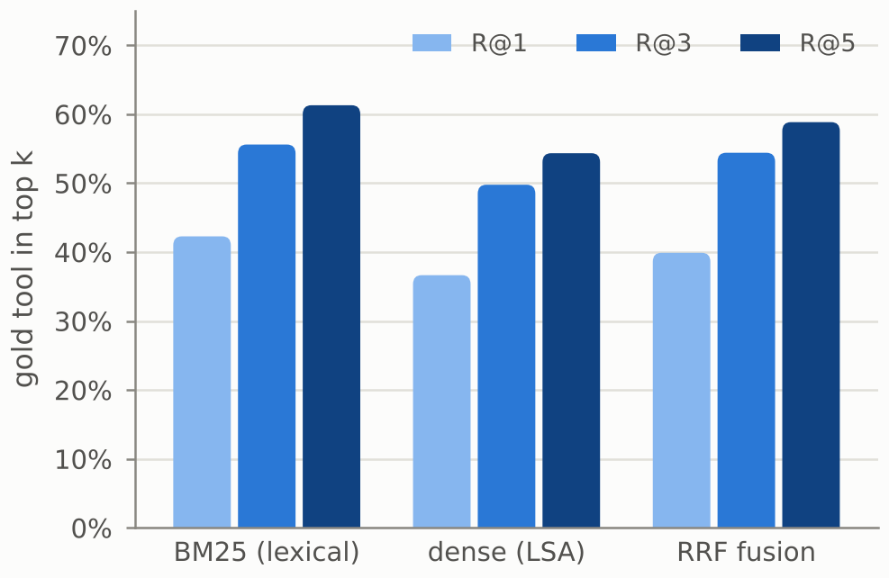

Raw-query retrieval over the 569-tool registry for all 1,509 MCPToolBench++ requests. BM25 alone reaches R@5 = 0.613; the LSA dense stand-in for BGE-M3 0.543; reciprocal-rank fusion 0.588, below BM25 because the dense component is weak. Source: results/e6_ablations.json.

Files: `results/figures/e6_retrieval.png`, `results/figures/e6_retrieval.pdf`

## Figure 10 — Binding-check regression in the Codex integration branch

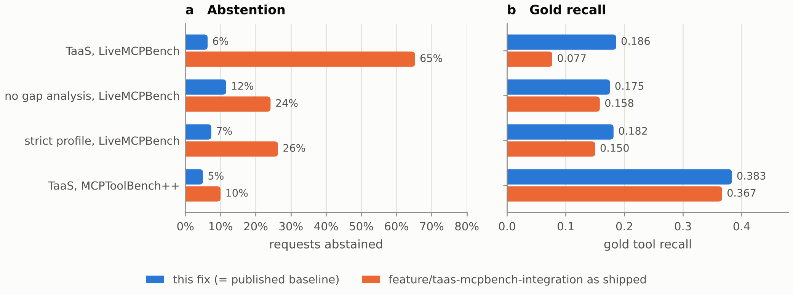

E3 re-run unchanged on two code versions. The witness-binding check added in commit 3a8a28e rejects valid certificates, so TaaS abstains on 65% of LiveMCPBench tasks instead of 6% and recall falls from 0.186 to 0.077. The fix reproduces all 337 compared baseline numbers. Sources: results/e3_gap_sonnet.json, results/e3_gap_sonnet_codex.json.

Files: `results/figures/codex_binding_regression.png`, `results/figures/codex_binding_regression.pdf`

## Figure 11 — MCP-Bench integration path, offline

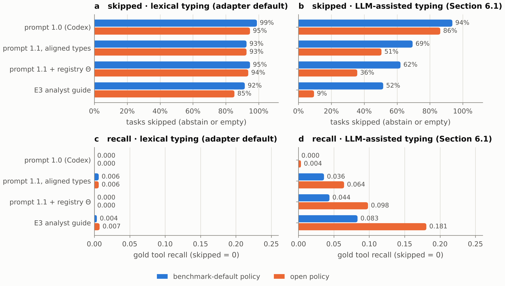

TaaSMCPBenchAdapter.select on the 525-tool LiveMCPTool catalogue in MCP-Bench's tool-map shape, 95 LiveMCPBench tasks, recorded Claude Sonnet analyst runs, fixed code. With the Codex defaults (prompt 1.0, lexical typing, benchmark-default policy) 99% of tasks are skipped. Aligning the prompt's vocabulary, passing Θ, typing contracts and opening the policy brings this to 36% (recall 0.098); the E3 analyst guide reaches 9% (recall 0.181). Source: results/e8_mcpbench_adapter_fixed.json.

Files: `results/figures/e8_adapter.png`, `results/figures/e8_adapter.pdf`
