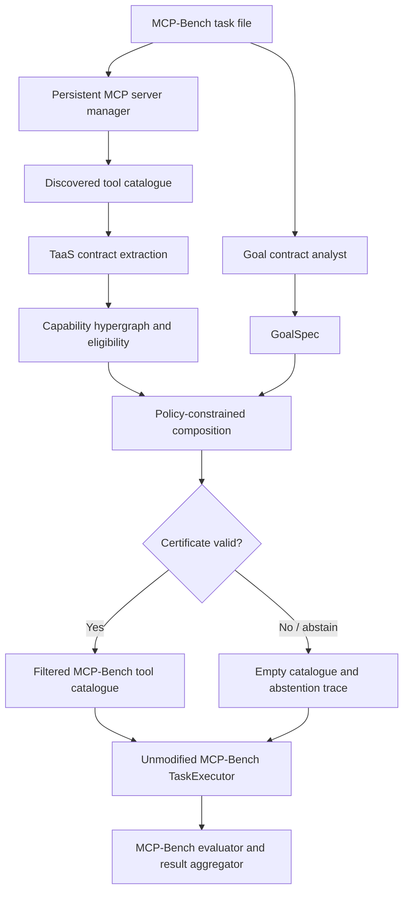

# TaaS integration with MCP-Bench

## Scope

TaaS is the system under evaluation. Accenture's MCP-Bench supplies the task-execution
and evaluation protocol. We do not replace its task files, agent executor, server
manager, judge, result aggregator, or reporting format.

The integration inserts TaaS after MCP-Bench connects to configured servers and
discovers tools, but before the task is passed to its agent executor.



## Reference pin

- Repository: https://github.com/Accenture/mcp-bench
- Inspected reference commit: 7a8eaeae83a842a2949080acc5473f65e1569daf
- Adapter: src/taas/mcpbench.py

Pin the MCP-Bench checkout to that commit for reproducible runs. Do not silently track
its moving main branch.

## Execution protocol

Keep MCP-Bench's own settings and task semantics unchanged:

- use its single-server, two-server and three-server task files;
- preserve fuzzy task descriptions and concrete-description evaluation reference;
- preserve configured server selection and distraction behaviour;
- preserve multi-round execution, round limits, retries and timeout;
- preserve the same LLM provider/model settings;
- preserve its evaluator dimensions, judge-stability setting and result aggregation;
- preserve cache policy and report cache state explicitly;
- retain execution traces, token/timing/tool-call/schema-compliance and judge outputs.

TaaS changes only the tool catalogue visible to the agent. The baseline uses the complete
MCP-Bench-discovered catalogue. The TaaS run uses the selected subset. All other
MCP-Bench task and execution settings must be identical. Record the TaaS analyst call
separately and include its overhead in total system cost and latency.

## GoalSpec analyst

MCP-Bench tasks are natural-language requests; TaaS discovery requires the structured
GoalSpec defined by the paper. The adapter therefore accepts an injected
goal_spec_factory(task) -> dict. It must use the configured experiment model/provider
and a frozen prompt/schema. It must not read gold tool labels, task dependency
annotations, or evaluator-only concrete descriptions.

Persist the exact GoalSpec, prompt hash, model identifier, generation settings, token
usage, and raw response for every task. The analyst may describe required outputs,
inputs, dependencies, classes and effects, but must not choose tool IDs or inspect gold
mappings.

## Adapter usage

```python
from taas.mcpbench import TaaSMCPBenchAdapter
from taas.mcpbench_analyst import MCPBenchGoalAnalyst
from taas.model_profile import ModelProfile
from taas.policy import Policy

adapter = TaaSMCPBenchAdapter(
    profile=ModelProfile.load("data/processed/profile_sonnet.json"),
    goal_spec_factory=MCPBenchGoalAnalyst(mcpbench_llm_provider),
    policy=Policy.make("benchmark-default"),
)
selection = adapter.select(task_description, server_manager.all_tools)
agent_tools = selection.tools
taas_trace = selection.trace
```

Pass agent_tools to the same MCP-Bench TaskExecutor path used by the baseline.
Persist taas_trace next to the native per-task result. The adapter does not execute
tools and does not replace MCP-Bench's evaluator.

### Runner hook (pinned MCP-Bench revision)

At the pinned revision, `TaskExecutor.__init__` snapshots
`server_manager.all_tools` into `self.all_tools`. The correct integration point
is immediately before constructing the executor, not only around
`executor.execute()`. The manager's live catalogue must be restored before actual
tool calls: `PersistentMultiServerManager.call_tool()` validates names against
`server_manager.all_tools`.

Use the following narrow hook in `BenchmarkRunner.execute_single_task_with_model`
after `ConnectionManager` has connected servers and before native executor creation:

```python
from taas.mcpbench import selected_task_executor_scope

selection = taas_adapter.select(task_description, conn_mgr.all_tools)
taas_trace = selection.trace

with selected_task_executor_scope(conn_mgr.server_manager, selection.tools):
    executor = TaskExecutor(
        llm_provider,
        conn_mgr.server_manager,
        self.concurrent_summarization,
    )

# The executor retained the filtered snapshot. The persistent server manager
# has the complete catalogue again so its call_tool() can dispatch selected calls.
result = await asyncio.wait_for(
    executor.execute(task_description),
    timeout=timeout_seconds,
)
result["available_tools"] = conn_mgr.all_tools  # full catalogue for evaluator parity
result["taas"] = taas_trace
```

The scope rejects unknown tool keys, derives selected metadata from the live
catalogue, restores the manager in `finally`, and preserves the executor's selected
snapshot. This hook does not alter MCP-Bench task files, execution loop, evaluator,
judge or aggregation. A zero-tool selection must be explicitly marked as TaaS
abstention by the runner; do not pass an empty catalogue into an executor that may
still synthesize an answer and have it counted as ordinary success. The live runner
patch and a real MCP smoke test remain separate validation steps.

## Paired-run controls

1. Same task IDs and task-file SHA-256.
2. Same MCP server definitions, versions, credential scope and discovered tool snapshot.
3. Same agent model/deployment, temperature, token limits and system prompts.
4. Same timeout, maximum rounds, retries, concurrency, cache and summarization settings.
5. Same judge model, rubric, judge repetitions and aggregation code.
6. Randomized/interleaved baseline and TaaS run order; preserve raw per-run records.
7. Report failed server starts and missing tools; do not silently drop tasks.
8. Report analyst overhead separately and include it in total cost/latency.
9. Do not use evaluator-only dependency analysis, concrete descriptions or gold mappings
   in goal construction or discovery.
10. A valid static certificate is not proof that a remote implementation obeyed its
    declared effects. Record actual execution traces separately.

## Result compatibility

Keep MCP-Bench's native result JSON unchanged. Add a sibling taas object or sidecar
record keyed by task_id, containing the adapter trace, selected tool keys, certificate,
abstention and discovery overhead. This avoids breaking its aggregator and preserves
baseline-compatible result files.

## Implementation boundary

The adapter converts discovered MCP metadata to TaaS contracts, runs the existing
discovery engine, and returns the selected tool map and trace. It is not yet wired into
a pinned MCP-Bench checkout, and live end-to-end runs have not been performed. The next
step is a thin runner hook and a smoke test against one safe MCP server.
