# Results

All numbers below are generated by `experiments/report.py` from `results/*.json` (produced by `experiments/run_all.py`). Mean ± 95% CI (normal approximation) where seeds or tasks vary. All figures, with generated captions, are indexed in [FIGURES.md](FIGURES.md).

## E0 — Registry characterisation (Table 1, §2.2)

| Registry | Servers | Tools | Annotated | Paper |
|---|---|---|---|---|
| LiveMCPTool | 69 | 525 | 44 | 69 / 525 / 44 |
| MCPToolBench++ | 10 | 87 | 0 | 10 / 87 / 0 |
| merged | 76 | 569 | 44 | 76 / 569 / 44 |

* Annotated tools all claim `readOnlyHint=true`: **True**; annotated but not read-only (silver labels): **1** (`opgg-mcp::lol-summoner-renewal`; paper: 1).
* Tools that modify state: silver **131 (23.0%)**, lexical labeller **183 (32.2%)**; paper 158 (27.8%). Lexical vs silver: precision 0.601, recall 0.840.
* Requiring declared read-only hints keeps **7.7%** of the registry (paper 7.7%); the closed-world annotation filter removes **0** tools.
* MCPToolBench++ public release: 1509 requests (1470 unique queries) vs 1,429 in Table 1.

## Measured ρ_LLM profiles (Definition 6)

Accuracy per class and input size n (4 items per cell, answered by reading only).

| Model | Class | n=10 | n=40 | n=160 | n=640 |
|---|---|---|---|---|---|
| haiku | extract | 1.00 | 1.00 | 1.00 | 1.00 |
| haiku | aggregate_sum | 1.00 | 1.00 | 0.25 | 0.00 |
| haiku | classify | 1.00 | 1.00 | 1.00 | 1.00 |
| haiku | count | 0.75 | 1.00 | 0.75 | 0.00 |
| sonnet | extract | 1.00 | 1.00 | 1.00 | 1.00 |
| sonnet | aggregate_sum | 1.00 | 1.00 | 1.00 | 1.00 |
| sonnet | classify | 1.00 | 1.00 | 1.00 | 1.00 |
| sonnet | count | 1.00 | 1.00 | 1.00 | 1.00 |

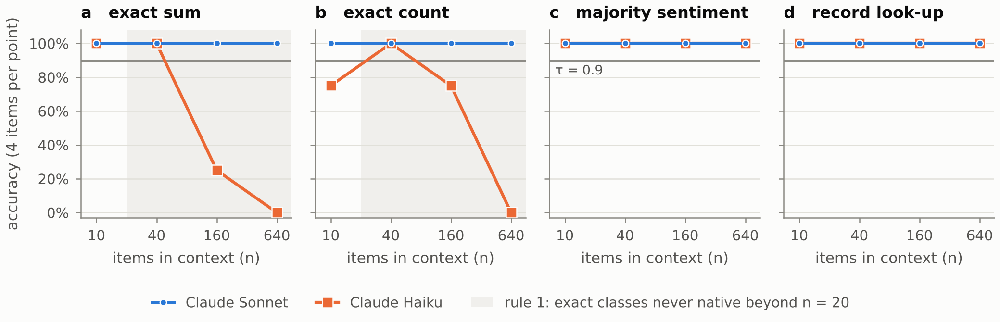

## E2 — H2: provenance-sound eligibility under forged and missing metadata

Exposure = share of truly unsafe tools admitted by a read-only policy (5 seeds). Metadata-only encodings (ann/lex) are evaluated on what an MCP client holds; obs/att on a registry with sandbox evidence (verifier FAR) and attestations for 30% of tools.

| α forged | FAR | ann+ | ann-cw | lex+ | lex-cw | obs+ | att+ |
|---|---|---|---|---|---|---|---|
| 0.0 | 0.0 | 0.008 | 0.855 | 0.160 | 0.160 | 0.000 | 0.000 |
| 0.0 | 0.05 | 0.008 | 0.855 | 0.160 | 0.160 | 0.058 | 0.017 |
| 0.0 | 0.2 | 0.008 | 0.855 | 0.160 | 0.160 | 0.220 | 0.063 |
| 0.25 | 0.0 | 0.293 | 0.861 | 0.397 | 0.174 | 0.000 | 0.000 |
| 0.25 | 0.05 | 0.293 | 0.861 | 0.397 | 0.174 | 0.058 | 0.017 |
| 0.25 | 0.2 | 0.293 | 0.861 | 0.397 | 0.174 | 0.220 | 0.063 |
| 0.5 | 0.0 | 0.519 | 0.869 | 0.594 | 0.183 | 0.000 | 0.000 |
| 0.5 | 0.05 | 0.519 | 0.869 | 0.594 | 0.183 | 0.058 | 0.017 |
| 0.5 | 0.2 | 0.519 | 0.869 | 0.594 | 0.183 | 0.220 | 0.063 |

At α = 0.25, FAR = 0.05 — safe retention: ann+ 0.35, ann-cw 1.00, lex+ 0.87, lex-cw 0.84, obs+ 1.00, att+ 0.31.

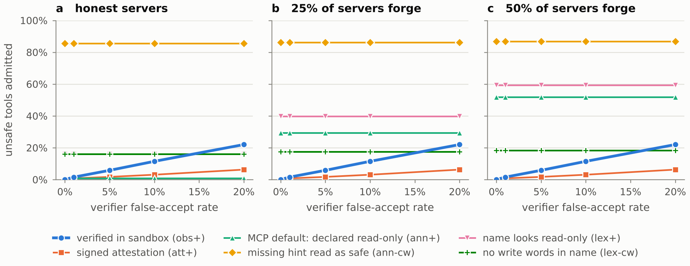

## E3 — H3: gap analysis shrinks toolkits

Dev-split tuning (MCPToolBench++ sample, 60 queries) selected **K=5|rel=10.0**. Pure Eq. 6 (w_rel = 0) loses recall as K grows:

| K | w_rel=0.0 | w_rel=1.0 | w_rel=3.0 | w_rel=10.0 |
|---|---|---|---|---|
| 3 | 0.317 | 0.317 | 0.283 | 0.350 |
| 5 | 0.200 | 0.233 | 0.233 | 0.383 |
| 10 | 0.100 | 0.233 | 0.233 | 0.350 |

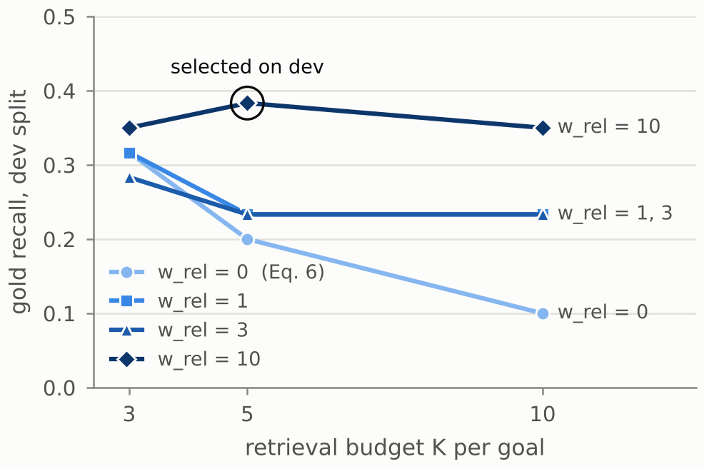

**LiveMCPBench** (test split, 95 tasks; analyst: recorded Claude Sonnet)

| System | |K| | tokens | gold recall | boundary recall | precision | abstain | certified |
|---|---|---|---|---|---|---|---|
| ours | 1.42 | 126 | 0.186 ± 0.054 | 0.211 | 0.318 | 0.06 | 0.94 |
| ours-nogap | 1.96 | 165 | 0.175 ± 0.054 | 0.199 | 0.200 | 0.12 | 0.88 |
| ours-strict | 1.92 | 162 | 0.182 ± 0.056 | 0.212 | 0.213 | 0.07 | 0.93 |
| per-subtask | 2.57 | 343 | 0.249 ± 0.066 | 0.253 | 0.246 | 0.00 | 0.00 |
| per-subtask-gap | 1.72 | 219 | 0.202 ± 0.061 | 0.220 | 0.288 | 0.00 | 0.00 |
| rag-top3 | 3.00 | 745 | 0.240 ± 0.065 | 0.248 | 0.186 | 0.00 | 0.00 |
| rag-top5 | 5.00 | 1252 | 0.293 ± 0.073 | 0.308 | 0.135 | 0.00 | 0.00 |
| mcp-zero | 2.59 | 386 | 0.213 ± 0.061 | 0.208 | 0.215 | 0.00 | 0.00 |
| all-tools | 569.00 | 96420 | 1.000 ± 0.000 | 1.000 | 0.005 | 0.00 | 0.00 |

**MCPToolBench++** (dev split, 60 queries; analyst: recorded Claude Sonnet)

| System | |K| | tokens | gold recall | boundary recall | precision | abstain | certified |
|---|---|---|---|---|---|---|---|
| ours | 1.00 | 88 | 0.383 ± 0.124 | 0.373 | 0.377 | 0.05 | 0.95 |
| ours-nogap | 0.90 | 84 | 0.367 ± 0.123 | 0.356 | 0.433 | 0.22 | 0.78 |
| ours-strict | 1.05 | 94 | 0.367 ± 0.123 | 0.356 | 0.360 | 0.05 | 0.95 |
| per-subtask | 1.32 | 252 | 0.433 ± 0.126 | 0.441 | 0.392 | 0.00 | 0.00 |
| per-subtask-gap | 1.05 | 236 | 0.417 ± 0.126 | 0.424 | 0.408 | 0.00 | 0.00 |
| rag-top3 | 3.00 | 617 | 0.467 ± 0.127 | 0.475 | 0.156 | 0.00 | 0.00 |
| rag-top5 | 5.00 | 1089 | 0.550 ± 0.127 | 0.559 | 0.110 | 0.00 | 0.00 |
| mcp-zero | 1.28 | 220 | 0.317 ± 0.119 | 0.322 | 0.300 | 0.00 | 0.00 |
| all-tools | 569.00 | 96420 | 1.000 ± 0.000 | 1.000 | 0.002 | 0.00 | 0.00 |

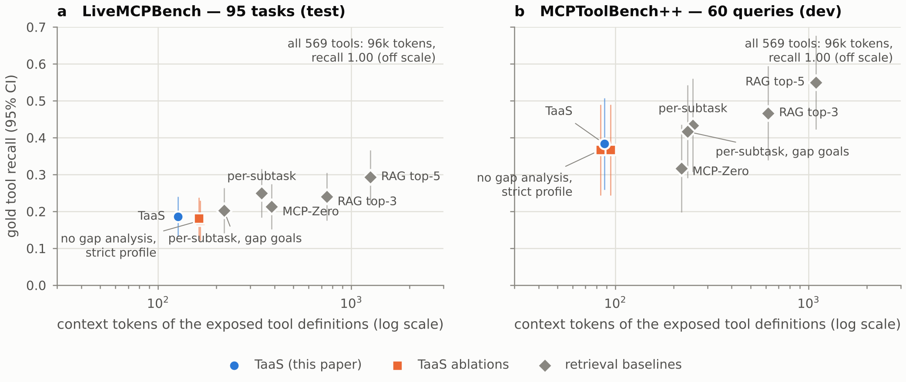

## E4 — H4: injected actions and Property 1

Worst-case success of injected actions whose effect class the task does not need (least-privilege policy per task, evidence ≥ ℓobs).

| System | ASR worst (out of scope) | ASR stochastic | gold recall | |K| |
|---|---|---|---|---|
| certified(cons,FAR=0.0) | 0.000 | 0.000 | 0.188 | 1.2 |
| certified(deriv,FAR=0.0) | 0.000 | 0.000 | 0.243 | 1.3 |
| certified(cons,FAR=0.05) | 0.000 | 0.000 | 0.189 | 1.2 |
| certified(deriv,FAR=0.05) | 0.000 | 0.000 | 0.244 | 1.3 |
| per-subtask | 0.032 | 0.011 | 0.321 | 2.1 |
| rag-top5 | 0.081 | 0.015 | 0.393 | 5.0 |
| mcp-zero | 0.035 | 0.010 | 0.253 | 2.1 |
| all-tools | 1.000 | 0.035 | 1.000 | 569.0 |

Property 1 — random call sequences over certified toolkits, true effects:

| Certification | effect-bound violations | flow violations | sequences |
|---|---|---|---|
| certified(cons,FAR=0.0) | 0 | 0 | 20400 |
| certified(cons,FAR=0.05) | 0 | 0 | 20350 |
| certified(deriv,FAR=0.0) | 0 | 3559 | 21450 |
| certified(deriv,FAR=0.05) | 0 | 3599 | 21400 |

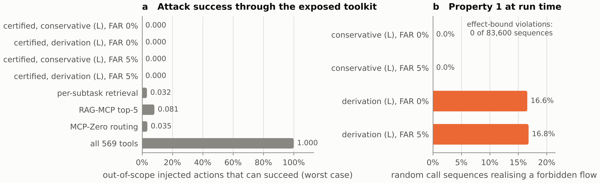

## E5 — Composition on synthetic typed registries (RQ3)

Independent checker; optimum by brute force; 48 tasks (L ∈ {2,3,4} × distractors ∈ {3,5} × 8 seeds).

| System | valid | optimal | cost / optimum | |K| | abstain | time (ms) |
|---|---|---|---|---|---|---|
| ours-exact | 1.000 | 1.000 | 1.000 | 3.00 | 0.00 | 12.1 |
| ours-greedy | 1.000 | 1.000 | 1.000 | 3.00 | 0.00 | 11.5 |
| ours-no-closure | 0.062 | 0.062 | 1.000 | 0.15 | 0.94 | 5.2 |
| per-subtask | 0.667 | 0.667 | 1.000 | 2.67 | 0.00 | 0.0 |

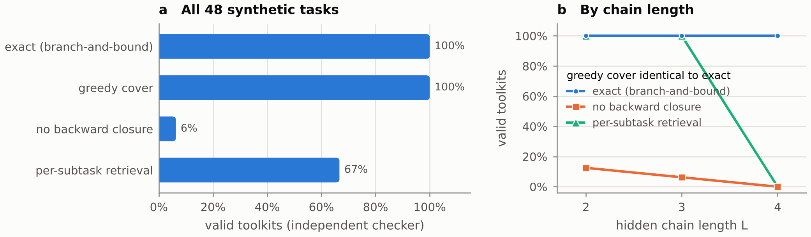

## E6 — Ablations

**Retrieval components** on all 1,509 MCPToolBench++ requests (raw queries):

| Retriever | R@1 | R@3 | R@5 |
|---|---|---|---|
| lex | 0.423 | 0.556 | 0.613 |
| den | 0.366 | 0.498 | 0.543 |
| rrf(lex+den) | 0.399 | 0.544 | 0.588 |

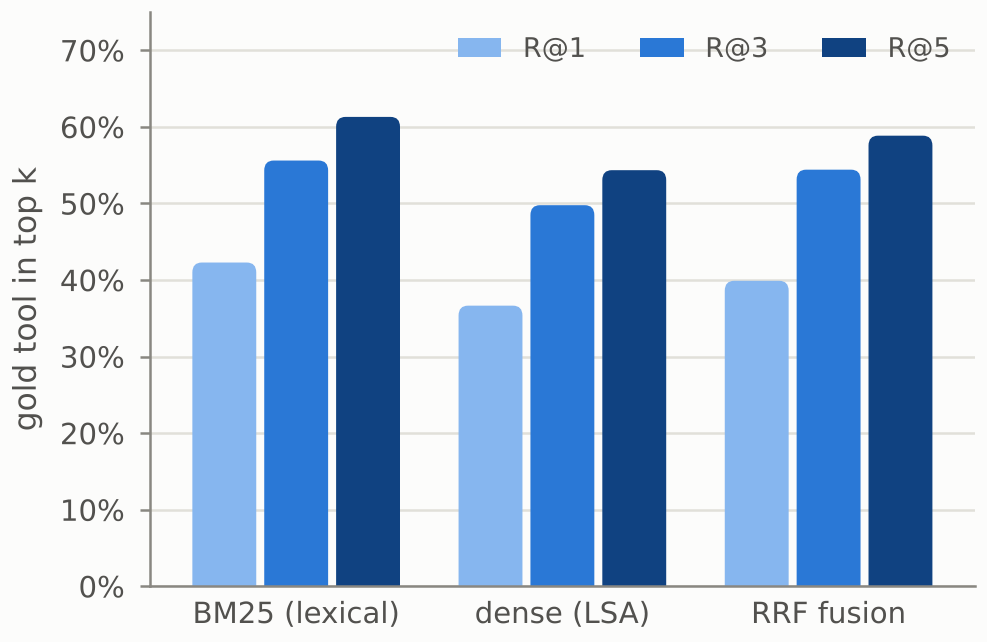

**Request path** on the LiveMCPBench test split:

| Variant | gold recall | |K| | abstain | certified |
|---|---|---|---|---|
| full (dev-tuned) | 0.186 | 1.42 | 0.06 | 0.94 |
| pure Eq.6 (w_rel=0) | 0.082 | 1.37 | 0.06 | 0.94 |
| no structural score | 0.173 | 1.39 | 0.07 | 0.93 |
| Alg.1 literal ctx | 0.175 | 1.93 | 0.09 | 0.91 |
| rule 1 off (exact_n_max=1e9) | 0.193 | 1.45 | 0.05 | 0.95 |
| strict profile (rule 2) | 0.182 | 1.92 | 0.07 | 0.93 |
| Haiku profile | 0.186 | 1.42 | 0.06 | 0.94 |
| Haiku analyst | 0.176 | 1.60 | 0.04 | 0.96 |
| no refinement | 0.182 | 1.39 | 0.08 | 0.92 |
| derivation-mode flow | 0.186 | 1.42 | 0.06 | 0.94 |
| closure depth 0 | 0.182 | 1.37 | 0.07 | 0.93 |

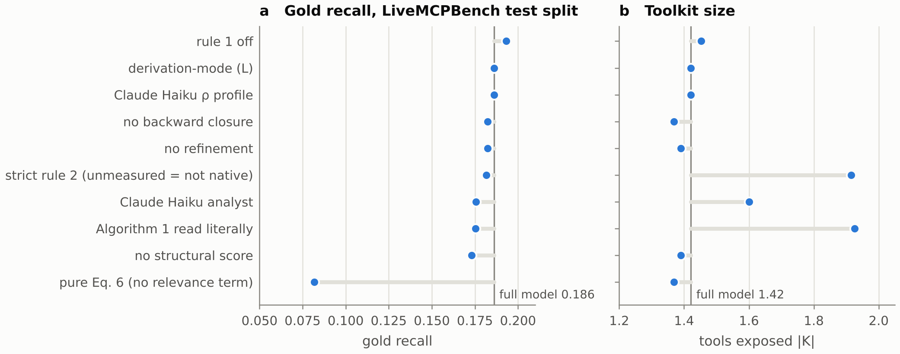

**Manifest sanitisation**: poisoned descriptions reaching the model — raw tool list 60/60, sanitised manifest 0/60; tokens per tool 169 → 96.

## E7 — Evolution and cost (RQ4)

| Tools | bitmap eligibility (µs) | naive scan (µs) | speed-up |
|---|---|---|---|
| 1,000 | 1.9 | 1517 | ×815 |
| 10,000 | 2.4 | 18967 | ×7784 |
| 100,000 | 5.4 | 174805 | ×32527 |

* Prop. 3: changed & invalidated 3615, changed & kept 0, unchanged & invalidated 0, unchanged & kept 5985; stale answers 0.
* Lemma 1: 0/300 violations.
* Maintenance: incremental `list_changed` 29.9 ms vs full rebuild 3.64 s. Rug pull on `filesystem::write_file`: evidence strength 0.73 → 0.25 (lex); after reverting to the verified definition: obs.

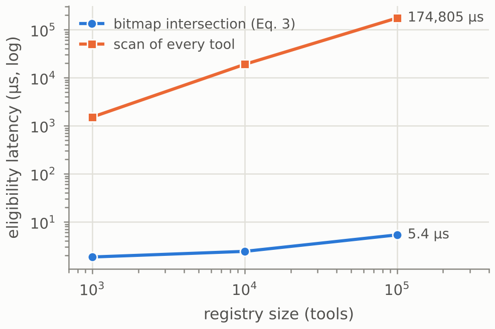

## E8 — MCP-Bench integration path, offline (TaaSMCPBenchAdapter.select)

525-tool LiveMCPTool catalogue in MCP-Bench's tool-map shape, 95 LiveMCPBench tasks, recorded analyst runs (Claude Sonnet). *Abstain* follows the runner patch: an engine abstention or an empty selection skips the agent. Recall counts an abstained task as 0. RO = the 57 tasks whose gold tools are all read-only (silver labels).

| Code | Analyst | Contract typing | Policy | abstain | gold recall | recall when run | |K| when run | RO abstain | RO recall |
|---|---|---|---|---|---|---|---|---|---|
| codex | guide | lexical | default | 0.99 | 0.000 | 0.000 | 1.00 | 0.98 | 0.000 |
| codex | guide | lexical | open | 0.98 | 0.000 | 0.000 | 1.00 | 0.96 | 0.000 |
| codex | prompt-1.0 | lexical | default | 0.99 | 0.000 | 0.000 | 1.00 | 0.98 | 0.000 |
| codex | prompt-1.0 | lexical | open | 0.95 | 0.000 | 0.000 | 1.00 | 0.98 | 0.000 |
| codex | prompt-1.1 | lexical | default | 0.95 | 0.006 | 0.117 | 1.00 | 0.91 | 0.010 |
| codex | prompt-1.1 | lexical | open | 0.95 | 0.006 | 0.117 | 1.00 | 0.91 | 0.010 |
| fixed | guide | lexical | default | 0.92 | 0.004 | 0.042 | 1.12 | 0.86 | 0.006 |
| fixed | guide | lexical | open | 0.85 | 0.007 | 0.050 | 1.14 | 0.82 | 0.006 |
| fixed | guide | llm | default | 0.52 | 0.083 | 0.171 | 1.30 | 0.35 | 0.124 |
| fixed | guide | llm | open | 0.09 | 0.181 | 0.198 | 1.55 | 0.11 | 0.195 |
| fixed | prompt-1.0 | lexical | default | 0.99 | 0.000 | 0.000 | 1.00 | 0.98 | 0.000 |
| fixed | prompt-1.0 | lexical | open | 0.95 | 0.000 | 0.000 | 1.00 | 0.98 | 0.000 |
| fixed | prompt-1.0 | llm | default | 0.94 | 0.000 | 0.000 | 1.00 | 0.89 | 0.000 |
| fixed | prompt-1.0 | llm | open | 0.86 | 0.004 | 0.026 | 1.31 | 0.89 | 0.000 |
| fixed | prompt-1.1 | lexical | default | 0.93 | 0.006 | 0.083 | 1.00 | 0.88 | 0.010 |
| fixed | prompt-1.1 | lexical | open | 0.93 | 0.006 | 0.083 | 1.00 | 0.88 | 0.010 |
| fixed | prompt-1.1 | llm | default | 0.69 | 0.036 | 0.117 | 1.14 | 0.58 | 0.051 |
| fixed | prompt-1.1 | llm | open | 0.51 | 0.064 | 0.129 | 1.40 | 0.49 | 0.074 |
| fixed | prompt-1.1+theta | lexical | default | 0.95 | 0.000 | 0.000 | 1.00 | 0.91 | 0.000 |
| fixed | prompt-1.1+theta | lexical | open | 0.94 | 0.000 | 0.000 | 1.33 | 0.91 | 0.000 |
| fixed | prompt-1.1+theta | llm | default | 0.62 | 0.044 | 0.114 | 1.28 | 0.46 | 0.072 |
| fixed | prompt-1.1+theta | llm | open | 0.36 | 0.098 | 0.151 | 1.59 | 0.28 | 0.135 |

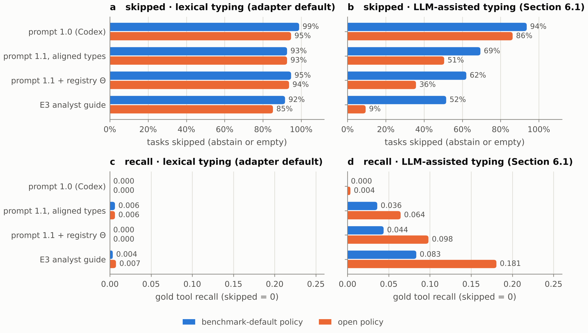

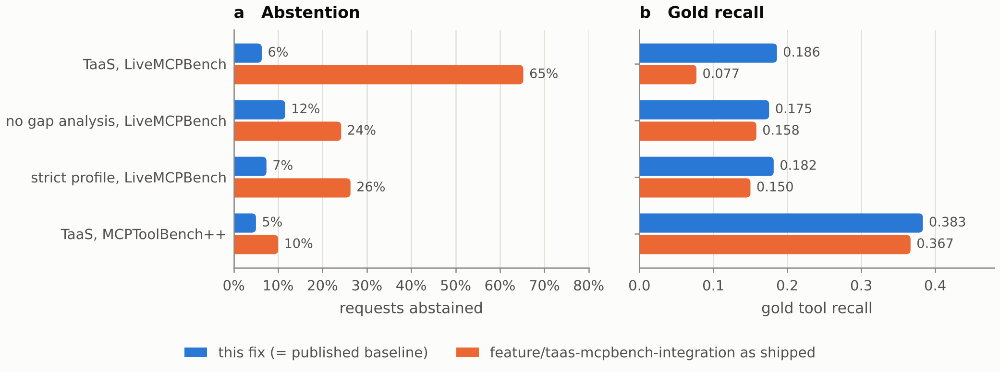

