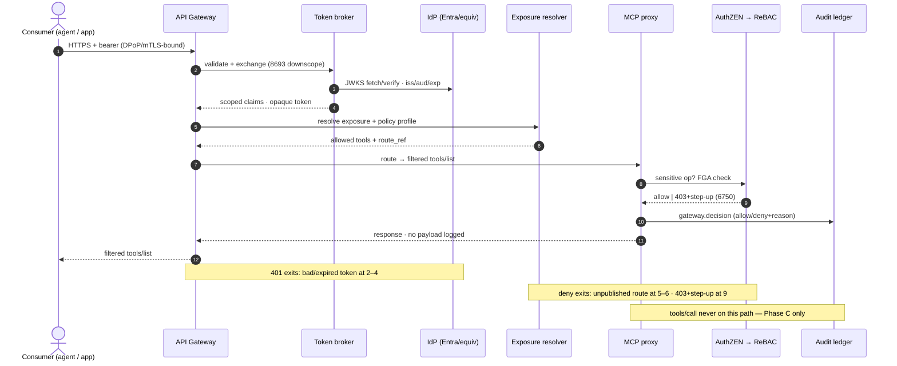
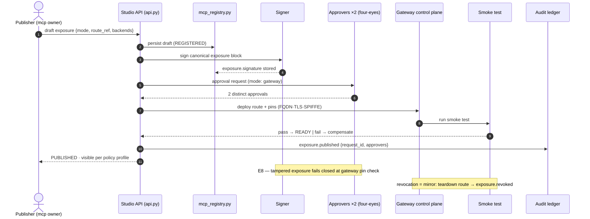
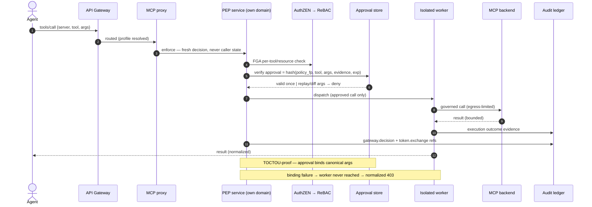
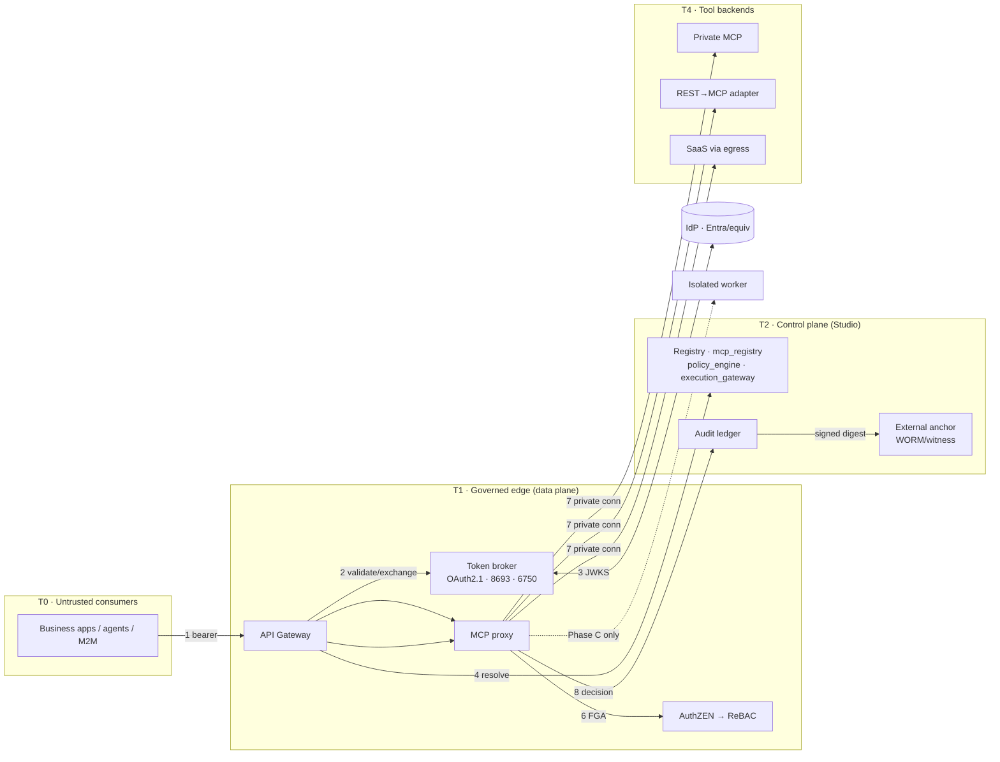

# Architecture Review — Principal Review Board Record
## TaaS Studio / MCP Gateway Extension

| Document control | Value |
|---|---|
| Document ID | TAAS-ARB-001 |
| Status | **Decisions recorded** — all outcomes folded into `TAAS_PLATFORM_MEGAPLAN.md`, `LAD.md`, `PAD.md`, `docs/studio/MCP_GATEWAY_EXTENSION.md` |
| Scope | Threat/assurance review of the Studio architecture extended with the MCP gateway requirements |
| Method | Every finding debated against alternatives; each decision carries a requirement ID so nothing is an opinion without an artifact |

## 1. Findings register

| # | Finding | Severity | Decision / requirement | Phase |
|---|---|---|---|---|
| F1 | Audit ledger is self-attested (producer = sole anchor) | **Critical** | LAD **D12**, FR-OBS-6, NFR-AUD-3, OD-3 | B |
| F2 | PEP shares the control plane's identity/admin/failure domain | **Critical** | LAD **D14**, NFR-SEC-5 | B/C |
| F3 | Bearer tokens replayable on the highest-value path | **High** | LAD **D13**, FR-GOV-3c, OD-2 | B |
| F4 | Registry `exposure` block unsigned — config-plane confused deputy | **Critical** | Extension **E8**, FR-SEC-6 | B |
| F5 | MCP session semantics undesigned (notifications = covert channel) | **High** | LAD **D11**, FR-INT-9, OD-5 | B |
| F6 | Approval not bound to call arguments (TOCTOU) | **High** | FR-EXEC-2 (already binds args — reaffirmed) + §4.4 | C |
| F7 | Tool descriptions propagate unsanitized (injection channel) | **Medium** | FR-SEC-7 | B |
| F8 | Inspection snapshots attest observation, not artifact origin | **Medium** | Extension **E9**, FR-SEC-8 | C/D |
| F9 | `route_ref` schema-identical but enforcement divergent | **Medium** | PAD §7.6 capability matrix, FR-DEP-5e | B |
| F10 | Token broker = new data-path SPOF | **Medium** | PAD §7.7, FR-DR-4, NFR-AVL-1 | B |
| F11 | Token broker framed as "evolution" of `ak_*` keys | **Low** (model risk) | E6 rewritten — edge **replacement** for data path | B |
| F12 | File/JSON stores: locking, ACID, migrations undesigned | **Medium** | OD-1 recorded (store decision) | B |

## 2. Debated options and resolutions

### F1 — Audit anchoring
- **Option A:** keep self-anchored chain, add operator attestation runbook. Rejected — does not survive a hostile or negligent operator; auditors must distinguish intact history from rewritten history without trusting the producer.
- **Option B:** WORM object-lock store for periodic signed digests. Simple, provider-native, but digest anchoring only (granular events still local).
- **Option C:** transparency-log-style witnessed append log. Strongest guarantees; heavier integration.
- **Decision (D12):** Option B minimum viable + streaming export to SIEM in real time; Option C kept open via OD-3. Anchor cadence = `TBD` (≤ hourly for governed environments).

### F2 — Enforcement-domain separation
- **Option A:** PEP in-process (current code shape). Rejected for any gating phase — the gate could be disabled by the thing it gates; valid only as inspection aid.
- **Option B:** PEP as separate service in separate namespace/identity, control plane has no credentials to alter it.
- **Decision (D14, NFR-SEC-5):** Option B mandatory wherever real traffic is gated. In-process `execution_gateway.py` remains the policy-evaluation library, deployed behind the PEP boundary — code is reused, domain is not.

### F3 — Sender-constrained tokens
- **Option A:** short-TTL bearer only. Rejected — TTL shrinks the replay window, does not eliminate it.
- **Option B:** DPoP. Works over TLS without PKI infra; per-request proof.
- **Option C:** mTLS binding. Stronger where service mesh exists; unavailable on some provider gateways.
- **Decision (D13, OD-2):** require sender-constraint on the MCP data path; mechanism per environment (DPoP floor, mTLS where mesh available) — recorded in PAD §7.6 matrix.

### F4 — Signed exposure records
- **Option A:** TLS + RBAC on the registry only. Rejected — protects transport, not content; a bad write is still faithfully served.
- **Option B:** sign the exposure block + four-eyes publication for `mode: gateway`.
- **Decision (E8, FR-SEC-6):** Option B + backend identity pinning (FQDN + TLS chain/SPIFFE). Gateway validates signature and pins before honoring a route; a corrupted registry fails closed, not open.

### F5 — MCP session semantics
- **Option A:** treat MCP as request/response (current implicit model). Rejected — ignores `notifications/*` (covert/exfil channel), elicitation, sampling, streaming, cancellation.
- **Decision (D11, FR-INT-9, OD-5):** the proxy binds sessions to identity, allow-lists server→client notification kinds, intercepts elicitation/sampling requests, caps streams/cancellation storms. Session model remains OD-5 (per-connection identity vs per-message claims).

### F6 — Approval TOCTOU
- FR-EXEC-2 already binds approvals to actor, server, tool, exact args, GoalSpec, policy fingerprint, tool-def hash, evidence hash — **reaffirmed**: any approval token reuse with different canonical args fails closed. No new requirement; binding is part of the Phase C contract, not optional hardening.

### F7 — Tool metadata sanitization
- **Decision (FR-SEC-7):** registry lints tool descriptions/schemas at inspection; instruction-like patterns flagged; only schema-required fields propagate to consumers. Tool descriptions are untrusted input regardless of channel trust.

### F8 — Artifact provenance
- **Decision (E9, FR-SEC-8):** server records gain `artifact.image_digest`, `sbom_ref`, `attestation_ref`; policy profiles may require digest equality between inspections — a swapped backend yields a detectably different snapshot, not a valid one.

### F9 — Divergent enforcement
- **Decision (PAD §7.6, FR-DEP-5e):** capability matrix is part of the contract; absent capabilities degrade to *documented* compensating controls (e.g., external WAF for K8s Gateway API); conformance proven by PT tests per environment.

### F10 — Broker SPOF
- **Decision (PAD §7.7, FR-DR-4, NFR-AVL-1):** ≥2 replicas, stateless validation, JWKS cache TTL + rotation overlap; IdP outage → new issuance fails closed, validation continues while cached material valid, then 401 — never fail-open.

### F11 — E6 framing
- **Decision:** broker is a data-path **replacement** at the edge; `ak_*` keys remain for control-plane/admin/dev only. Prevents bolting asymmetric trust onto a symmetric store.

### F12 — Store decision
- **Decision (OD-1):** ADR drafted at `docs/adr/ADR-001-persistence.md` — proposed Postgres primary + sqlite embedded profile, object store retained for anchors/evidence blobs; NFR-SCL-3 keeps the swap contract-safe. Awaiting owner sign-off.

## 3. What was deliberately NOT changed

- The delivered Studio surface — every finding resolves to a Phase B/C seam, not new code claimed today.
- The boundary invariant — nothing here authorizes or executes; sequences in the diagrams show inspection flows as solid and governed execution as dashed design.
- Extension-not-invention discipline — every fix lands on an existing entity (registry record, manifest, policy profile, lifecycle, audit kinds) or a named decision/requirement.

## 4. Detailed design notes

### 4.1 MCP session & notification policy (D11, FR-INT-9)

Proxy must maintain per-session state:
`session_id → {consumer_principal, token_binding, negotiated_caps, open_streams}`.
Rules: server→client `notifications/message` allowed only for methods on the
session allow-list; `elicitation/create` and `sampling/createMessage` are
**interposed** — surfaced to policy, not passed through; stream count,
message rate and cancellation rate capped per session. Session teardown on
token expiry or principal change.

### 4.2 Audit anchoring flow (D12, FR-OBS-6)

`audit_ledger.py` unchanged internally. New anchoring worker (design):
every `anchor_interval` → compute `digest = H(chain_head || seq)` → sign with
attestation key → write to WORM store → record `audit.anchor` event.
Verification (`/audit/verify`) compares local chain head against the last
anchored digest — external proof without trusting the producer.
Real-time path: events also stream to SIEM (FR-OBS-5) — two independent
records an attacker would have to rewrite consistently.

### 4.3 Sender-constrained tokens (D13, FR-GOV-3c)

Data-path tokens carry a confirmation claim (`cnf.jkt` for DPoP, `cnf.x5t#S256`
for mTLS). The proxy requires proof at each request; a captured token alone is
useless. `ak_*` keys never satisfy the data path — they authenticate
control-plane callers only.

### 4.4 Approval binding (FR-EXEC-2 reaffirmed)

`approval_token = sign(key, hash(actor, server_id, tool_name,
canonical_args_hash, goal_spec_hash, policy_fingerprint,
tool_definition_hash, evidence_hash, exp))`. PEP verifies every component at
call time; any drift → deny + `gateway.decision` audit event.

### 4.5 Signed exposure pipeline (E8, FR-SEC-6)

`exposure` publication: draft → sign (publisher key) → 2 distinct approvers →
`exposure.published` audit → route deploy → smoke test → READY.
Gateway honors a route only if signature verifies and backend connection
matches `backend_identity` pin (FQDN + TLS chain/SPIFFE). Revocation tears
down the route and writes `exposure.revoked`.

## 5. Sequence diagrams (Mermaid)

Same flows as `taas-studio-architecture.drawio` pages STU-08/09/10 — kept
here so they render in GitHub and stay diffable next to the decisions.

### 5.1 Governed request — every hop bound to request_id (Phase B)

### 5.2 Exposure publication — READY only after sign + four-eyes + smoke test

### 5.3 Phase C governed tools/call — design seam only (TOCTOU-proof)

### 5.4 Platform context — trust zones and data flow

Solid connections = delivered today; the Phase C worker edge is a design seam.

## 6. Traceability

| Artifact | Where the decisions live |
|---|---|
| Requirements | megaplan `FR-GOV-3b/3c`, `FR-INT-9`, `FR-DEP-5e`, `FR-OBS-6/7`, `FR-SEC-6/7/8`, `FR-DR-4`, `NFR-AUD-3`, `NFR-SEC-5`, `NFR-AVL-1`, OD-1..5 |
| Logical decisions | `LAD.md` D11–D14, threat-map rows §9.3 |
| Entity extensions | `MCP_GATEWAY_EXTENSION.md` E6 (rewritten), E8, E9 |
| Physical | `PAD.md` §7.6 capability matrix, §7.7 broker/IdP resilience |
| Diagrams | `taas-studio-architecture.drawio` STU-07 gap map; STU-08/09/10 sequence diagrams; `taas-enterprise-architecture.drawio` page 01 trust boundaries |
| Evidence audit | `REQUIREMENTS_GAP.md` — all rows marked `design seam`/`not implemented` |
