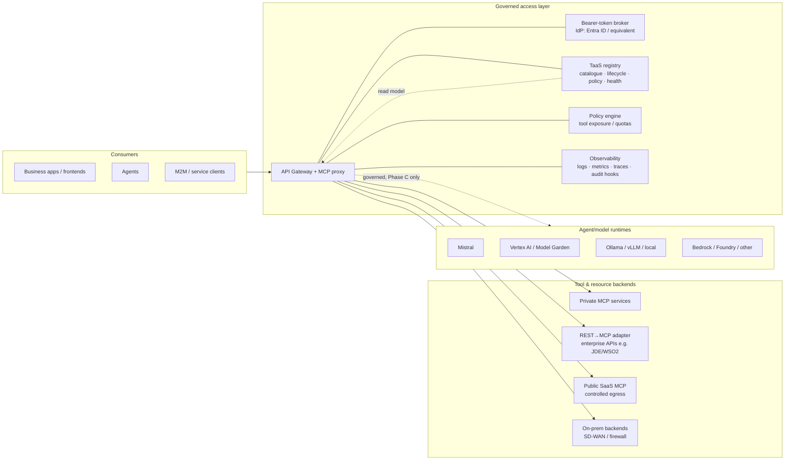
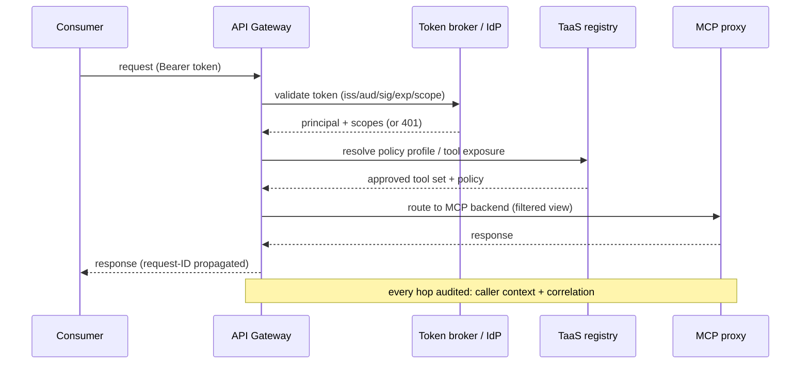
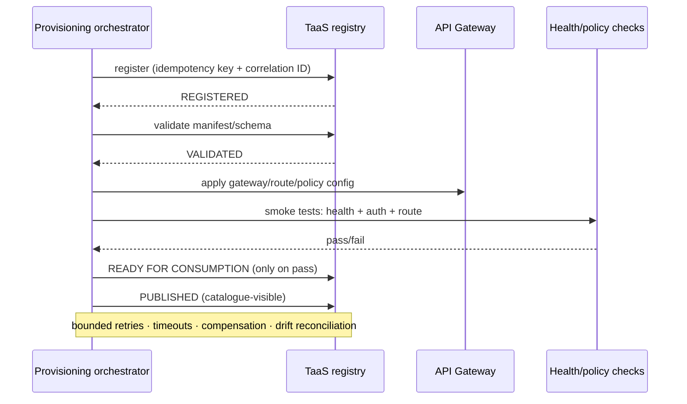

# Logical Architecture Document (LAD)
## TaaS Studio — Provenance-Aware Agent & Tool Governance Platform
## Centralized MCP Gateway, Bearer-Token Broker and Governed Tool Exposure

| Document control | Value |
|---|---|
| Document ID | TAAS-ENT-LAD-001 |
| Version | 0.2 — Restructured to professional template |
| Date | November 2025 |
| Status | Draft — logical design baseline; physical realization in `PAD.md` |
| Related documents | `SOW.md`, `PAD.md`, `SAW.md`, `TAAS_PLATFORM_MEGAPLAN.md`, `REQUIREMENTS_GAP.md` |
| Template baseline | `docs/examples/02-LAD-MCP-Agent-Gateway.md` |
| Implementation evidence | `src/taas/studio/`, `docs/studio/LIFECYCLE_API_MEGAPLAN.md`, `REQUIREMENTS_GAP.md` |

> **Reading note.** This document describes the *logical* architecture — responsibilities, contracts and decisions — independent of any single vendor or product. Where a logical element is not yet implemented, it is labelled a **design seam** or **not implemented**. Current delivered scope: single-operator inspection/assurance control plane (see `REQUIREMENTS_GAP.md`).

## 1. Purpose and scope

This LAD translates the SoW's target capability into a logical system design:

- the boundary between consumers, the governed access layer, runtimes and resources;
- the components inside the governed access layer and their contracts;
- the flows for consumer access, provisioning/registration, MCP inspection and (future) governed invocation;
- the identity and threat model — five identity domains kept strictly distinct;
- the logical non-functional requirements and the decision set that fixes the gateway strategy per environment.

Physical topology, connectivity matrices and per-cloud realization live in `PAD.md`. Product/API delivery scope lives in `docs/studio/LIFECYCLE_API_MEGAPLAN.md`.

## 2. Architecture drivers

| Driver | Consequence |
|---|---|
| Agents and tools must be governed, not merely reachable | Central registry + lifecycle states + policy profiles; gateway as the only ingress |
| `tools/list` must not imply `tools/call` | Inspection and execution are separate capabilities with separate gates |
| Consumer tokens are not backend tokens | Token broker performs validation + exchange/delegation; passthrough is forbidden |
| Deployments span private cloud, on-prem and public clouds | One logical gateway contract, provider-adapted realizations (D3) |
| Audit must survive scrutiny | Tamper-evident chain; caller context + correlation captured; no payload logging |
| Pioneering positioning | Boundaries are features: honest `UNAVAILABLE`, no fabricated liveness, no implicit authorization |

## 3. Design principles

1. **Single ingress** — all MCP/tool access passes the gateway/proxy; direct consumer→MCP is a defect.
2. **Identity separation** — consumer, end-user, gateway workload, agent runtime and backend identities are never conflated.
3. **Least exposure** — `tools/list` is filtered per consumer policy profile; only approved tools are visible, and (Phase C) callable.
4. **Fail closed** — absent/invalid token → deny; unvalidated → not READY; unavailable → `UNAVAILABLE`.
5. **Provenance everywhere** — every governed action records request-ID + caller context in audit metadata.
6. **Adapted, not identical** — provider-native realization behind one logical contract.
7. **Separation of planes** — control plane (registry/lifecycle) ≠ data plane (gateway/proxy) ≠ execution plane (future PEP).

## 4. Context and system boundary

**Boundary:** the governed access layer owns authentication, authorization, exposure filtering, routing, audit hooks and observability. Runtimes and resources are *behind* it — never directly reachable. The TaaS control plane today implements the **registry + inspection + assurance** subset of this layer; the gateway/proxy, token broker and execution plane are design components.

## 5. Logical components and responsibilities

| Component | Responsibility | Boundary notes | Status |
|---|---|---|---|
| API Gateway | Single ingress; TLS; OIDC/JWT validation; rate/quota; threat protection; request-size limits; routing; request-ID propagation | Enforces policy; does not own the catalogue or decide lifecycle | Design — not implemented |
| MCP proxy | MCP-aware mediation: filtered `tools/list`; gated `tools/call` (Phase C); REST→MCP adaptation; backend health | Sits behind the gateway; never client-exposed directly | Design — not implemented |
| Bearer-token broker | Token validation (iss/aud/sig/exp/scope); token exchange; workload-identity delegation; JWKS handling | Uses IdP (Entra ID / equivalent); never persists tokens; does **not** itself grant authorization | Design — not implemented |
| TaaS registry | Catalogue of agents/tools/MCP servers; lifecycle states; endpoint references; policy profiles; health status | Read model for gateway decisions; authoritative for lifecycle, not for runtime | Delivered (control-plane scope) |
| Policy engine | Exposure rules, quotas, approval requirements, environment constraints | Informs gateway; does not execute | Design seam |
| Audit / evidence | Tamper-evident event chain; signed evidence bundles; request-ID ↔ audit-seq correlation | Tamper evidence only — never proof of truth/authorization/execution | Delivered |
| Observability | Structured logs, metrics, traces, decision logs, SIEM export | No payload logging; no secrets | Partially delivered (request logs + correlation) |
| Provisioning orchestration | Automated registration→publication workflows; idempotency; compensation; drift reconciliation | Backstage/Camunda-style; design intent, not implemented | Design seam |
| Governed execution (PEP + workers) | Phase C only: isolated workers, fresh evidence checks, one-time approvals | Explicitly out of current scope | Not implemented |

## 6. Logical views

### 6.1 Consumer access flow

### 6.2 Provisioning / registration flow

An agent/tool **must not** reach `READY` on configuration alone — smoke tests gate the transition.

### 6.3 MCP inspection vs invocation

- **`tools/list` (inspection, delivered):** the control plane inspects registry snapshots and metadata; filtered per profile; never implies executability. Marked `inspection_only: true`, `tool_execution_performed: false`.
- **`tools/call` (invocation, Phase C — not implemented):** permitted only via the governed path — gateway → policy check → PEP → isolated worker → fresh evidence → one-time approval. The control-plane API exposes no `tools/call` route today.

### 6.4 LLM/model routing policy view

Model backends (Mistral, Vertex AI/Model Garden, Bedrock, Foundry, Ollama/vLLM) are reachable through the same governed layer where integration exists. Routing is policy-driven: provider selection, region/data-residency, fallback rules (never silent provider switches), and private connectivity where supported.

## 7. Protocol and interface contracts

| Interface | Contract | Notes |
|---|---|---|
| Consumer → Gateway | HTTPS, Bearer token; request-ID header propagated | TLS; 2 MiB body parity |
| Gateway → Token broker | OIDC/JWT validation; token exchange (e.g. RFC 8693-style) | Issuer/audience/scope verified |
| Gateway → Registry | Read model: endpoints, lifecycle, policy profiles, health | Registry authoritative for lifecycle only |
| Gateway/proxy → MCP | MCP JSON-RPC; `tools/list` filtered; `tools/call` gated | Phase C for call |
| Proxy → REST adapter | REST→MCP mapping for enterprise APIs | e.g. JDE/WSO2-style backends |
| All → Observability | Structured logs/metrics/traces; audit hooks | No payloads/secrets |

## 8. Registry data model

The registry is the authoritative catalogue. Logical entities map to the delivered manifest contract (`docs/studio/AGENT_MANIFEST_V1ALPHA1.md`):

- **Agent** — manifest (id, version, owner, skills/tools bindings, policy profile, lifecycle state, endpoints).
- **Tool/MCP server** — endpoint reference, policy profile, health status, inspection history, lifecycle state.
- **Policy profile** — exposure set, quotas, approval requirements, environment constraints.
- **Endpoint** — logical reference (private FQDN/service attachment); never a raw runtime claim.
- **Evidence/audit** — event chain + signed bundles.

Lifecycle states: `REGISTERED → VALIDATED → READY FOR CONSUMPTION → PUBLISHED → REVOKED/DECOMMISSIONED` — configuration states, never runtime states.

## 9. Security architecture

### 9.1 Identity domains (strictly separated)

| Domain | Principal | Used for |
|---|---|---|
| Consumer principal | App/frontend/agent caller | Ingress authentication + exposure decision |
| End-user principal | Human behind a consumer (where applicable) | Delegated context, on-behalf-of flows |
| Gateway workload identity | The gateway/proxy itself | Calling registry/backends; never impersonates consumer |
| Agent runtime identity | Agent/tool runtime service | Runtime-to-resource calls |
| Backend/MCP identity | MCP server/backend service | Accepting governed calls; its own authZ |

**Rule (D5):** the consumer Bearer token is *never* assumed valid downstream. Use token exchange (delegated) or a dedicated workload identity — the choice is explicit per backend, never implicit passthrough.

### 9.2 Control layers

Edge (TLS, WAF/threat, size limits) → Identity (token validation, exchange) → Policy (exposure, quota, approval) → Routing (allow-listed backends) → Audit (correlated records) → Observability (decision logs).

### 9.3 Threats and mitigations

| Threat | Mitigation |
|---|---|
| Confused deputy (token passthrough) | Mandatory exchange/delegation; per-backend identity rule |
| Token audience/scope misuse | iss/aud/sig/exp/scope validation at broker + gateway |
| Over-exposed tools | Filtered `tools/list`; least-privilege exposure per profile |
| SSRF / arbitrary targets | FQDN allow-lists, private endpoints, no raw-IP dialing, egress policy |
| Injection → unsafe tool call | `tools/call` gated by PEP (Phase C); control plane never calls |
| Secret leakage | No payload logging; secret stores; no secrets in audit/manifests |
| Replay / DoS | Rate limits, quotas, request-size caps, threat protection |
| Cross-tenant access | Tenant isolation + RBAC (Phase B) |

## 10. Logical non-functional requirements

| ID | NFR |
|---|---|
| NFR-01 | Portability: one logical contract, provider-adapted realizations |
| NFR-02 | Auditability: tamper-evident, correlated, no-fabrication |
| NFR-03 | Security: identity separation, least exposure, fail-closed |
| NFR-04 | Scalability: gateway data-plane scales independently of control plane |
| NFR-05 | Resilience: registry outage → published routes continue only with valid cached policy; new publications fail closed |
| NFR-06 | Observability: end-to-end correlation, decision logs, SIEM export |
| NFR-07 | Operability: config as code; overlays not divergent bundles; drift reconciliation |
| NFR-08 | Privacy/compliance: NIST AI RMF, ISO 42001, ISO 27001 alignment |
| NFR-09 | Performance: exposure filtering and routing add bounded latency; budgets defined per environment |
| NFR-10 | Availability: targets per environment (PAD); no false zero-downtime claims |
| NFR-11 | Extensibility: REST→MCP and provider adapters as pluggable seams |
| NFR-12 | Consistency: lifecycle semantics identical across environments |

## 11. Options and decisions

| D | Decision | Rationale | Status |
|---|---|---|---|
| D1 | All MCP access centralized via gateway/proxy — no client-direct MCP | Single control/audit point; prevents unmanaged exposure | Approved (design) |
| D2 | Bearer-token broker = Entra ID or equivalent IdP; short-lived scope-bound tokens; never persisted | Correct identity; avoids passthrough | Approved (design) |
| D3 | **Gateway per environment**: private/on-prem → **Kubernetes Gateway API** (GatewayClass e.g. Envoy Gateway/NGINX Fabric/Kong + HTTPRoute); GCP → ApigeeX/Hybrid + PSC; AWS → API GW/ALB + PrivateLink; Azure → APIM/AppGW + Private Link | Same logical contract; provider-native realization; portable private cloud | Approved (design) |
| D4 | Control plane remains inspection-only; `tools/call` only via PEP-gated Phase C | Preserves the boundary invariant | Approved |
| D5 | Downstream identity: token exchange or workload identity — never passthrough | Kills confused-deputy | Approved |
| D6 | REST→MCP exposure via gateway adapter | Enterprise APIs onboarded as tools without rewrites | Approved (design) |
| D7 | Registry is authoritative for lifecycle, not runtime | Prevents config≠runtime conflation | Approved |
| D8 | Provisioning via orchestration with idempotency/compensation/drift | Industrializes onboarding | Design seam |

## 12. Operations and governance

- **Publication lifecycle:** gates per §8; smoke tests before READY; revocation recorded, not deleted.
- **Change lifecycle:** gateway/policy/registry changes are versioned, reviewed, promoted via pipeline with approvals.
- **Tool-catalogue governance:** tool approval, exposure profiles, periodic re-validation, deprecation flow.
- **Drift reconciliation:** scheduled comparison of actual gateway resources vs registry metadata; alert + correct.

## 13. Observability metadata

Minimum per governed request: `request_id`, `correlation_id`, caller principal (hashed/ID, not token), policy profile, route/backend, decision (allow/deny), latency, status/category. Exported to central observability + SIEM; **no** payloads, tokens or secrets.

## 14. Architecture decisions / open questions

| ADR | Question | Current position | Owner |
|---|---|---|---|
| ADR-01 | Private-cloud GatewayClass implementation | Kubernetes Gateway API; Envoy Gateway vs NGINX Fabric vs Kong — open | Platform architect |
| ADR-02 | Token exchange standard per backend | RFC 8693-style exchange vs workload identity — per backend | Identity eng |
| ADR-03 | Managed vs self-hosted gateway on public clouds | Provider-native preferred (D3) | Platform architect |
| ADR-04 | Orchestrator product (Backstage/Camunda/other) | Registry contract first; orchestrator pluggable | Product owner |
| ADR-05 | Phase C PEP/worker model | Design exists (`ISOLATED_PEP.md`); not scheduled | Platform architect |

## 15. References

- `docs/examples/02-LAD-MCP-Agent-Gateway.md` — template baseline
- `docs/archi/apigeeArea.png` — physical connectivity reference
- Kubernetes Gateway API — https://kubernetes.io/docs/concepts/services-networking/gateway/
- `docs/studio/AGENT_MANIFEST_V1ALPHA1.md`, `GOVERNED_EXECUTION_GATEWAY_PHASE1.md`, `ISOLATED_PEP.md`, `POLICY_ENGINE_V1.md`
- `docs/enterprise/TAAS_PLATFORM_MEGAPLAN.md`, `SOW.md`, `PAD.md`, `SAW.md`, `REQUIREMENTS_GAP.md`

---

**End of document — TAAS-ENT-LAD-001**
