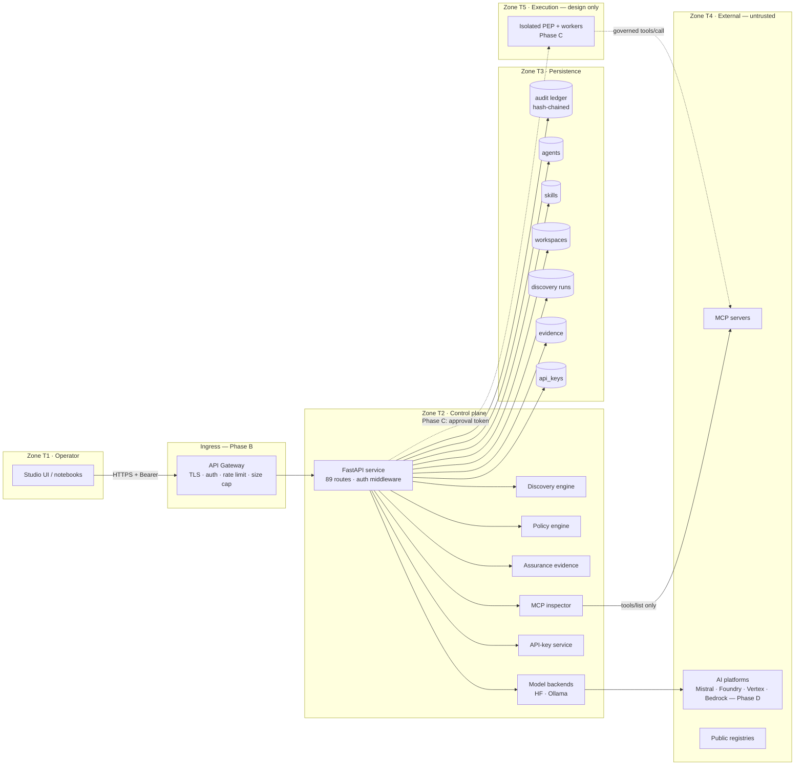

# LAD — Logical Architecture Design

Component topology, interfaces, and data flows of the TaaS control plane,
with trust-boundary analysis per flow.

## 1. Logical components

## 2. Interface inventory

| Interface | Producer → consumer | Contract |
|---|---|---|
| REST API | T2 → T1 | `taas.*/v1` versioned schemas; `record_semantics` + `execution_record` markers on every payload |
| MCP registry config | operator → T2 | `TAAS_MCP_SERVERS_JSON/FILE`; stdio commands vetted by operator, never browser-supplied |
| Inspection | T2 → T4 | JSON-RPC `tools/list` only; snapshots persisted + diffable; `tools/call` absent |
| Evidence envelope | EVD → T2 | Content-addressed record: subject binding, issuer, assessor, method, observation/expiry, payload digest, HMAC attestation |
| Approval token (design) | T2 → T5 | Short-lived one-time token bound to actor, server, tool, exact args, GoalSpec, policy fingerprint, tool-def hash, evidence hash |
| Provider adapter (design) | T2 → T4 | Uniform model catalog/runtime interface; per-provider auth + endpoint; metadata `unverified` marker mandatory |
| Audit events | all writers → T3 | Append-only; `actor` + `payload.request_id`; subject-json for scoped queries |

## 3. Data-flow scenarios

**F1 — Author a GoalSpec (Define).** UI → `POST /goals/validate` →
deterministic validator → draft response (`authored_draft_not_validation…`
semantics). Workspace save → revision recorded with actor + field-level diff.
*Trust:* T1 input is untrusted until validated; a valid draft is still a
proposal.

**F2 — MCP inspection (Discover).** UI → `POST …/inspect` → inspector reads
operator config → `tools/list` → snapshot persisted → diff endpoints.
*Trust:* T4 responses recorded as observations; `inspection_only: true`,
`tool_execution_performed: false` markers pinned in tests.

**F3 — Sign → approve → audit (Verify).** Publisher signs version →
attestation record (evidence store) + ledger event; approver records approval
→ ledger event; `audit/verify` walks the chain. *Trust:* signature proves a
record exists, not that its claims hold; approval ≠ authorization; every event
carries `request_id` back to the HTTP call.

**F4 — Governed invocation (design only).** Operator → preflight → short-lived
token issued → PEP validates *fresh* (never trusting caller state) → isolated
worker executes → outcome recorded. *Trust:* token is bound, single-use, and
fails closed on any mismatch/expiry/replay. Not implemented in this build.

## 4. Trust-boundary analysis

| Crossing | What crosses | Failure mode |
|---|---|---|
| T1→T2 | Bearer credential + request | Fail closed: 503/401; body ≤ 2 MiB; security headers |
| T2→T3 | Writes via parameterized SQL only | No traversal; audit + evidence append-only |
| T2→T4 | Read-only inspection, outbound fetch | Timeouts; results marked unverified/observed |
| T1→T3 | *(none — impossible by construction)* | T3 unreachable except via T2 |
| T2→T5 | Approval token (Phase C) | Mismatch/expiry/replay → refuse |
| T4→T5 | `tools/call` (Phase C) | Only through PEP; no direct path exists |
