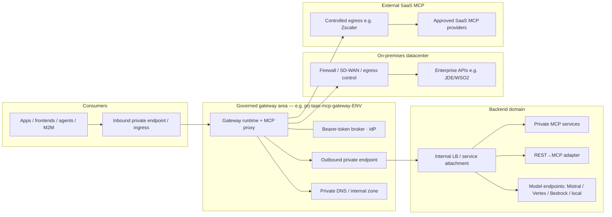

# Physical Architecture Document (PAD)
## TaaS Studio — Provenance-Aware Agent & Tool Governance Platform
## Centralized MCP Gateway Deployment, Token Broker and Per-Environment Realization

| Document control | Value |
|---|---|
| Document ID | TAAS-ENT-PAD-001 |
| Version | 0.2 — Restructured to professional template |
| Date | November 2025 |
| Status | Provisional — environment specifics (IPs, project IDs, endpoint ownership, routes) are `TBD` pending platform/network validation |
| Related documents | `SOW.md`, `LAD.md`, `SAW.md`, `TAAS_PLATFORM_MEGAPLAN.md`, `REQUIREMENTS_GAP.md` |
| Template baseline | `docs/examples/03-PAD-MCP-Agent-Gateway.md` |
| Physical reference | `docs/archi/apigeeArea.png` — real-project ApigeeX/PSC connectivity pattern |

> **Important reading note.** This PAD is a design baseline, not a claim that depicted resources exist. Names like `prj-taas-mcp-gateway-<env>` and example FQDNs are illustrative, modelled on the reference pattern in `docs/archi/apigeeArea.png`. It must not be used as a firewall implementation specification until the network/platform teams validate the endpoint inventory and connectivity matrix.

## Architecture diagrams (draw.io)

Design-first companion: `docs/archi/taas-pad.drawio` — 8 pages aligned to this document's sections. Open in draw.io desktop, diagrams.net, or the VS Code Draw.io extension. Visual convention: **solid = delivered · dashed = design seam / not implemented**.

| Page | Maps to |
|---|---|
| PAD-01 Physical-Overview | §2 reference topology (ApigeeX-style) |
| PAD-02 K8s-GatewayAPI | §7.1 private/on-prem realization (GatewayClass/Gateway/HTTPRoute) |
| PAD-03 Env-Matrix | §7 per-environment gateway baseline |
| PAD-04 Connectivity-Matrix | §5.1 NET-01..10 flow map |
| PAD-05 Private-Conn-Checklist | §5.3 producer/consumer + port/egress rules |
| PAD-06 DNS-Environments | §6 DNS design + §11 environment strategy |
| PAD-07 Trust-DR | §8 trust boundaries + §9 availability/DR |
| PAD-08 Deploy-TestPlan | §12 pipeline + §14 PT-01..14 test plan |

Feature-level overview diagrams: `docs/archi/taas-enterprise-architecture.drawio` (10 pages, one per feature).

## 1. Purpose and physical scope

This PAD translates the logical architecture into a deployment and network design covering:

- The **centralized MCP gateway + proxy** as the single governed ingress.
- The **bearer-token broker** integrated with an enterprise IdP (Entra ID or equivalent).
- **Per-environment gateway realization** — one logical contract, provider-native implementations:
  - **Private cloud / on-premises → Kubernetes Gateway API** (GatewayClass + Gateway + HTTPRoute).
  - **GCP → ApigeeX/Hybrid + Private Service Connect** (reference: `apigeeArea.png`).
  - **AWS → API Gateway / ALB/NLB + PrivateLink** equivalents.
  - **Azure → API Management / Application Gateway + Private Link**, Entra ID native.
- Private connectivity (inbound/outbound private endpoints, service attachments, LB-fronted backends), private DNS, controlled SaaS egress, on-prem reachability via SD-WAN/firewall, secrets, observability, environments, deployment/config management and the physical test plan.

## 2. Physical architecture overview



**Interpretation caveat:** logicalized rendering of the reference pattern. Producer/consumer roles for each private-connection flow and exact paths must be confirmed against real network configuration and service-attachment owners.

## 3. Physical zones and deployment domains

| Zone / domain | Components | Responsibility | Validation needed |
|---|---|---|---|
| Consumer zone | Business apps, frontends, agents, M2M | Invoke governed endpoints via private ingress | Source networks, auth method |
| Governed gateway area | Inbound endpoint, gateway runtime + MCP proxy, token broker, outbound endpoint, private DNS | Single governed ingress + mediation | Project/VPC/subnet IDs, owners |
| Backend domain | Internal LB, service attachments, MCP services, REST→MCP adapter, model endpoints | Host governed tools/runtimes | Backend inventory, health checks |
| On-prem datacenter | Firewall, SD-WAN, WSO2/JDE-class APIs | Private enterprise backends | Routing, TLS trust, source ranges |
| External SaaS zone | Controlled egress, SaaS MCP providers | Approved third-party tools | Provider list, egress policy |
| DNS/peering zone | Private zones, peering/forwarding | Name resolution across networks | Zone ownership, forwarding direction |

## 4. Physical components and inventory

| Ref | Component | Placement | Role | Status |
|---|---|---|---|---|
| PHY-01 | Inbound private endpoint / ingress | Consumer-facing edge | Private entry to gateway | Design — ID TBD |
| PHY-02 | Gateway runtime + MCP proxy | Governed gateway area | Policy enforcement + MCP mediation | Design — not implemented |
| PHY-03 | Bearer-token broker + IdP | Governed area / IdP service | Validation, exchange, delegation | Design — IdP dependency |
| PHY-04 | Outbound private endpoint | Governed area | Private path to backends | Design — ID TBD |
| PHY-05 | Internal LB / service attachment | Backend domain | Fronts MCP/model backends | Design |
| PHY-06 | Private DNS zone(s) | DNS zone | Resolve gateway/backend FQDNs | Design — records TBD |
| PHY-07 | Private MCP services | Backend domain | Governed tools | Inventory TBD |
| PHY-08 | REST→MCP adapter | Backend domain | Expose enterprise REST as MCP | Design |
| PHY-09 | Model endpoints | Backend/domain | Mistral/Vertex/Bedrock/local | Provider-dependent |
| PHY-10 | On-prem API backend | On-prem | Enterprise APIs via WSO2-class | Routing TBD |
| PHY-11 | SaaS MCP endpoints | External | Approved providers via egress | Provider list TBD |
| PHY-12 | Firewall/SD-WAN/egress control | Boundary | Routes, inspection, egress policy | Policy owners TBD |
| PHY-13 | TaaS registry/control plane | Control plane | Catalogue/lifecycle/assurance | Delivered (control-plane) |
| PHY-14 | Observability/SIEM | Ops | Telemetry + export | Platform TBD |
| PHY-15 | Secret store | Per-environment | Vault/Key Vault/Secrets Manager | Per-env |

## 5. Network connectivity and traffic flows

### 5.1 Connectivity matrix

| Flow ID | Source | Destination | Pattern | Purpose | Validation |
|---|---|---|---|---|---|
| NET-01 | Consumers | Inbound endpoint | Private endpoint/ingress + TLS | Invoke governed endpoints | Source nets, DNS, auth |
| NET-02 | Gateway | Token broker/IdP | OIDC/JWKS over TLS | Validate/exchange tokens | IdP endpoints, metadata |
| NET-03 | Gateway/proxy | Private MCP services | Outbound private endpoint → LB → service | Governed tool calls | Attachment ownership, FQDN |
| NET-04 | Gateway/proxy | REST→MCP adapter → enterprise API | Private route | REST-as-tool | API contract |
| NET-05 | Gateway/proxy | Model endpoints | Private connectivity where supported | Model/tool runtime | Provider path, IAM |
| NET-06 | Gateway/proxy | On-prem API | SD-WAN/firewall | JDE/WSO2-class access | Routes, TLS, source IPs |
| NET-07 | Gateway/proxy | SaaS MCP | Controlled egress (Zscaler-class) | Approved SaaS tools | Allowlist, auth, residency |
| NET-08 | All | Private DNS | Forwarding/peering | Resolve private FQDNs | Zone ownership |
| NET-09 | Orchestrator | Registry + gateway mgmt | Private mgmt route | Register/configure/publish | Mgmt reachability, IAM |
| NET-10 | All | Observability/SIEM | Approved telemetry path | Logs/metrics/traces | Collector endpoints |

### 5.2 Transport and port policy

- TLS everywhere; TCP 443 default for HTTPS — **but each backend listener must be verified**; never create firewall rules from assumption alone.
- The MCP proxy must **never** be reachable directly by general workloads — restrict to the gateway path (Kubernetes NetworkPolicy / firewall equivalent).
- Explicit FQDN/IP/port allow-lists; no broad wildcard egress.
- Prefer private connectivity for internal/model endpoints; public SaaS MCP only via the approved egress path.

### 5.3 Private-connectivity design checklist

For every private-connection relationship (PSC / PrivateLink / Private Link / service attachment), record:

1. Producer side: project/account/subscription, VPC/VNet, region, attachment ID.
2. Consumer side: project, VPC/VNet, region, endpoint ID + IP/subnet.
3. Connection state (accepted/rejected) and preference.
4. DNS record + private-zone ownership.
5. Firewall/route requirements both sides.
6. Health-check path, failover, maintenance ownership.
7. Flow role: ingress-to-gateway, gateway-to-runtime, or gateway-to-model-backend.

A private endpoint and a service attachment are **not** interchangeable — identify producer vs consumer for every flow.

## 6. DNS design

- All backends addressed by **private FQDNs**, never raw IPs — enables name-based allow-listing.
- Required specification per deployment: zone ownership; split-horizon; peering/forwarding direction; records (FQDN, type, target, TTL); SAN alignment; strict environment separation (dev/test/prod names must never cross-resolve).
- Illustrative gateway FQDNs (example domain, `TBD` ownership): `mcp-gw-dev.example.corp`, `mcp-gw.example.corp`, backend LB FQDNs per service.
- No IPs/CIDRs/TTLs prescribed here — they are not validated.

## 7. Gateway baseline per environment

> One logical contract (identity, exposure filtering, policy, audit, correlation). Four provider-adapted realizations. This is decision **D3** in `LAD.md`.

### 7.1 Private cloud / on-premises — **Kubernetes Gateway API**

The portable, vendor-neutral gateway for private cloud is the [Kubernetes Gateway API](https://kubernetes.io/docs/concepts/services-networking/gateway/):

- **GatewayClass** — the controller implementation (e.g. Envoy Gateway, NGINX Gateway Fabric, Kong) — **open ADR-01**; chosen per platform standards.
- **Gateway** — the instantiated ingress (listeners, TLS) representing the governed entry point.
- **HTTPRoute** (+ applicable route kinds) — bind paths/hostnames to backend Services; attach policy via extension/policy-attachment where needed (rate limits, authZ).
- **Namespaces**: separate `control-plane`, `mcp-proxy`, and (Phase C) `pep` namespaces; RBAC scoped accordingly.
- **NetworkPolicy**: restrict the MCP proxy/data-plane so only the gateway pods can reach it — no direct workload→MCP access (mandatory control, mirrors the reference pattern's in-cluster restriction).
- **Service identity** for the proxy (workload identity / SPIFFE-class) rather than shared secrets where supported.
- Multi-cluster caveat: keep gateway/MCP enablement consistent across clusters serving the same environment — mixed enablement can return 503-class failures.
- Deployment substrate: K3s/kubeadm/managed-K8s per environment; GPU node pools where agent/model runtimes are colocated (Phase D).

### 7.2 GCP — ApigeeX / Apigee Hybrid + Private Service Connect

Realization modelled on `docs/archi/apigeeArea.png`:

- Dedicated gateway project (`prj-…-mcp-gateway-<env>` pattern) and VPC/subnets.
- Inbound FQDN → **inbound PSC endpoint** → service attachment → gateway runtime.
- Outbound **PSC endpoint** → service attachment → internal LB → backends (MCP, Vertex AI/Model Garden).
- **Private connectivity to AI providers** (e.g. Mistral via PSC inbound/outbound endpoints) — no public egress where PSC exists.
- Public SaaS MCP (Snowflake/Atlassian-class) via controlled egress (Zscaler-class).
- On-prem via SD-WAN + firewall.
- Private Cloud DNS zones + peering.
- **Version/feature caveat:** managed-gateway MCP capabilities are version-dependent (e.g. Hybrid MCP support begins at a specific supported release) — validate the current supported release, protocol versions and in-cluster MCP restrictions with the vendor at implementation time; do not hard-code a version. Restrict any in-cluster MCP service to the intended gateway pods only.

### 7.3 AWS — API Gateway / load balancer + PrivateLink

- Ingress: API Gateway (public/regional) or internal ALB/NLB as the governed entry; PrivateLink/NLB service endpoints for private consumer access.
- Private connectivity: AWS PrivateLink (endpoint services) to backends and supported AI providers (e.g. Bedrock via PrivateLink/PrivateLink-for-AWS-services).
- Identity: IAM / IAM Identity Center / OIDC federation for the token broker; Secrets Manager for secrets.
- Egress: controlled via NAT + egress controls/inspection.

### 7.4 Azure — API Management / Application Gateway + Private Link

- Ingress: Azure API Management and/or Application Gateway; Private Link/private endpoints for private access.
- Identity: **Microsoft Entra ID** native for the token broker; workload identity for AKS pods.
- Private connectivity: Azure Private Link / private endpoints to backends and AI services (Foundry/Azure AI via private endpoints where supported).
- Secrets: Key Vault. Egress: Azure Firewall/controlled egress.

### 7.5 Kubernetes runtime network controls (all K8s deployments)

- NetworkPolicy restricting the MCP proxy service to gateway pods only.
- Namespace separation of control-plane / proxy / execution.
- Resource requests/limits, pod-disruption and rollout settings per supported config.
- Consistent gateway/MCP enablement across all clusters in an environment group.
- Backup/restore/upgrade/rollback ownership for stateful components.

## 8. Physical security and trust boundaries

| Boundary | Required controls |
|---|---|
| Consumer → Gateway | TLS, token validation, audience/scope, WAF/threat where licensed |
| Gateway ↔ private endpoints/backends | Connection acceptance, allowlist, DNS integrity, route restrictions |
| Gateway → MCP proxy | In-cluster/VPC restriction to gateway pods only — no direct access |
| Gateway → model backends | Private connectivity preferred; backend authN; no consumer-direct |
| Gateway → on-prem API | Firewall/SD-WAN rules, mTLS/approved TLS, source allowlist, audit |
| Gateway → SaaS MCP | Explicit egress allowlist, inspection, OAuth/service creds, tenant limits |
| Broker → IdP | Trusted OIDC metadata; JWKS; least-privilege app registrations |
| Orchestrator → control planes | Workload identity, least-privilege admin, signed/audited changes |
| Admin → control planes | MFA/SSO, PAM, role separation, change audit |

## 9. Availability, resilience and disaster recovery

Recommended checklist (not a claim the design already implements it):

- Evaluate ≥2 independently operated runtime clusters where upgrade traffic diversion is required.
- Health checks for gateway, registry, runtimes, model endpoints and integration paths.
- **Registry unavailable:** already-published routes may continue only while cached policy remains valid; new registrations/publications fail closed.
- Backend failure → documented timeout/retry/circuit-breaker; **no silent provider switching** (semantics/residency/cost differ).
- Back up registry metadata, gateway config and stateful components per approved RPO/RTO.
- Document rollback for publication, policy deploys, schema changes and gateway upgrades.
- RTO/RPO/availability/failover/retention = `TBD` per environment.

## 10. Physical observability and operations

Minimum dashboards:

- Gateway: request volume, latency, errors, 4xx/5xx, throttling, backend codes.
- `tools/list` vs `tools/call` volume, tool-level latency, **denied calls**, quota events.
- Backend availability/latency/error per provider; PSC/private-endpoint health.
- On-prem and SaaS dependency health.
- Registry/gateway **drift**, failed reconciliation, stale endpoints.
- Deployment/upgrade status, policy deploy failures, certificate expiry.

No tokens, keys, passwords or unredacted payloads in telemetry. Request-ID ↔ audit-seq correlation end-to-end; SIEM export.

## 11. Environment strategy

| Environment | Purpose | Isolation | Data/access |
|---|---|---|---|
| DEV | Engineering/integration | Separate gateway env + non-prod endpoints | Test creds, synthetic data |
| TEST/INT | E2E regression | Separate policies + test backends | Representative test data; SaaS sandboxes |
| PREPROD | Production-like rehearsal | Prod-like connectivity/policy | No uncontrolled prod data; release gate |
| PROD | Business service | Approved prod cluster/network, private DNS, controlled egress | Prod IAM/secrets, audit retention, change windows |

Environment differences are **configuration overlays**, never divergent manually-maintained bundles.

## 12. Deployment and configuration management

- Version-control: gateway bundles/routes, policy configs, registry schemas, workflows, network manifests, env overlays.
- CI/CD: static validation, policy tests, **secret scanning**, promotion approvals.
- No secrets in source, registry records, images or pipeline artefacts.
- Least-privilege deploy identities; auditable release jobs.
- **IaC** (Terraform module layout below) for cloud/network resources where standards permit.
- Pre-deploy validation: endpoint reachability, DNS, TLS certs, IdP metadata, backend readiness.
- Scheduled reconciliation of actual gateway resources vs registry metadata; alert on drift.

### Terraform module layout (design)

```text
infra/
  modules/
    gateway/            # per-env gateway (k8s Gateway API | apigee | aws | azure)
    mcp-proxy/          # proxy deployment + policy
    token-broker/       # IdP app registrations / exchange config
    private-connectivity/ # PSC | PrivateLink | Private Link | service attachments
    dns/                # private zones, records
    observability/      # logs/metrics/traces/SIEM
    secrets/            # vault/key vault/secrets manager wiring
    registry/           # control-plane deployment
  envs/
    dev/ test/ preprod/ prod/ private-onprem/
```

## 13. Physical implementation test plan

| Test ID | Test | Expected result |
|---|---|---|
| PT-01 | Resolve dev/prod gateway FQDN | Resolves to intended private endpoint; no cross-env mapping |
| PT-02 | Verify private endpoint/attachment state | Accepted; reachable only from approved consumer net |
| PT-03 | Validate TLS chain + SAN | Correct trusted cert per FQDN |
| PT-04 | Unauthorized pod → MCP proxy direct | Denied by network policy |
| PT-05 | Consumer → MCP backend **direct** (bypassing gateway) | Denied + logged |
| PT-06 | Gateway → private MCP service | Approved private path only |
| PT-07 | Gateway → model backend | Approved private/service route; correct identity |
| PT-08 | Gateway → on-prem API | Approved route; unauthorized source blocked |
| PT-09 | Gateway → approved SaaS MCP | Via approved egress; non-allowlisted denied + logged |
| PT-10 | Token broker: invalid/expired/wrong-audience token | 401; exchange to wrong audience denied |
| PT-11 | Consumer token replayed downstream unchanged | Rejected — exchange/delegation enforced |
| PT-12 | Registry outage | Published routes serve only with valid cached policy; new publishes fail closed |
| PT-13 | Reconciliation after failed publication | Orphan proxy/registry state detected + corrected/surfaced |
| PT-14 | Egress & log redaction review | No credential leakage; only approved telemetry fields |

## 14. Items to confirm before a production-ready PAD

| ID | Required information | Owner |
|---|---|---|
| PAD-Q01 | Project/account/subscription IDs + owners per environment | Cloud platform |
| PAD-Q02 | VPCs/VNets, subnets, CIDRs, regions, route tables | Network |
| PAD-Q03 | Private-connection producer/consumer mapping, attachment/endpoint IDs+IPs | Network/service owners |
| PAD-Q04 | K8s distribution/version, GatewayClass choice (ADR-01), node pools, namespaces | K8s platform |
| PAD-Q05 | Managed-gateway product/version/feature entitlements per cloud | Gateway owner/vendor |
| PAD-Q06 | Model provider endpoints, regions, private-connectivity support | AI platform |
| PAD-Q07 | On-prem API list, source ranges, WSO2-class mediation, data classification | Integration |
| PAD-Q08 | First-wave SaaS MCP providers, URLs, tenants, OAuth scopes, egress | Product/security |
| PAD-Q09 | DNS zones, peering/forwarding, record ownership, TTLs | DNS |
| PAD-Q10 | Firewall/SD-WAN/egress policies + change windows | Net/sec ops |
| PAD-Q11 | IdP choice per environment (Entra ID/equivalent), federation, app regs | Identity |
| PAD-Q12 | Observability/SIEM platform, collectors, retention | Ops |
| PAD-Q13 | RTO/RPO/availability/failover requirements | Service owner |
| PAD-Q14 | Load profile: agents, tools, concurrent calls, sizes, token usage, peaks | Product/platform |

## 15. Physical design decisions

| Decision | Position | Status |
|---|---|---|
| Private-cloud gateway | **Kubernetes Gateway API** (GatewayClass + Gateway + HTTPRoute) | Approved; GatewayClass impl open (ADR-01) |
| GCP realization | ApigeeX/Hybrid + PSC per reference pattern | Validate versions/features |
| AWS realization | API GW / ALB-NLB + PrivateLink | Proposed |
| Azure realization | APIM / AppGW + Private Link + Entra ID | Proposed |
| SaaS MCP access | Controlled egress + explicit allowlist | Proposed; list open |
| REST→MCP onboarding | Gateway adapter for enterprise REST | Proposed |
| MCP proxy access | Restrict to gateway pods only | Mandatory control |
| Upgrade availability | No zero-downtime claim; multi-cluster diversion if required | Open pending HA assessment |

## 16. References

- Kubernetes Gateway API — https://kubernetes.io/docs/concepts/services-networking/gateway/
- `docs/examples/03-PAD-MCP-Agent-Gateway.md` — template baseline
- `docs/archi/apigeeArea.png` — physical connectivity reference
- Apigee Hybrid MCP docs (version/feature baseline — validate at implementation)
- `docs/enterprise/SOW.md`, `LAD.md`, `SAW.md`, `TAAS_PLATFORM_MEGAPLAN.md`, `REQUIREMENTS_GAP.md`
- `docs/studio/LIFECYCLE_API_MEGAPLAN.md`, `GOVERNED_EXECUTION_GATEWAY_PHASE1.md`, `ISOLATED_PEP.md`

---

**End of document — TAAS-ENT-PAD-001**
