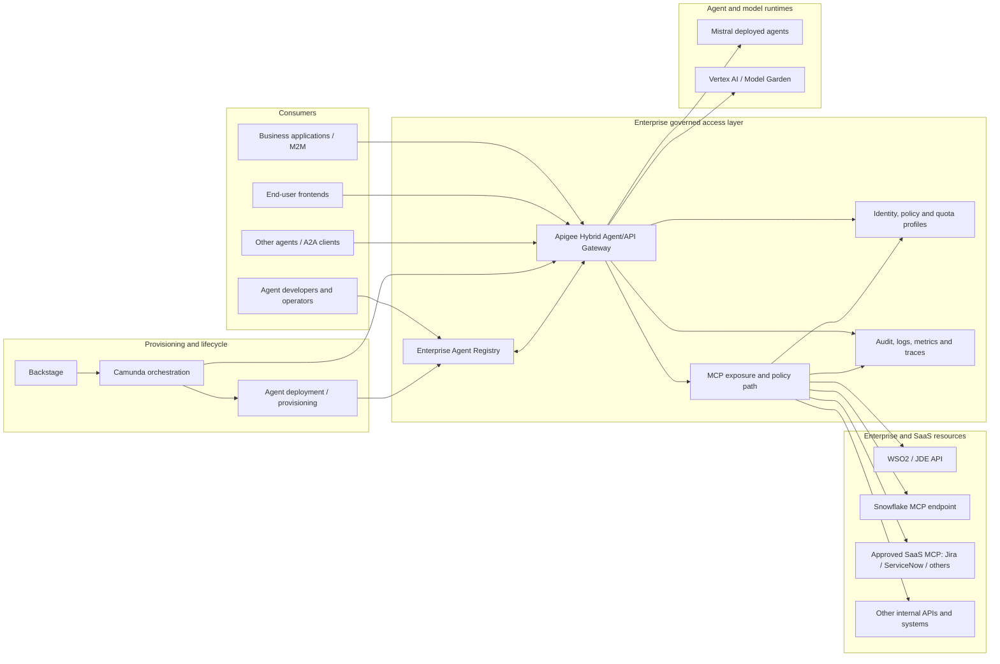
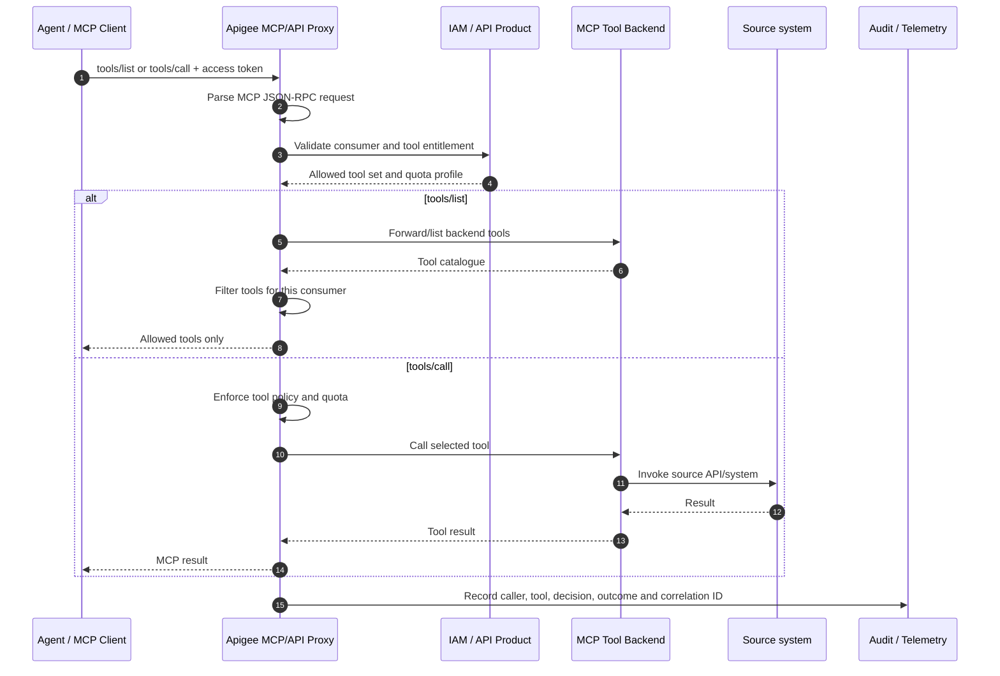
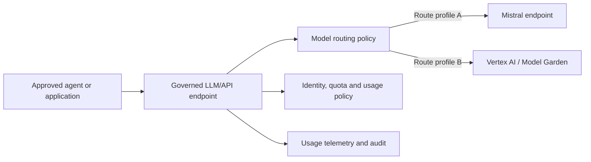

# Logical Architecture Document (LAD)
## Enterprise Agent Gateway, MCP Gateway and Automated Agent Exposure

| Document control | Value |
|---|---|
| Document ID | D2AI-CEVA-AGW-LAD-001 |
| Version | 0.1 — Draft for architecture review |
| Date | 17 November 2026 |
| Status | Proposed logical design; physical details and feature entitlements require confirmation |
| Related documents | `01-SoW-MCP-Agent-Gateway.md`, `03-PAD-MCP-Agent-Gateway.md` |
| Proposed baseline | Apigee Hybrid + custom Enterprise Agent Registry + Backstage/Camunda workflow integration |

## 1. Purpose and architecture scope

This document defines the logical architecture for a governed enterprise access layer covering deployed agents, MCP tools and selected LLM endpoints. It describes responsibilities, logical components, interfaces, identity flows, lifecycle behaviour, security controls and important architecture decisions. Product-specific deployment topology is specified in the PAD.

The architecture addresses two related but distinct consumption needs:

- **Agent exposure:** make a deployed agent consumable by business applications, end-user frontends and other agents through a governed endpoint.
- **Tool/resource access:** provide agents with controlled access to internal APIs, selected non-API systems and external/SaaS MCP servers.

The architecture must not collapse MCP and A2A into one protocol. MCP is the tool/resource interaction pattern; A2A is the agent-to-agent communication pattern. The gateway may govern both protocol paths, but their contracts and policy models remain explicit.

## 2. Architecture drivers

| Driver | Architectural implication |
|---|---|
| R1 already provisions agents | Reuse the existing deployment workflow; extend it rather than create a parallel lifecycle. |
| R2 must auto-register and expose | Provisioning workflow must call registry and gateway control APIs with idempotent operations. |
| Multiple consumer types | Consumer identity and policy must be represented independently from agent runtime identity. |
| Mistral is a non-GCP runtime in the stated use case | Keep the registry and gateway contract runtime-neutral; use private connectivity to the Mistral endpoint. |
| Vertex AI is also required | Provide a governed model access route without leaking provider-specific topology to consumers. |
| Internal and SaaS MCP endpoints | Separate private enterprise integration paths from controlled internet/SaaS egress. |
| Need central audit and policy | Enforce authentication, authorisation, quota, tool visibility and observability at the gateway boundary. |
| Full agent mesh is not yet selected | Deliver governed exposure and basic A2A access; avoid assuming a full mesh platform is part of this release. |

## 3. Architecture principles

1. **Gateway as policy enforcement point:** every in-scope consumer request traverses a governed entry point.
2. **Registry as system of record:** metadata and lifecycle state are held in the Enterprise Agent Registry, not inferred from runtime endpoints.
3. **Automation first:** lifecycle changes are event/API driven and repeatable.
4. **Stable consumer contracts:** endpoint names and logical capabilities remain stable across runtime replacement where practical.
5. **Identity propagation by design:** identity is validated, mapped and delegated according to the downstream resource's trust model.
6. **Least privilege and explicit consent:** expose only approved agents and tools to each consumer class.
7. **Protocol separation:** A2A for agent collaboration; MCP for tool and resource access; REST/API for application integration where appropriate.
8. **Private by default:** internal runtimes and enterprise backends use private connectivity; public egress is explicitly allowlisted.
9. **Observable without over-logging:** collect call metadata and security outcomes while redacting credentials and sensitive content.
10. **Portable control metadata:** avoid embedding vendor/runtime-specific assumptions in the registry schema.

## 4. Context and logical system boundary



**Boundary note:** Apigee is the runtime gateway and policy enforcement layer. The custom registry is the logical catalogue and lifecycle metadata service. Backstage/Camunda is the provisioning orchestration path. These responsibilities should not be conflated. A product capability may replace one or more custom components only after a documented decision.

## 5. Logical components and responsibilities

| Component | Logical responsibility | Key interfaces |
|---|---|---|
| Consumer applications | Initiate authorised agent, API, MCP or A2A requests | REST/HTTPS, MCP client, A2A client |
| Apigee Hybrid gateway | Stable ingress, authentication enforcement, routing, rate limits, threat protection, analytics and audit hooks | API proxy endpoints; gateway administration APIs |
| Agent exposure adapter | Generate/configure gateway-facing endpoints and bind them to runtime endpoints | Provisioning service API; Apigee management API; versioned proxy template |
| Enterprise Agent Registry | Catalogue, ownership, tags, runtime references, protocol, lifecycle and access-policy references | Registry REST API; search/discovery API; event interface |
| Backstage | Developer-facing provisioning/catalogue workflow and service ownership | Software templates, catalog entities, workflow actions |
| Camunda | Workflow orchestration, retries, compensation, approval and status progression | Process APIs, workers, task/events |
| Agent runtime | Execute agent tasks and expose a runtime API or A2A endpoint | Runtime-specific HTTPS/API interface |
| MCP adapter/exposure | Make approved APIs/resources available as MCP tools and route to MCP servers | MCP JSON-RPC over HTTP; OpenAPI/API backend |
| WSO2 integration layer | Preserve existing API mediation for JDE or other enterprise systems | Existing WSO2 API interface |
| LLM/model façade | Apply approved routing to Mistral and Vertex AI backend(s) | Model invocation API; backend-specific connector |
| Enterprise IAM | Authenticate consumers and issue/validate tokens; support delegated identity where allowed | OIDC/OAuth, JWT validation, token exchange or equivalent |
| Secret manager | Store and retrieve backend/service credentials | Secret references and workload identity |
| Observability platform | Central metrics, logs, traces, audit correlation and alerting | OpenTelemetry-compatible telemetry and platform logging |
| Network/security controls | Enforce segmentation, egress, DNS, private access and TLS trust | PSC, VPC, firewall, SD-WAN, Zscaler, DNS, PKI |

## 6. Logical architecture views

### 6.1 Consumer access view

All in-scope consumers address a stable gateway endpoint. The gateway authenticates the calling principal, resolves the requested logical agent or tool, applies a policy and forwards the request to the approved target.

```mermaid
sequenceDiagram
    autonumber
    participant C as Consumer (M2M / UI / Agent)
    participant I as Enterprise IAM
    participant G as Apigee Gateway
    participant R as Agent Registry
    participant A as Agent Runtime
    participant O as Observability

    C->>I: Authenticate / obtain token
    I-->>C: Access token with intended audience and claims
    C->>G: Invoke logical agent endpoint + token
    G->>G: Validate token, client, scopes and request
    G->>R: Resolve agent + policy metadata
    R-->>G: Target reference, policy and lifecycle state
    G->>G: Authorise consumer; apply quota and threat controls
    G->>A: Forward request using approved downstream identity
    A-->>G: Agent response
    G->>O: Emit correlated audit/metrics/trace metadata
    G-->>C: Normalised response
```

**Identity rule:** the consumer's token must be valid for the gateway. The gateway must not assume it is also valid for the downstream agent or SaaS resource. Where user identity is required downstream, use a supported token-exchange/delegation mechanism or an explicitly approved identity mapping. Otherwise use a dedicated workload identity and record the acting user/client context as claims or audit metadata where legally and technically permitted.

### 6.2 R1-to-R2 automated provisioning view

```mermaid
sequenceDiagram
    autonumber
    participant U as Developer / Platform user
    participant B as Backstage
    participant C as Camunda
    participant P as R1 Agent Provisioner
    participant M as Mistral / Agent Runtime
    participant R as Enterprise Agent Registry
    participant G as Apigee Management API
    participant H as Health / Smoke Test

    U->>B: Request new agent from approved template
    B->>C: Start provisioning workflow
    C->>P: Provision agent
    P->>M: Create/deploy agent
    M-->>P: Runtime endpoint + deployment ID
    P-->>C: Deployment result (no secret values)
    C->>R: Register agent (idempotency key)
    R-->>C: Registry ID + REGISTERED state
    C->>G: Generate/deploy proxy from approved template
    G-->>C: Proxy ID + gateway endpoint
    C->>R: Update endpoint and policy references
    C->>H: Run health, auth and route smoke tests
    H->>G: Test gateway endpoint
    G->>M: Test runtime route
    M-->>G: Health response
    G-->>H: Gateway test result
    H-->>C: Validation result
    alt All checks pass
      C->>R: Mark READY_FOR_CONSUMPTION
      C-->>B: Publish catalogue status
      B-->>U: Agent ready with governed endpoint
    else Any check fails
      C->>R: Mark failure state; keep endpoint unpublished
      C->>G: Disable or remove incomplete exposure
      C-->>B: Report failure and remediation action
    end
```

**Automation controls:** use idempotency keys, explicit correlation IDs, bounded retries, workflow timeouts, compensating actions and periodic drift reconciliation. A registry record must not be marked ready until gateway configuration and health tests have passed.

### 6.3 MCP tool invocation view



Apigee documentation describes a ParsePayload-based policy pattern for extracting MCP operations, API-product-based tool visibility and per-tool quota enforcement. The exact policy support must be verified against the selected Hybrid release and entitlement set before adopting this design.

### 6.4 Logical model/LLM routing view



This view does not decide whether Mistral is an agent runtime, a model-serving endpoint or both. The detailed contract, streaming behaviour, request/response schema, model identifiers, fallback and routing criteria must be agreed in ADR-05.

## 7. Protocol and interface contracts

| Interface | Purpose | Protocol / format | Design rule |
|---|---|---|---|
| Agent consumer endpoint | Application or frontend calls a deployed agent | HTTPS REST/API, or agreed streaming transport | Stable logical URL; versioned contract; gateway authentication required |
| A2A endpoint | Agent-to-agent communication | A2A over supported binding (for example HTTP/JSON-RPC) | Use A2A semantics for task-oriented agent collaboration; govern identity and permitted peers |
| MCP endpoint | Agent-to-tool/resource interaction | MCP JSON-RPC over HTTP | Keep tool schemas and operations explicit; authorise each consumer/tool |
| Registry API | Agent lifecycle and discovery | HTTPS REST + JSON; optional eventing | Registry is source of truth for lifecycle metadata |
| Provisioning event/API | R1 to R2 lifecycle handoff | Backstage/Camunda API/event | Include stable deployment ID, runtime reference, environment, owner and correlation ID |
| Gateway management API | Create/update/disable proxies and products | Apigee management interfaces | Use least-privilege workload identity; secrets never supplied in event payload |
| Runtime health check | Decide if agent can be published | HTTPS health/readiness endpoint | Separate liveness from business readiness where possible |
| Backend integration | Access WSO2/JDE, Snowflake, SaaS | HTTPS/API or MCP | Use backend-specific identity and allowlisted routes |
| Model invocation | Access Mistral / Vertex AI | Provider/runtime API | Abstract provider details behind an approved policy and endpoint contract |

### 7.1 Agent Registry — minimum logical data model

| Attribute | Description | Required? |
|---|---|---|
| `agent_id` | Immutable registry identifier | Yes |
| `name` / `display_name` | Human-readable name | Yes |
| `description` | Purpose and supported business capability | Yes |
| `owner_team` / `owner_contact` | Accountable owner | Yes |
| `environment` | Dev, test, pre-production or production | Yes |
| `runtime_type` | Mistral, Vertex AI Agent, custom runtime, etc. | Yes |
| `runtime_endpoint_ref` | Secret-free reference to runtime endpoint/config | Yes |
| `gateway_endpoint` | Published stable consumer URL | When exposed |
| `protocols` | REST, A2A, MCP (as applicable) | Yes |
| `version` | Agent contract/version | Yes |
| `lifecycle_state` | State machine value | Yes |
| `auth_profile_ref` | Reference to approved auth policy | Yes |
| `policy_profile_ref` | Reference to consumer/tool policy | Yes |
| `secret_refs` | Secret-manager references only | When needed |
| `tags` | Domain, classification, criticality, data sensitivity | Yes |
| `health_status` | Last health/readiness result | When deployed |
| `created_at`, `updated_at` | Audit timestamps | Yes |
| `provisioning_correlation_id` | R1/R2 workflow correlation | Yes |
| `deprecation_date` | Planned retirement where applicable | Optional |

### 7.2 Example registration manifest (illustrative)

```yaml
apiVersion: platform.example.com/v1
kind: AgentExposure
metadata:
  name: claims-assistant
  environment: dev
spec:
  owner:
    team: claims-platform
    contact: claims-platform@example.invalid
  runtime:
    type: mistral
    endpointRef: secret://agent-runtimes/claims-assistant/dev/endpoint
    deploymentId: "<deployment-id-from-r1>"
  exposure:
    protocols: [rest, a2a]
    gatewayProduct: agent-consumers-dev
    proxyTemplate: agent-http-v1
    publishAfterValidation: true
  security:
    authProfileRef: auth-profile://enterprise-oauth-user-or-workload
    policyProfileRef: policy-profile://claims-agent-readonly
    secretRefs:
      - secret://agent-runtimes/claims-assistant/dev/credential
  lifecycle:
    correlationId: "<camunda-process-correlation-id>"
    idempotencyKey: "<stable-provisioning-operation-key>"
```

The manifest is illustrative, not an existing platform API. Final field names, schema validation, identity providers and secret URI conventions must be aligned with client standards.

## 8. Security architecture

### 8.1 Identity domains

The design distinguishes:

- **Consumer principal:** the application, frontend or calling agent.
- **End-user principal:** the human user represented in a frontend-originated transaction.
- **Gateway workload identity:** identity used by Apigee or provisioning components to reach management APIs and services.
- **Agent runtime identity:** identity under which the deployed agent executes.
- **Backend identity:** identity or credential used to access an API, MCP server, SaaS service or data source.

These identities are not interchangeable. A policy must state which identity is used for authentication, authorisation, audit and downstream access.

### 8.2 Required control layers

| Layer | Controls |
|---|---|
| Consumer authentication | OAuth/OIDC or approved enterprise mechanism; issuer, signature, expiry, audience and client validation |
| Consumer authorisation | Client/agent allowlist, role/scope, environment and business-domain entitlement |
| Agent exposure | Agent lifecycle state, proxy binding, endpoint allowlist, version and health status |
| MCP tool authorisation | Per-tool allowlist, tool filtering, scope and quota; deny unapproved tools by default |
| A2A authorisation | Trusted agent identity, peer allowlist, purpose/scope, task/data classification and rate limit |
| Downstream identity | Token exchange/delegation or backend-specific service identity; no unsafe token passthrough |
| Network | Private ingress/egress, PSC, firewall allowlists, DNS controls, TLS and restricted service-to-service paths |
| Secrets | Secret manager, rotation, access logging and no plaintext configuration |
| Audit | Caller, subject/actor context, agent/tool, policy decision, target, timestamp, outcome and correlation ID |
| Content protection | Payload size limits, sensitive-data redaction, injection/tool-risk controls appropriate to the use case |

### 8.3 Threats to address in detailed design

- Confused-deputy and token audience errors.
- Agent impersonation and compromised workload identities.
- Excessive tool exposure and over-privileged MCP clients.
- Malicious or compromised MCP server/tool descriptions.
- Prompt injection leading to unsafe tool invocation.
- SSRF or arbitrary-target routing through proxy configuration.
- Secret leakage through prompts, logs, error messages or registry metadata.
- Replay, denial of service and unbounded long-running requests.
- Cross-tenant or cross-environment data access.
- Registry/gateway drift and orphaned public endpoints.

## 9. Logical non-functional requirements

Numerical values are intentionally left open until workload data and service objectives are agreed.

| ID | Quality attribute | Requirement / measure to agree |
|---|---|---|
| NFR-01 | Availability | Service availability target, maintenance exclusions and multi-cluster need |
| NFR-02 | Performance | Gateway overhead, p50/p95/p99 latency and maximum response time by endpoint type |
| NFR-03 | Throughput | Concurrent calls, requests/second, tool-call rate, model tokens/second and burst profile |
| NFR-04 | Scalability | Number of agents, tools, consumers, environments, API products and daily calls |
| NFR-05 | Resilience | Retry, timeout, circuit-breaker, backend failover and partial failure behaviour |
| NFR-06 | Recovery | RTO, RPO, backup/restore and regional recovery expectations |
| NFR-07 | Security | Authentication coverage, privileged access, secret rotation and vulnerability response |
| NFR-08 | Auditability | Audit event completeness, retention, query access and integrity |
| NFR-09 | Privacy | Payload minimisation, redaction and retention by classification |
| NFR-10 | Operability | Health checks, dashboards, alert thresholds and on-call ownership |
| NFR-11 | Maintainability | Versioned templates, configuration-as-code, automated tests and drift detection |
| NFR-12 | Portability | Registry and contracts remain decoupled from runtime-specific deployment metadata |

## 10. Architecture options and decisions

### 10.1 Gateway / registry platform choice

| Option | Description | Advantages | Trade-offs / constraints | Status |
|---|---|---|---|---|
| A — Apigee Hybrid + custom registry | Apigee Hybrid provides managed API exposure/enforcement; custom enterprise registry handles agent metadata and lifecycle; Backstage/Camunda orchestrates registration and exposure | Fits stated Mistral/non-GCP case; reuses existing API governance and contractual direction; separates registry from runtime | Custom registry and automation required; full mesh features not included automatically; version and feature support must be validated | **Proposed baseline; approval required** |
| B — Gemini Enterprise Agent Platform | Use Google's broader agent platform capabilities for agent registry/mesh/orchestration together with Google ecosystem runtime | Potentially broader agent catalogue, mesh policies and orchestration capabilities | May introduce platform/ecosystem dependency; Mistral integration, commercial fit and migration implications need validation | Optional alternative / future assessment |

**Decision statement:** for the first delivery increment, proceed with Option A as the working design assumption, subject to proof of required Apigee feature entitlements, automation APIs and A2A requirements. Do not describe Option A as a full agent mesh. If full mesh governance is a mandatory requirement, reopen ADR-01 and compare Option B and other platform options.

### 10.2 Apigee Hybrid version and MCP compatibility

The source brief mentions a 1.16.x prerequisite. Current Google documentation dated 17 November 2026 lists Hybrid 1.17.3 and states that native MCP support in Apigee Hybrid starts at 1.17.0. Hybrid supports stateful MCP protocol versions `2025-11-25`, `2025-06-18`, `2025-03-26` and `2024-11-05`; the stateless `2026-07-28` protocol is documented for Apigee but not Apigee Hybrid. Therefore:

- The 1.16.x note must not be used as the MCP Hybrid baseline.
- Validate the exact Apigee Hybrid patch and feature matrix against the client's contractual entitlements.
- Validate MCP client/server protocol compatibility before selecting protocol versions.
- Confirm the Hybrid-specific ingress restriction: the MCP data plane must only be reachable from intended Message Processor pods and must be protected by cluster network policy.
- Validate any additional AI Gateway, Agent Exposure Management, Agent Access Protection and Advanced API Security entitlements separately; the public MCP support statement does not prove entitlement to every named agentic feature.

### 10.3 A2A boundary

A2A is a separate protocol from MCP. The initial release provides authenticated and authorised exposure of approved agent endpoints and basic peer access. A full agent mesh—central agent discovery federation, agent-to-agent orchestration, policy propagation between agents, delegation graph, scheduling and zero-trust mesh control—is not inferred from gateway API proxy functionality and is not in baseline scope without an explicit decision.

## 11. Logical operations and governance model

### 11.1 Publication lifecycle

- Registry record creation is triggered by a trusted R1 deployment result.
- Registry validates required metadata and owner information.
- Exposure adapter generates/configures a proxy from a controlled template.
- Gateway policies are attached from approved policy profiles.
- Automated validation verifies endpoint, authentication, routing, health and basic authorization.
- Only then is the registry record marked `READY_FOR_CONSUMPTION` and made visible to authorised consumers.
- A reconciliation process detects orphaned proxies, stale registry records and runtime endpoints no longer deployed.

### 11.2 Change lifecycle

Agent version changes must be staged and validated before promotion. The registry should preserve previous version references for rollback. Decommissioning must revoke consumer access, disable the gateway endpoint, update the registry and retain audit records according to policy.

### 11.3 Tool catalogue governance

Every MCP tool must have an owner, purpose, input/output schema, data classification, side-effect classification, permitted consumer groups, backend identity method, quota profile and support contact. Write/destructive tools require elevated policy controls and human-approval patterns where required by business risk.

## 12. Observability model

Each gateway call should emit the minimum useful metadata:

- UTC timestamp and environment.
- Correlation/trace ID and gateway request ID.
- Consumer client/agent identity and (where allowed) delegated subject reference.
- Logical agent or MCP server/tool name and version.
- Policy profile and decision (allow/deny/throttle).
- Backend target identifier (not credentials or secret endpoint parameters).
- Latency, status, retry count and error category.
- Usage metrics for model calls, token counts and quota consumption where supported.

Payload logging is disabled by default unless an explicit business, privacy and security approval defines a safe sampling/redaction pattern.

## 13. Key architecture decisions and open questions

| ADR / question | Required decision | Owner | Status |
|---|---|---|---|
| ADR-01 | Apigee Hybrid + custom registry or Gemini Enterprise Agent Platform? | Architecture board / client sponsor | Proposed Option A |
| ADR-02 | Exact Apigee Hybrid version, topology, licence and feature entitlements? | Apigee platform owner / Google | Open |
| ADR-03 | Which R1 event/API is the authoritative provisioning completion event? | Backstage/Camunda owner | Open |
| ADR-04 | Is proxy generation implemented via Apigee API templates, dedicated adapter or another supported mechanism? | Apigee architect | Open; spike required |
| ADR-05 | Is the Mistral/Vertex AI requirement model routing, agent routing, or both? | AI platform owner | Open |
| ADR-06 | A2A version/binding, supported features and peer trust model? | Agent platform/security owner | Open |
| ADR-07 | Which downstream integrations must preserve end-user identity? | IAM and application owners | Open |
| ADR-08 | Exact first-wave SaaS MCP services and auth flows? | Product owner | Open |
| ADR-09 | Does JDE remain behind WSO2 and which API operations are exposed? | Enterprise integration owner | Open |
| ADR-10 | Availability, latency, scale, retention, RTO/RPO and DR targets? | Service owner | Open |
| ADR-11 | Exact network projects, subnets, PSC attachments, FQDNs and routes? | Cloud/network owner | Open |
| ADR-12 | Who owns the registry service at runtime and how is it operated? | Platform owner | Open |

## 14. References

- Google Cloud, [MCP in Apigee overview](https://docs.cloud.google.com/apigee/docs/api-platform/apigee-mcp/apigee-mcp-overview).
- Google Cloud, [MCP tool access with API products](https://docs.cloud.google.com/apigee/docs/api-platform/apigee-mcp/manage-mcp-tool-access).
- Google Cloud, [Enable MCP in Apigee Hybrid](https://docs.cloud.google.com/apigee/docs/api-platform/apigee-mcp/enable-mcp).
- Google Cloud, [Hybrid supported platforms and versions](https://docs.cloud.google.com/apigee/docs/hybrid/supported-platforms).
- Google Cloud, [Upgrade Hybrid to 1.17](https://docs.cloud.google.com/apigee/docs/hybrid/v1.17/upgrade).
- MCP project, [Authorization](https://modelcontextprotocol.io/specification/2025-11-25/basic/authorization).
- A2A project, [A2A and MCP](https://a2a-protocol.org/latest/topics/a2a-and-mcp/).

---

**End of document — D2AI-CEVA-AGW-LAD-001**
