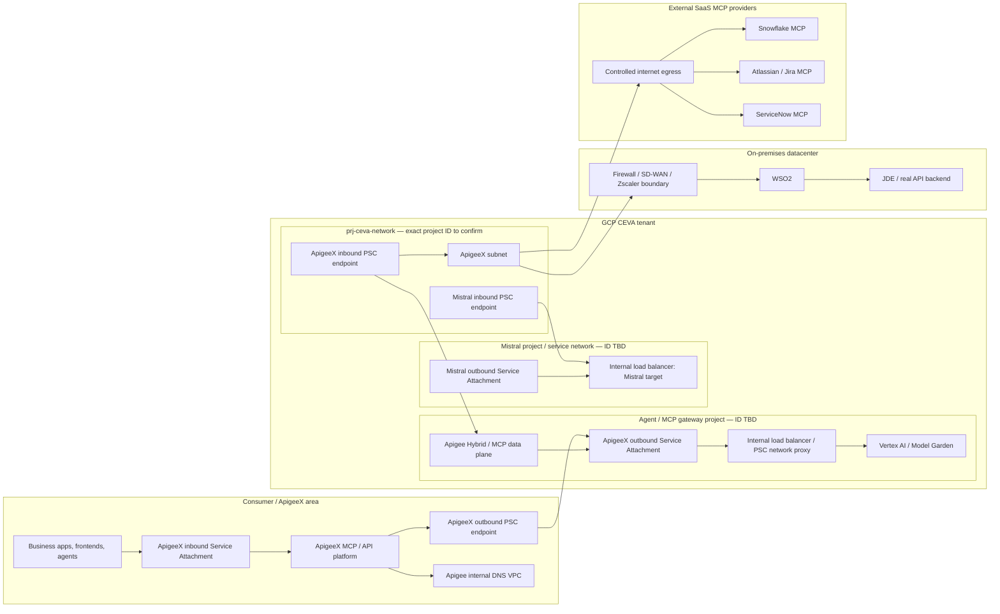

# Physical Architecture Document (PAD)
## Enterprise Agent Gateway, MCP Gateway and Automated Agent Exposure

| Document control | Value |
|---|---|
| Document ID | D2AI-CEVA-AGW-PAD-001 |
| Version | 0.1 — Draft based on supplied network architecture image |
| Date | 17 November 2026 |
| Status | Provisional; IPs, project IDs, endpoint ownership and exact routes are not yet validated |
| Related documents | `01-SoW-MCP-Agent-Gateway.md`, `02-LAD-MCP-Agent-Gateway.md` |
| Target context | GCP CEVA tenant, ApigeeX connectivity area, Mistral endpoints, on-premises datacenter and external SaaS MCP services |

> **Important reading note.** The supplied network diagram is low-resolution and several project names, addresses and connection directions are not fully legible. This PAD preserves the visible architecture concepts but marks ambiguous physical details as `TBD`. It must not be used as a firewall implementation specification until the network team validates the endpoint inventory and connectivity matrix.

## 1. Purpose and physical scope

This document translates the logical architecture into a provisional deployment and network design. It covers:

- ApigeeX / Apigee managed area and its inbound/outbound Private Service Connect (PSC) connectivity.
- The GCP CEVA tenant network and the Apigee Hybrid / gateway network components shown in the source diagram.
- Mistral inbound and outbound private service connectivity.
- Vertex AI / Model Garden access through a controlled internal load-balancer path.
- Private connectivity to on-premises API backends, including the WSO2-mediated JDE path.
- Controlled outbound access to public/SaaS MCP endpoints such as Snowflake and Atlassian/Jira, and other approved providers such as ServiceNow.
- DNS, firewall, SD-WAN, Zscaler, TLS, logging and operational dependencies.

The PAD is a design baseline, not a declaration that all depicted resources already exist or are configured as drawn.

## 2. Physical architecture overview

**Interpretation caveat:** this is a logicalised rendering of the supplied physical drawing. It is not a precise reconstruction of every arrow. The detailed PSC producer/consumer roles and exact path for each flow must be confirmed from the actual GCP network configuration and the owners of the service attachments.

## 3. Physical zones and deployment domains

| Zone / domain | Visible or inferred components | Physical responsibility | Validation needed |
|---|---|---|---|
| ApigeeX area | ApigeeX inbound Service Attachment, ApigeeX MCP Platform, outbound PSC endpoint, internal DNS VPC | Managed ApigeeX/API platform side and its private consumer/provider connection points | Confirm whether this area is Apigee X managed runtime, Apigee Hybrid connectivity integration, or a named internal landing zone; confirm ownership and exact resource IDs |
| GCP CEVA tenant network | `prj-ceva-network`, ApigeeX inbound PSC endpoint, ApigeeX subnet, Mistral inbound PSC endpoint | Consumer-side VPC/subnet and private access to gateway/runtime services | Confirm project ID, VPC, subnet CIDRs, region, route tables, PSC endpoint names and IPs |
| Gateway/MCP project | Project label appears as `prj-dl-mcp-gateway-cenv` (low-confidence transcription), ApigeeX outbound Service Attachment, load balancer/PSC network proxy, Vertex AI path | Central gateway/egress integration services and model routing | Confirm exact project name, services deployed, whether Apigee Hybrid is here or in a separate cluster project, and the load-balancer backend |
| Mistral service domain | Mistral Outbound Service Attachment, Mistral Inbound PSC Endpoint, Mistral inbound/outbound service endpoints | Private access to the Mistral runtime/service | Confirm service producer and consumer roles, project ownership, attachment names, approved ports and runtime directionality |
| On-prem datacenter | Real API backend, WSO2, firewalls, SD-WAN, Zscaler | Private enterprise API and source-system access | Confirm datacenter routing, WSO2 API names, source address ranges, TLS termination and egress/ingress rules |
| External SaaS zone | Public MCP endpoints; Snowflake and Atlassian logos; ServiceNow/Jira in the brief | Controlled egress to third-party MCP endpoints | Confirm providers in the first release, SaaS tenant URLs, authentication method, egress proxy and data residency requirements |
| Peering / DNS zone | Cloud DNS peering zone, internal VPC DNS, private zone DNS | Name resolution across participating networks | Confirm DNS zone names, forwarding/peering direction, split-horizon rules and record owners |

## 4. Physical components and inventory

The following inventory captures the components visible in the supplied diagram. Resource names marked **TBD** must be confirmed before implementation.

| Ref | Component | Proposed location / placement | Role | Status |
|---|---|---|---|---|
| PHY-01 | ApigeeX inbound Service Attachment | ApigeeX area | Provides private producer-side connection for inbound access | Shown in diagram; exact identifier TBD |
| PHY-02 | ApigeeX inbound PSC endpoint | `prj-ceva-network` | Private consumer endpoint into the ApigeeX ingress path | Shown in diagram; IP/CIDR TBD |
| PHY-03 | ApigeeX MCP/API platform | ApigeeX area | API/MCP ingress and policy enforcement | Shown in diagram; product/runtime topology to confirm |
| PHY-04 | ApigeeX outbound PSC endpoint | ApigeeX area | Private outbound connection to a service attachment | Shown in diagram; exact identifier TBD |
| PHY-05 | ApigeeX outbound Service Attachment | Gateway/MCP project (label TBD) | PSC producer attachment for outbound service connectivity | Shown in diagram; exact project/region TBD |
| PHY-06 | Shared subnet | GCP tenant / shared network | Subnet participating in PSC/LB architecture | Shown in diagram; CIDR and purpose TBD |
| PHY-07 | Mistral outbound Service Attachment | Mistral service domain | Private service producer path for Mistral traffic | Shown in diagram; confirm semantics and producer/consumer role |
| PHY-08 | Mistral inbound PSC endpoint | `prj-ceva-network` or associated network | Private client endpoint to Mistral inbound service | Shown in diagram; IP/CIDR TBD |
| PHY-09 | Mistral target load balancer | Project label unclear | Resolves/forwards the Mistral service endpoint | Shown in diagram; backend and health-check details TBD |
| PHY-10 | Internal load balancer / PSC network proxy | Gateway/MCP project | Forwards approved traffic to model backend(s) | Shown in diagram; backend service TBD |
| PHY-11 | Vertex AI / Model Garden | Google Cloud managed service | One of the two identified LLM backend families | In scope; model/region/API details TBD |
| PHY-12 | Mistral runtime endpoint | Mistral network/service | Second identified model/agent backend family | In scope; endpoint and contract TBD |
| PHY-13 | Internal DNS VPC | ApigeeX area | Internal DNS resolution for gateway endpoints | Shown in diagram; zone names TBD |
| PHY-14 | Cloud DNS peering zone | Peering zone | DNS resolution across connected VPCs | Shown in diagram; peer configuration TBD |
| PHY-15 | Private zone DNS | GCP tenant VPC | Resolves private service FQDNs | Shown in diagram; record ownership TBD |
| PHY-16 | On-prem WSO2 | On-prem datacenter | Existing API mediation for the JDE API path | Mentioned/shown; exact product/version and endpoint TBD |
| PHY-17 | JDE / real API backend | On-prem datacenter | Enterprise source API/backend | Shown in diagram; API contract TBD |
| PHY-18 | Snowflake MCP endpoint | External SaaS | External tool/resource endpoint | Scope note in diagram; exact service and auth flow TBD |
| PHY-19 | Atlassian/Jira MCP endpoint | External SaaS | External tool/resource endpoint | Shown in diagram; exact service and auth flow TBD |
| PHY-20 | ServiceNow MCP endpoint | External SaaS | Candidate external tool/resource endpoint | Mentioned in brief; confirm first-wave scope |
| PHY-21 | Firewall / SD-WAN / Zscaler | Network security boundary | Controls routes, egress and inspection | Shown in diagram; policy owners TBD |

## 5. Network connectivity and traffic flows

### 5.1 Connectivity matrix

| Flow ID | Source | Destination | Connectivity pattern | Purpose | Required decision / validation |
|---|---|---|---|---|---|
| NET-01 | Business apps / frontends / agents | ApigeeX inbound endpoint | Private Service Connect as depicted; TLS | Invoke governed agent/API/MCP endpoints | Confirm source VPCs, PSC endpoint, DNS and consumer authentication |
| NET-02 | ApigeeX / gateway runtime | Mistral service endpoint | PSC via service attachment and endpoint | Invoke Mistral agent/model runtime | Confirm direction, service attachment ownership, FQDN, TLS and backend port |
| NET-03 | Gateway runtime | Vertex AI / Model Garden | Internal LB / PSC proxy path as depicted, then Google API service | Invoke Vertex AI model endpoint | Confirm whether PSC for Google APIs, Private Google Access, service networking or another approved route is intended |
| NET-04 | Gateway runtime | WSO2 / JDE API | Private WAN / SD-WAN / firewall route | Invoke JDE operations via WSO2 | Confirm route advertisement, source IPs, TLS trust, WSO2 API contract and firewall rules |
| NET-05 | Gateway/MCP proxy | Snowflake MCP endpoint | Controlled egress via firewall/Zscaler | Use approved Snowflake tools | Confirm service URL, auth flow, egress allowlist and data boundary |
| NET-06 | Gateway/MCP proxy | Atlassian/Jira MCP endpoint | Controlled egress via firewall/Zscaler | Use approved Atlassian tools | Confirm exact SaaS endpoint and auth flow |
| NET-07 | Gateway/MCP proxy | ServiceNow MCP endpoint | Controlled egress via firewall/Zscaler | Use approved ServiceNow tools | Confirm first-wave scope and auth flow |
| NET-08 | ApigeeX / gateway networks | Internal DNS / Cloud DNS peering | Private DNS forwarding/peering | Resolve private gateway and backend FQDNs | Confirm authoritative zones and DNS forwarding direction |
| NET-09 | R1/Camunda/Backstage | Registry and Apigee management APIs | Private management plane/API route | Register agent and configure exposure | Confirm management endpoint reachability and workload IAM |
| NET-10 | Gateway and runtimes | Observability platform | Approved telemetry path | Export logs, metrics and traces | Confirm collector endpoints, protocols and data-retention policy |

### 5.2 Transport and port policy

- Use TLS for all gateway, runtime, registry, management and SaaS API paths.
- TCP 443 is the default expected HTTPS transport, but each backend's documented listener and the actual network configuration must be verified. No firewall rule should be created from this assumption alone.
- Do not expose the Apigee Hybrid MCP data-plane service directly to general VPC workloads. For Hybrid MCP, restrict the in-cluster MCP service to the intended Apigee Message Processor pods, using Kubernetes NetworkPolicy, Cilium, Calico, Istio AuthorizationPolicy or an equivalent control.
- Use explicit FQDN/IP/port allowlists. Avoid broad wildcard egress rules.
- Prefer private service connectivity for Mistral and internal service endpoints. Public SaaS MCP traffic must traverse the approved egress control path.

### 5.3 PSC design checklist

For every PSC relationship, record:

1. Service producer project, VPC, region and service attachment ID.
2. Service consumer project, VPC, region and endpoint ID.
3. Endpoint IP address and subnet CIDR.
4. Accepted/rejected connection state and connection preference.
5. DNS record and private zone ownership.
6. Firewall and route requirements on both sides.
7. Health-check path, failover behaviour and maintenance ownership.
8. Whether the connection is ingress-to-gateway, gateway-to-runtime or gateway-to-model backend.

A PSC endpoint and a service attachment are not interchangeable. The network design must identify which side is the service producer and which side is the consumer for each flow.

## 6. DNS design

The supplied diagram shows an Apigee internal DNS VPC, a Cloud DNS peering zone and a private zone DNS in the GCP tenant network. It also shows candidate gateway FQDNs:

- `apim-gw-ai-dev.logistics.corp` (visible in the image; confirm exact spelling and ownership).
- `apim-gw-ai.logistics.corp` (visible in the image; confirm exact spelling and production mapping).
- `api-backend.logistics.corp` (visible with a question mark in the image; confirm whether this is the Mistral/backend load-balancer hostname or another service).

The final DNS plan must specify:

| DNS item | Required detail |
|---|---|
| Zone ownership | Authoritative team, project and change process |
| Split-horizon | Internal and external answers where required |
| VPC peering | Which VPC imports/exports which private zone |
| Forwarding | Inbound/outbound forwarding policies and resolver addresses |
| Records | FQDN, record type, target IP/PSC endpoint and TTL |
| Certificate alignment | SANs must cover the exact published FQDNs |
| Environment separation | Dev/test/prod names must not resolve to the wrong environment |

No IP addresses, CIDRs, DNS targets or TTLs are prescribed in this draft because they are not legible or present in the source artefacts.

## 7. Apigee Hybrid deployment and version baseline

### 7.1 Version decision

The supplied key-information screenshot says AI Gateway features require Apigee 1.16.x and the environment is on 1.15.x. That statement needs to be treated as a dated feature-specific note, not as the current native MCP baseline.

As checked on **17 November 2026**, Google's public documentation lists Apigee Hybrid **1.17.3** (released 29 October 2026) and states that native MCP support in Apigee Hybrid begins with **1.17.0**. The Hybrid MCP implementation has the following relevant constraints:

- Use a supported stateful MCP protocol version: `2025-11-25`, `2025-06-18`, `2025-03-26` or `2024-11-05`.
- The stateless MCP protocol version `2026-07-28` is documented for Apigee but not for Apigee Hybrid.
- In Hybrid 1.17.0 documentation, the MCP data plane relies on the Message Processor for caller identity. Requests requiring authentication must pass through an Apigee proxy with an authentication policy.
- Restrict access to the in-cluster MCP service so only the intended Message Processor pods can reach it.
- MCP data-plane capacity and pod resources must be sized from actual OpenAPI specifications, number of tools, response size and traffic profile.

The target version should be the latest client-approved, supported patch at implementation time, not hard-coded permanently to 1.17.3. Validate the current release, supported Kubernetes version, Helm, cert-manager, Cassandra and upgrade path with Google before change approval.

### 7.2 Upgrade and availability considerations

Google's Hybrid 1.17 upgrade guide states that the upgrade may require downtime and recommends at least two clusters with production traffic diverted away from the cluster being upgraded to minimise impact. Therefore:

- Do not promise zero-downtime upgrade in the design.
- Confirm the client's actual cluster count and whether independent clusters serve the same environment group.
- Test upgrade and rollback procedures in non-production.
- Establish an approved maintenance window and traffic-diversion procedure.
- Verify data-store backup/restore constraints during a mixed-version period.

This risk is directly relevant if the existing installation is on 1.15.x and must be upgraded through supported intermediate versions.

## 8. Kubernetes and runtime network controls

Where Apigee Hybrid hosts an MCP data plane:

- Deploy the required Hybrid components in the approved Kubernetes cluster and namespace.
- Enable MCP only after prerequisites and version compatibility are verified.
- Restrict MCP service ingress on TCP 443 to the expected Apigee Message Processor pods in the same namespace.
- Keep management plane access and runtime data-plane access logically separated.
- Apply Kubernetes security controls, resource requests/limits, pod disruption and rollout settings according to the supported Hybrid configuration.
- Ensure MCP is enabled consistently across all clusters serving the same Apigee environment group; mixed enablement can cause requests to return 503 on clusters without MCP enabled.
- Define backup, restore, upgrade and rollback responsibilities for Cassandra/other stateful components.

The precise cluster name, Kubernetes distribution, node pools, namespace, network policies and resource settings are **TBD**.

## 9. Physical security and trust boundaries

| Trust boundary | Required controls |
|---|---|
| Consumer to ApigeeX | TLS, client authentication, token validation, audience/scope checks, WAF/threat controls where licensed and available |
| ApigeeX / PSC to GCP tenant | PSC connection acceptance, endpoint allowlist, DNS integrity, VPC firewall and route restrictions |
| Gateway to Mistral | Private connectivity, TLS identity validation, backend authentication, no direct consumer access to runtime |
| Gateway to Vertex AI | Approved private/service access path, workload identity and IAM least privilege |
| Gateway to on-prem WSO2/JDE | Firewall and SD-WAN rules, mTLS or approved TLS, source allowlist, API credentials/identity and audit |
| Gateway to SaaS MCP | Explicit egress allowlist, Zscaler/firewall inspection, OAuth/service credentials, tenant restrictions and rate limits |
| Gateway to MCP data plane | In-cluster network policy; only intended Message Processor pods may call MCP service |
| Provisioning to registry/gateway control plane | Workload identity, restricted administrative permissions, signed/audited deployment changes |
| Admin to control planes | MFA/SSO, privileged access management, role separation and change audit |

## 10. Availability, resilience and disaster recovery

The final topology depends on business service objectives, traffic and platform constraints. The following is the recommended design checklist, not a claim that the current diagram already implements it:

- At least two independently operated runtime clusters should be evaluated for production if the business requires upgrade traffic diversion and reduced maintenance impact.
- If multiple clusters serve one Apigee environment group, all must have consistent MCP enablement and compatible policy/configuration.
- Configure health checks for the gateway, registry, runtime endpoints, model endpoints and integration paths.
- Define behaviour for unavailable registry: existing already-published proxies may continue to serve traffic only if cached policy data and security controls remain valid; new registrations/publications should fail closed.
- Define whether a Mistral backend failure triggers retry, circuit-breaker, a controlled fallback or a hard failure. Do not silently switch providers where model behaviour, data residency or pricing differs.
- Define model fallback rules between Mistral and Vertex AI only after approval of semantic, security, cost and regional constraints.
- Back up registry metadata, gateway configuration and stateful Hybrid components according to approved RPO/RTO.
- Document rollback for proxy publication, policy deployment, registry schema changes and Hybrid upgrade.

RTO, RPO, availability target, geographic failover and data-retention periods remain **TBD**.

## 11. Physical observability and operations

### 11.1 Telemetry path

The gateway, provisioning orchestration, registry, agent runtimes and integration backends should export correlated telemetry to the approved central observability platform. The exact platform and collector path are not specified in the source diagram and must be confirmed.

### 11.2 Minimum operational dashboards

- Gateway request volume, latency, errors, 4xx/5xx, throttling and backend response codes.
- Agent endpoint health, readiness, version, lifecycle state and provisioning-to-publication duration.
- MCP tools/list and tools/call volume, tool-level latency, denied calls and quota events.
- Mistral and Vertex AI backend availability, latency, error rate and usage/token metrics where exposed.
- PSC endpoint and service attachment health/connection status where observable.
- WSO2/JDE dependency health and SaaS MCP dependency health.
- Registry/gateway drift, failed reconciliation and stale endpoint counts.
- Upgrade and deployment status, policy deployment failures and certificate expiry.

Do not collect access tokens, API keys, passwords or unredacted sensitive request/response payloads in telemetry.

## 12. Environment strategy

| Environment | Purpose | Physical isolation | Data / access rules |
|---|---|---|---|
| DEV | Initial engineering and integration | Separate Apigee environment and non-production agent endpoints; network separation as available | Test credentials, synthetic or approved test data |
| TEST / INT | End-to-end integration and regression | Separate gateway products/policies and backend test endpoints | Representative test data; controlled SaaS sandbox tenants where available |
| PREPROD | Production-like verification and release rehearsal | Production-like connectivity and policy configuration | No uncontrolled production data; release approval gate |
| PROD | Business service | Approved production cluster/network, private DNS and controlled egress | Production IAM, secrets, audit retention, support and change windows |

Environment-specific differences must be configuration overlays, not divergent manually maintained proxy bundles.

## 13. Deployment and configuration management

- Store proxy bundles, shared flows, policy configurations, registry schemas, workflow definitions, network manifests and environment overlays in version control.
- Use a controlled CI/CD pipeline with static validation, policy tests, secret scanning and promotion approvals.
- Do not store secret values in source control, registry records, container images or pipeline artefacts.
- Deploy proxies and policy changes through least-privilege service identities and auditable release jobs.
- Use infrastructure-as-code for supported cloud/network resources where client standards permit.
- Require pre-deployment validation of endpoint reachability, DNS resolution, TLS certificates, identity provider metadata and backend readiness.
- Reconcile actual gateway resources against registry metadata on a schedule and alert on drift.

## 14. Physical implementation test plan

| Test ID | Test | Expected result |
|---|---|---|
| PT-01 | Resolve dev and production gateway FQDN from authorised networks | Each resolves to the intended private endpoint; no cross-environment mapping |
| PT-02 | Verify PSC endpoint/service attachment state | Connection accepted and service reachable only from approved consumer VPC/subnet |
| PT-03 | Validate TLS certificate chain and SAN | Correct trusted certificate for each gateway/backend FQDN |
| PT-04 | Attempt direct access to Hybrid MCP service from an unauthorised pod | Connection denied by cluster network policy |
| PT-05 | Apigee proxy to Mistral endpoint | Successful private route; no public path required |
| PT-06 | Apigee route to Vertex AI endpoint | Successful approved model invocation with expected IAM identity |
| PT-07 | Gateway to WSO2/JDE endpoint | Approved API call succeeds; unauthorised source is blocked |
| PT-08 | Gateway egress to approved SaaS MCP endpoint | Allowed endpoint succeeds through approved egress path |
| PT-09 | Gateway egress to non-allowlisted endpoint | Connection denied and logged |
| PT-10 | DNS failure / stale record test | Failure is detected and raised; no uncontrolled fallback to public DNS |
| PT-11 | Backend failure / timeout | Gateway applies documented timeout, retry and circuit-breaker behaviour |
| PT-12 | Hybrid cluster maintenance/upgrade rehearsal | Traffic diversion, upgrade, validation and rollback steps follow approved runbook |
| PT-13 | Reconciliation after failed publication | Orphan proxy/registry state is detected and corrected or surfaced for action |
| PT-14 | Egress and log redaction review | No credential leakage; only approved telemetry fields are recorded |

## 15. Items to confirm before a production-ready PAD

| ID | Required information | Owner |
|---|---|---|
| PAD-Q01 | Exact GCP project IDs, project owners and folder hierarchy | Cloud platform team |
| PAD-Q02 | VPC names, subnet names, CIDRs, regions and route tables | Network team |
| PAD-Q03 | PSC producer/consumer mapping, service attachment IDs, endpoint IDs and IPs | Cloud network / service owners |
| PAD-Q04 | Apigee Hybrid cluster name, Kubernetes distribution/version, node pools, namespace and region | Apigee platform team |
| PAD-Q05 | Whether ApigeeX and Apigee Hybrid are both deployed, and the precise role of each | Apigee architect / Google |
| PAD-Q06 | Exact Apigee runtime version, add-ons and contractual feature entitlements | Apigee owner / procurement / Google |
| PAD-Q07 | Mistral inbound/outbound service names, FQDNs, ports, TLS and authentication | Mistral platform team |
| PAD-Q08 | Vertex AI endpoint region, API, model IDs, IAM and private access pattern | AI platform team |
| PAD-Q09 | WSO2 endpoint, JDE API list, source ranges and data classification | Integration team |
| PAD-Q10 | First-wave SaaS MCP providers, endpoint URLs, tenant IDs, OAuth scopes and egress controls | Product/security owners |
| PAD-Q11 | Internal DNS zone names, peering/forwarding direction, record ownership and TTLs | DNS team |
| PAD-Q12 | Firewall, SD-WAN, Zscaler policies and approved change windows | Network/security operations |
| PAD-Q13 | Central log/metric/trace platform, collector endpoint and retention | Operations team |
| PAD-Q14 | Production availability, RTO/RPO and cluster failover requirements | Service owner |
| PAD-Q15 | Load profile: active agents, tool count, concurrent calls, request sizes, model token usage and peaks | Product/platform owners |

## 16. Physical design decisions

| Decision | Proposed position | Approval status |
|---|---|---|
| Private connectivity to internal runtimes | PSC where supported and shown in the supplied diagram | Validate exact producer/consumer mapping |
| SaaS MCP access | Controlled outbound egress through firewall/Zscaler; explicit provider allowlist | Proposed; endpoint list open |
| JDE integration | Keep WSO2 in the path; expose approved API operations via MCP/API gateway pattern | Proposed; API contract open |
| Hybrid MCP version | Use supported Hybrid release at implementation; native Hybrid MCP requires 1.17.0+ | Validate with current Google support and client environment |
| MCP protocol | Stateful MCP protocol supported by Hybrid; protocol version chosen after client/server compatibility test | Open |
| Hybrid MCP service ingress | Restrict service access to intended Message Processor pods | Mandatory security control |
| Production upgrade availability | Plan for possible downtime; multi-cluster traffic diversion if required and feasible | Open pending HA assessment |

## 17. External technical references

- Google Cloud, [MCP in Apigee overview](https://docs.cloud.google.com/apigee/docs/api-platform/apigee-mcp/apigee-mcp-overview) — Hybrid MCP baseline, protocol versions, in-cluster data plane and limitations.
- Google Cloud, [Enable MCP in Apigee Hybrid](https://docs.cloud.google.com/apigee/docs/api-platform/apigee-mcp/enable-mcp) — enablement and MCP service ingress restrictions.
- Google Cloud, [Manage MCP tool access with API products](https://docs.cloud.google.com/apigee/docs/api-platform/apigee-mcp/manage-mcp-tool-access) — policy, tool filtering and per-tool quota pattern.
- Google Cloud, [Apigee Hybrid supported platforms and versions](https://docs.cloud.google.com/apigee/docs/hybrid/supported-platforms) — current support matrix and release status.
- Google Cloud, [Upgrade Apigee Hybrid to 1.17](https://docs.cloud.google.com/apigee/docs/hybrid/v1.17/upgrade) — current upgrade path and downtime considerations.
- MCP project, [Authorization specification](https://modelcontextprotocol.io/specification/2025-11-25/basic/authorization).
- A2A project, [A2A and MCP](https://a2a-protocol.org/latest/topics/a2a-and-mcp/).

---

**End of document — D2AI-CEVA-AGW-PAD-001**
