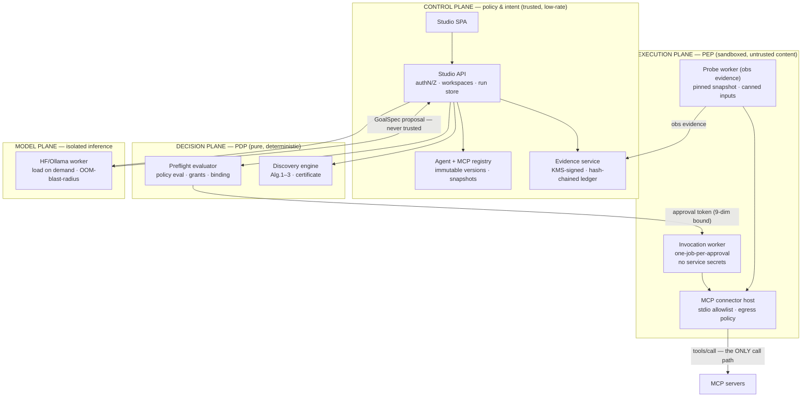

# TaaS Studio — Expert Architecture Review

**Reviewed:** `main @ 06ee062` plus the in-flight stack at `origin/feature/objective-clause-provenance-graph`
(read via `git show`; not executed). Reviewer frame: agentic-AI system design and tool governance.
**Date:** 2026-11-05. Companion document: `docs/studio/MEGAPLAN.md`.

---

## 1. Verdict

TaaS Studio is an unusually disciplined control-plane prototype. Its distinguishing property is not
the feature set — it is that **every layer is fail-closed and textually honest about what it does
not know or cannot prove**. Structural validation never claims semantic correctness; certificates
never claim runtime evidence; inspection never claims execution; attestation never claims truth.
For an agentic tool-governance surface, that honesty *is* the security control — most real
tool-execution incidents in this space come from surfaces that over-claim.

Architectural maturity: **late prototype / pre-product**. The `main` baseline is a clean
single-process discovery appliance. The stacked chain sketches — but does not yet land — the correct
governance shape: intent → decomposition → discovery → certification → authorization → (future)
execution, with hash-bound identities and immutable stores at every transition. The chain's weak
points are exactly where a governance system must be strongest: **key custody, execution
confinement, human-approval plumbing, and evidence integration** — four of which the code itself
already admits by hardcoding `False` checks in `authorization_preflight.py`.

The single largest architectural risk is not in any module; it is **process topology**: model
weights, MCP child processes, SQLite stores, discovery CPU load and the HTTP boundary all share one
process and one OS identity. Acceptable for the demo profile; unacceptable as the governance
runtime. The target state needs a three-plane separation (§6).

---

## 2. Design-principles scorecard

| Principle | Grade | Evidence | Gaps |
|---|---|---|---|
| Fail-closed defaults | **A** | Uncalibrated `ModelProfile` assigns ρ=0; missing token ⇒ 503; preflight returns `deny` with named reasons; ApprovalStore requires policy non-None | — |
| Honest capability surface | **A** | `execution_performed=false`, `weights_downloaded=false`, `t4_assessment: not_verified`, `semantic_correctness_verified=false` carried in-band on every response | — |
| Evidence-graded trust | **A−** | Ladder `lex(0.25) < ann(0.50) < obs(0.55+0.20κ) < att(0.60–1.00)`; per-property `lex_by_property` caps (deletes/pays/execs ≈ 0.45–0.50) so lexical evidence can *never* clear a `lmin=obs` policy on dangerous actions | Benchmark data carries mostly lex/ann evidence — obs/att sources don't exist yet (§5) |
| Hash-bound identity (anti-TOCTOU) | **A−** | Approval token binds actor+server+tool+`arguments_sha256`+`goal_spec_sha256`+`policy_fingerprint`+`tool_definition_hash`+`evidence_hash`; snapshot→agent binding is write-once (SQL trigger) | `RawTool.definition_hash` truncates SHA-256 to 128 bits; acceptable, cheap to raise to full 256 |
| Immutability / append-only | **B+** | SQLite WAL + `BEFORE UPDATE/DELETE → RAISE(ABORT)` triggers on `mcp_registry_snapshots`, `agent_versions` content fields, `assurance_evidence`; snapshot binding set-once | DB-level immutability ≠ tamper-evidence: a host-local writer can still rewrite the file. No hash-chain/anchoring across records (§4 T4) |
| Least-privilege execution boundary | **B (design) / n/a (impl)** | `mcp_registry.py` allowlists commands from operator env only; `tools/list` inspection, never `tools/call`; env-vars forwarded by *name* not value | No sandboxed PEP exists; inspection runs in the API's OS identity (§4 T3) |
| Human-in-the-loop | **B+** | `human_review_confirmed` required on `objectives/discover`; benchmark review checkbox invalidates on any GoalSpec edit; one-time `Approval` tokens are consumption-bound | Approval *issuance* path isn't wired to a UI confirmation step — `human_approval_workflow_available=False` by design |
| PDP/PEP separation | **B−** | Studio is a clean PDP-preview; `execution_gateway`/`authorization_preflight` are pure decision functions | The PEP (enforcement at the MCP call boundary) does not exist — correct for a discovery-only product, but it is *the* missing plane, not a feature |
| Zero-trust input handling | **A−** | `extra="forbid"` DTOs, bounded strings/limits everywhere, repo-id regexes, env-derived policy (never client-supplied) in preflight | No rate limiting / global concurrency cap; discovery is CPU-bound single-process (§4 T10) |
| Supply-chain hygiene | **B+** | `trust_remote_code=False`, `use_safetensors=True`, safetensors-only load; artifacts endpoint reports sha256 | `model_id` accepts any `owner/name` at latest revision — no `@sha` pinning, artifact hashes are *reported* but not *enforced* on load (§4 T6) |

---

## 3. Component deep-review

### 3.1 API boundary (`api.py`, `main`: 504 lines → stack: ~1,690)

**Strengths.** Single auth dependency (`require_api_token`) with `hmac.compare_digest`; strict
`ConfigDict(extra="forbid")` DTOs; `validate_studio_goal_spec` is a *pure* precondition shared by
`/goals/validate` and `/discover`; bench endpoints enforce gold-label omission at the serializer
(whitelisted fields only). No CORS middleware — same-origin model is implicit and correct for the
loopback profile.

**Weaknesses.** One function does validation, persistence, external calls and engine orchestration;
the stack already proves a router split (`assurance_routes.py`) that the file itself hasn't adopted.
`/ready` leaks configuration detail (acceptable at loopback, noisy behind a tunnel). The
`/api/v1/discover` → `/api/v1/objectives/discover` rename on the stack is the right direction
(purpose-named route, `human_review_confirmed` gate) but leaves a schema-hidden legacy alias —
deprecate it in Phase 1 rather than letting two discovery contracts coexist.

### 3.2 Evidence ladder realization (`provenance.py`, `contracts.py`, `data/registries.py`)

The four-level ladder with per-property lexical caps is the architecture's most novel governance
mechanism — a lexical signal can describe but never *elevate* a tool's trust on dangerous
properties. `definition_hash` binds evidence to (tool, hash) pairs so a changed definition loses its
evidence (rug-pull defense, Prop. 3). **Current hash is 128-bit truncated SHA-256** (`hexdigest()[:32]`)
— adequate for collision resistance at 10⁵ tools but trivially extendable to 256 bits; do it in Phase 1.

### 3.3 Governance runway (stack tip)

- **`execution_gateway.py` — good primitive.** One-time tokens: `secrets.token_urlsafe(32)` stored
  only as HMAC digests, TTL 1–600 s, `consume()` is pop-then-verify across **nine** bound dimensions
  with constant-time compares. Correctly documented as process-local/prototype. Missing: no
  out-of-process persistence (restart = mass revocation — actually a *feature* for fail-closedness),
  no rate cap on issuance, and no UI-facing approval *prompt* contract (token minting needs a human
  confirmation ceremony with rendered diffs of what is being approved).
- **`authorization_preflight.py` — honest scaffold.** Returns a deterministic `deny` preview with a
  binding record (`agent_id`, `manifest_sha256`, `snapshot_id`, `tool_definition_sha256`,
  `arguments_sha256`, `goal_spec_sha256`, `principal`, `policy_sha256`). Four checks are hardcoded
  `False` — `tool_arguments_schema_validated`, `human_approval_workflow_available`,
  `trusted_effect_assessment_available`, `assurance_evidence_available` — which is exactly the right
  way to ship a runway: **named, visible debt** instead of silent pass-through. Each is a Phase-6
  work item in MEGAPLAN M6.
- **`assurance_evidence.py` — solid single-issuer record.** HMAC-SHA256 attestation over a canonical
  record with typed subjects, bounded validity (≤30 days), immutability triggers, `0o600/0o700`
  permissions, key from `TAAS_EVIDENCE_ATTESTATION_KEY` (≥32 UTF-8 bytes). Limits honestly stated:
  HMAC proves *issuance/integrity*, not the claim's truth; no key rotation, no external anchoring,
  no ledger chaining, no third-party verifiability (symmetric key can't produce public proofs).
- **`agent_registry.py` — cleanest module in the stack.** Write-once snapshot binding via trigger,
  immutable manifest fields, append-only `agent_events` with FK to versions, lifecycle
  draft→validated→published. This is the pattern to copy for the future run/evidence stores.
- **`mcp_registry.py` — right boundary, wrong confinement.** Operator-env-only server config (≤50
  entries, strict normalization, env forwarded by name) and `tools/list`-only inspection are exactly
  correct. But `stdio_client` spawns the child **inside the API process's OS identity and network
  namespace** — a malicious or compromised configured server runs unsandboxed next to the token
  env var and the evidence SQLite. Needs a probe worker with seccomp/container confinement before
  this surface grows (§6).
- **`model_runtime.py` — honest but topologically fragile.** `trust_remote_code=False`,
  `use_safetensors=True`, fp32/bf16/fp16 selection, RLock-serialized single model, replace-only-after-
  success swap, strict GoalSpec envelope parsing (`parse_goal_spec_response` rejects any extra
  top-level field), deterministic `diagnose_goal_spec` lexical checks (missing aggregation,
  count-output-not-numeric, currency-policy-unspecified, scope-completeness-unproven). The problem
  is placement: a multi-GB `from_pretrained` + `generate` runs **in the API process's address space**
  — one OOM or CUDA wedge kills the control plane, and a long generate blocks the GIL-bound event
  loop. Move to a worker (§6).
- **`objective_contract*.py` — the correct shape for NL→contract.** Deterministic lexical frame with
  exact Unicode spans, Θ-aware vocabulary, conservative singularization, explicit "not an NLP proof
  system". The model *proposes*, deterministic code *validates*, the human *confirms* — the three-
  role separation every agentic authoring flow should have.

### 3.4 Frontend (`index.html`, 830 → ~2,300 lines)

Architecturally notable for one reason: it encodes trust policy as *interaction invariants* —
task switch invalidates GoalSpec+selections, JSON edits require explicit reload, benchmark runs are
blocked until the review checkbox is set *and* the tool basket equals the request set. These are
state-machine constraints, not styling. The risk is they're encoded in one file of DOM glue with no
formal model — Phase 2 should extract a real state machine (even a 30-line explicit one) so the
invariants are testable, not incidental.

---

## 4. Threat analysis (agentic-tooling specific)

| # | Threat | Current posture | Residual risk |
|---|---|---|---|
| T1 | **Evidence forgery at eligibility** (annotation ≠ behavior) | Annotations rank `ann=0.50`, below `obs`; `lex_by_property` caps dangerous props; default studio policy `lmin=obs` admits none on benchmark data | The UI demo ships `lmin=ann` — by design, but users will copy it. Keep the shipped default `obs` and label `ann` profiles visibly "weakest evidence" |
| T2 | **TOCTOU — tool changes between discovery and invocation** | Definition hash keyed evidence; stack binds `tool_definition_sha256` + immutable `snapshot_id` into agent version and approval token | Complete on paper; no PEP exists yet to enforce at call time — must re-resolve the live definition hash in the executor and compare to the approved one |
| T3 | **Process confinement breach** | MCP commands operator-allowlisted; env by name; `tools/list` only | Spawned MCP servers inherit API's OS identity + can read `~/.taas/studio/*.sqlite3` + env token. Needs isolated probe worker with no secret env, restricted FS, no network except stdio |
| T4 | **Evidence/ledger tampering** | Immutability triggers, WAL, `0o600` files, per-record HMAC | File-level rewrite is undetected; records aren't hash-chained and the HMAC key lives in the same env/FS. Add monotonic hash-chaining + periodic external anchoring before claiming audit-grade evidence |
| T5 | **Bearer-token replay/theft** | Loopback default; `hmac.compare_digest`; token in page memory | Single shared token = single blast radius; no per-caller identity, so audit attribution is impossible. Token over a non-Access quick tunnel is plaintext-sniffable — already warned in docs; enforce named tunnel + Access |
| T6 | **Model supply chain** | Safetensors-only, no remote code | `@latest` revision pull; artifact sha256 reported to the user but not *verified at load*. Pin `model_id@revision`, verify `sha256` against the artifacts record before `from_pretrained` |
| T7 | **SSRF / command injection via requests** | Ollama URL is env-only; HF host fixed; MCP commands env-only; all request inputs bounded/regexed | Low. Keep it that way: any future "custom endpoint" field must go through an operator allowlist, never a URL string |
| T8 | **Prompt→GoalSpec semantic drift** | `diagnose_goal_spec` lexical diagnostics + `objective_contract` spans + mandatory `human_review_confirmed` | Residual by design; the correct control is already human review. Do not let v3's span precision be marketed as semantic proof — clause links are provenance, not correctness |
| T9 | **Gold-label leakage** | `/bench/tasks` whitelists fields; tests assert absence | Fragile-by-convention: a future field addition reintroduces gold. Phase 1 must add a serializer-level denylist (response-model or post-filter) rather than field whitelists alone |
| T10 | **Resource exhaustion** | Bounds on every input (500 tools, 2048 tokens, 30 s timeouts, 4 s probe) | No global concurrency/queue limits; one `discover` on 500 tools + one HF `generate` = CPU+RAM exhaustion in one process. Worker isolation + admission control (max in-flight) needed |
| T11 | **Untraceable administrative actions** | `agent_events` append-only log | No request-level audit log; evidence/attestation events aren't journaled into the events table; authz decisions are ephemeral. One `audit_events` stream should cover auth, discovery, snapshot, publish, preflight |

---

## 5. Evidence-model analysis — what `obs`/`att` actually require

The ladder is only as strong as its *sources*. Realization per level:

| Level | Exists today? | What a real source looks like |
|---|---|---|
| `lex` | Yes — description parsing in `contracts.py` | — |
| `ann` | Yes — MCP `annotations` from `tools/list` + benchmark metadata | — |
| `obs` | **No** — nothing executes tools | Sandboxed probe harness invoking reference inputs on a *pinned* snapshot, capturing outputs + timing; this is what `integrations/` and the `probe` extra (`mcp>=1.0`) are for |
| `att` | **No** — service-side HMAC attests Studio-issued records only | Publisher-signed attestations (pipelock-style Ed25519 + SLSA predicate in `_meta`), registry-official `_meta` claims, or reproducible builds — see `GITHUB_RESEARCH.md` §d |

Architectural implication: until an `obs` probe worker exists, **every production policy should pin
`lmin=ann` and treat `obs` as an aspirational filter** — or equivalently, document that `lmin=obs`
yields the empty eligible set on current data. This is already consistent with the engine's
fail-closed behavior; it just needs to be *said* in the policy editor UI (Phase 5).

---

## 6. Target-state reference architecture (three planes)

**Non-negotiable invariants in the target:**
1. `tools/call` exists in exactly one place — the invocation worker — and only after
   `ApprovalStore.consume()` re-verifies the nine binding dimensions *and* the live tool definition
   hash against the approved snapshot.
2. The PEP is process-isolated: no `TAAS_STUDIO_API_TOKEN`, no evidence key, no registry DB access —
   it receives the approval token, the exact invocation, and the policy fingerprint, nothing else.
3. Evidence flows one direction: probe worker → evidence service → preflight evaluator. The
   executor never writes evidence; it *emits* runtime records that a verifier may later promote.
4. The model plane cannot touch the decision plane: its GoalSpec output enters only through the
   same `parse → validate → diagnose → human_review` funnel as any client-supplied spec.

---

## 7. Concrete gaps before "governed execution" can exist

Each is currently a hardcoded `False` or an absent plane — the code names its own debt:

1. `tool_arguments_schema_validated` — wire a JSON Schema validator against the snapshot's
   `input_schema` at preflight *and* again at the PEP.
2. `human_approval_workflow_available` — an issuance ceremony: rendered diff of (server, tool,
   args, effects, policy) → explicit confirm → one-time token with ≤120 s TTL.
3. `trusted_effect_assessment_available` — the pipeline that turns probe/MCP observations into
   graded `obs` evidence records in `assurance_evidence`.
4. `assurance_evidence_available` — evidence store lookup keyed to `tool_definition_sha256` with
   expiry/freshness enforced inside preflight (records already have `expires_at`; consume it).
5. The PEP itself — worker + `consume()` + live-hash re-check + output capture (§6 invariants).

---

## 8. Roadmap deltas (amendments to MEGAPLAN §6)

- **Phase 1** add: full 256-bit `definition_hash`; serializer-level gold-field denylist; deprecate
  hidden `/api/v1/discover` alias; request-ID + audit-event schema introduced *now* (cheap while the
  surface is small).
- **Phase 2** add: extract the UI interaction invariants into an explicit state machine module
  (selection↔request sync, review-checkbox invalidation, JSON-edit gating) with unit tests.
- **Phase 3 M2 (model runtime)** change: ship the HF runtime as a **separate worker process**
  (same `model_runtime.py` contract, HTTP or stdio JSON-RPC transport) — the file is already
  interface-shaped (`status/load/chat/decompose`); do not let weights into the API's address space.
- **Phase 3 M5** add: isolated **probe worker** for MCP inspection — same `tools/list` contract,
  but spawned in a no-secret, no-network (except the child) sandbox so `mcp_registry` stops sharing
  OS identity with the control plane.
- **Phase 3 M6** add: the four §7 items as the milestone's acceptance criteria; KMS/HSM-backed or at
  minimum rotated `TAAS_EVIDENCE_ATTESTATION_KEY` with key-id in attestations; hash-chained audit
  ledger across evidence + agent events.
- **Phase 6 (evaluator)** add: pin `lmin` semantics in the evaluator boundary — evaluation metrics
  must record which evidence level admitted each tool.
- **Phase 8** becomes "Data-plane build-out": PEP worker, admission control, OIDC identity, KMS,
  network egress policy — this is where (and only where) `tools/call` may ever be written.

## 9. Bottom line

The architecture's *ideas* are already at production quality — evidence-graded eligibility,
hash-bound snapshots, deny-by-default preflight, immutable registries, three-role intent authoring.
Its *topology* is at prototype quality — one process, one token, one env var holding the evidence
key, one OS identity touching MCP children and model weights. The roadmap's job is to land the
stack's ideas while rebuilding the topology around them: control, decision, execution, and model
planes isolated such that a compromise in the untrusted-content plane cannot reach the secrets,
the stores, or the approval path that the decision plane guards.
