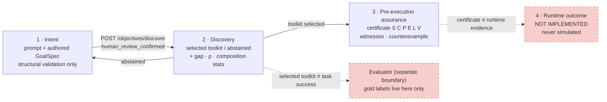

# TaaS Studio — Megaplan: Features, Architecture and Delivery Roadmap

**Baseline:** `main @ 06ee062` (2026-11-05). GitHub state fetched from the GitHub REST API on 2026-11-05
(repo: `msellamiTN/taas-provenance-discovery`, public, created 2026-11-01, Python, 1 star, 0 forks).
**Scope of this document:** deep analysis of TaaS Studio as shipped on `main`, the in-flight stacked
PR chain, the research branches, and a phased plan to converge them into a coherent product.
**Companion:** `ARCHITECTURE_REVIEW.md` — expert design/governance review with the three-plane
target architecture and threat analysis; `taas-studio-architecture.drawio` — editable diagram.

---

## 1. Executive summary

TaaS Studio is the control-plane surface of the TaaS reference implementation
(*Tool-as-a-Service: Provenance-Aware Tool Discovery for LLM Agents in MCP Ecosystems*, Sellami & Mezni).
On `main` it is an **experimental, single-user, discovery-only workspace**: a FastAPI boundary
(`src/taas/studio/api.py`, 504 lines, 13 routes) around the discovery engine, a read-only Hugging Face
metadata adapter (`models.py`), host GPU/CUDA diagnostics (`runtime.py`), and one self-contained
vanilla-JS page (`static/index.html`, 830 lines).

On GitHub, development has run far ahead of `main`: **54 PRs** exist, of which only 14 are merged.
~37 open draft PRs form a single deep dependency stack (~10,400 added lines at the tip) that turns
Studio into a full agent workbench — local/Ollama model runtimes, objective-contract intent
decomposition, an immutable agent registry, live MCP server inspection, a fail-closed execution
authorization path, and an HMAC-attested assurance evidence service. A separate research line
(PaMCP, ~10,600 lines) adds a multi-benchmark experiment workbench. **Nothing in the stack has landed
on `main` since PR #9 (2026-11-03).** The tip branch's CI is currently red.

The strategic question this plan answers: *how to land the in-flight architecture on `main` in
reviewable increments without breaking the discovery-only trust boundary that the codebase
consistently and deliberately enforces.*

---

## 2. GitHub repository state

### 2.1 Branch topology

56 remote branches in five families:

| Family | Branches | Role |
|---|---|---|
| `main` | 1 | Audited baseline; Studio core only |
| `feature/*` | 35 | Studio/agent workbench stack + research features |
| `fix/*` | 4 | Regression and contract fixes |
| `integration/*` | 7 | Rebase branches used to merge the stack |
| `research/*`, `codex/*`, `chore/*` | 5 | PaMCP experiment workbench, orchestration, tracker |

### 2.2 Pull-request chains (all 54 PRs)

**Merged to `main`** (the shipped baseline):
- #5 Studio API foundation + Colab T4 profile · #6 T4 GPU diagnostics · #7 discovery contract/launcher
  fix · #8 retained MCP-Bench workspace · #9 visual GoalSpec editor + structural validation.

**Merged inside the stack** (integration rebases + hardening):
- #29–#34 (integration rebases onto `feature/studio-model-agent-workspaces`), #49 (GoalSpec-conformant
  agent), #50 (universal objective engineering) — merged into `feature/multi-backend-model-runtime`.

**Open stack — Studio/Agent workbench** (draft unless noted; each PR targets its parent):
```
#15 studio-model-agent-foundation ─ HF Model Studio + Agent Studio
#16 studio-ux-agent-reliability ─ UX foundation + GoalSpec reliability
#17 studio-workspace-navigation ─ persistent shell
#18 studio-professional-ux ─ professional UX
#19 studio-model-agent-workspaces ─ task-focused workspaces
#20 taas-model-engineering-workbench ─ model engineering workbench
#21 colab-model-agent-studio (+ #28 rebase, draft) ─ Colab launcher alignment
#24 taas-professional-studio-shell ─ capability-aware nav, truthful execution boundaries
#25 taas-agent-spec-lifecycle ─ declarative agent manifest + validation
#26 taas-agent-registry-lifecycle ─ immutable registry + lifecycle
#27 taas-versioned-mcp-registry-snapshots ─ versioned MCP snapshots + tool-grant binding
#35 governed-authorization-preflight (open) ─ fail-closed agent authorization preview
#36 trusted-assurance-evidence-service (open) ─ assurance evidence foundation
#38 hypergraph-discovery-projection ─ read-only semantic hypergraph
#39 discovery-hypergraph-api ─ discovery results × hypergraph projection
#40 hypergraph-explorer-studio ─ Core-backed Hypergraph Explorer in Studio
#41 hypergraph-explorer-hardening ─ retrieval edge cases
#42 hypergraph-explorer-browser-e2e ─ Colab Playwright E2E
#43 hypergraph-explorer-studio-discovery-action ─ launch Core discovery from Explorer
#44 hypergraph-explorer-discovery-clean ─ discovery actions in existing Studio
#45 discovery-result-refresh-persistence ─ restore results/hypergraph after refresh
#46 studio-navigation-workflow-hardening ─ navigation + E2E workflow
#47 goalspec-semantic-diagnostics ─ analytical intent + semantic diagnostics
#48 multi-backend-model-runtime ─ HF CPU/CUDA + Ollama runtimes
   (merged into it: #49 goalspec-conformant-agent, #50 objective-contract-hardening)
#53 objective-contract-v3-studio-integration ─ typed v3 contract + clarification workflow
#54 objective-clause-provenance-graph ─ source-grounded clause provenance  ← stack tip
```

**Standalone open PRs against `main`:**
- #1 codex experiment orchestration · #2 benchmark capability hypergraph · #3 semantic enrichment
  pipeline · #4 MCP-Bench execution integration (audited in `docs/research/PR4_INTEGRATION_AUDIT.md`)
- #10 semantic output typing · #11 offline retrieval evaluation · #12 integrated Colab runtime
  product · #13 task-context isolation fix · #14 E8 agent GoalSpec evaluation
- #22 engineering execution tracker · #23 stale UI regression fix
- #51 PaMCP experimental workbench (`research/pamcp-experimental-v1 → main`) · #52 PaMCP
  multibenchmark (`research/pamcp-multibenchmark-v1 → research/pamcp-experimental-v1`)

### 2.3 Issues and CI

- **0 open issues** — the repo metadata's `open_issues_count: 41` is GitHub counting open PRs.
- **Workflows:** `Benchmark hypergraph validation` (pytest + hypergraph bundle artifact) and
  `PaMCP Experimental Workbench`. Latest tip-branch run (`feature/objective-clause-provenance-graph`,
  run 42078999714) **fails at the `Run regression suite` step**; the PaMCP workflow is green.
  `main` has no dedicated Studio CI job — the single workflow triggers only on two legacy branch
  names plus PRs to `main`.

### 2.4 Diff magnitude (verified via `git diff --stat`)

| Line | Diff vs `main` | Key additions |
|---|---|---|
| Stack tip `feature/objective-clause-provenance-graph` | 47 files, **+10,368/−179** | 13 new `studio/*.py` modules, `hypergraph_projection.py`, +1,482 lines of UI, ~20 test files |
| `research/pamcp-multibenchmark-v1` | 74 files, **+10,620/−18** | `src/taas/experiments/` (12 modules), Studio experiments routers, E0 Colab notebook, ~18 test files |

---

## 3. Architecture on `main`

### 3.1 Layer model

```mermaid
---
config:
  layout: elk
---
flowchart TB
  subgraph SPA["Browser — TaaS Studio SPA · static/index.html"]
    v_bench["Benchmark workspace<br/>datasets · tasks · tool basket"]
    v_goal["Visual GoalSpec editor<br/>+ local structural checks"]
    v_disc["Discovery result + Assurance<br/>certificate · counterexample"]
    v_res["Resources<br/>HF catalog · artifacts · GPU probe"]
    v_stack["Stack-only views (PR chain)<br/>Objective Eng · Hypergraph Explorer<br/>Agent workspaces · model chat"]:::stack
  end

  subgraph API["FastAPI boundary — taas.studio.api · uvicorn 127.0.0.1:8000"]
    auth["require_api_token<br/>env Bearer · hmac.compare_digest"]
    r_sys["Public<br/>/health · /ready · /"]
    r_goals["/api/v1/goals/validate"]
    r_disc["/api/v1/discover<br/>(stack: /objectives/discover)"]
    r_bench["/api/v1/bench/*<br/>gold labels withheld"]
    r_models["/api/v1/models/*<br/>search · detail · artifacts · estimate"]
    r_rt["/api/v1/runtime/hardware"]
    r_agents["/api/v1/agents/* + /mcp/*<br/>+ authorization/preflight"]:::stack
    r_obj["/api/v1/objectives/*"]:::stack
  end

  subgraph SVC["Studio services — taas.studio.*"]
    s_hf["models.py<br/>HF metadata adapter"]
    s_hw["runtime.py<br/>nvidia-smi · torch probe<br/>VRAM estimator"]
    s_reg["data/registries.py<br/>load_processed (lru_cache)"]
    s_mrt["model_runtime.py +<br/>ollama_runtime.py"]:::stack
    s_obj["objective_contract v2/v3<br/>+ analyst_contract"]:::stack
    s_mcp["mcp_registry.py<br/>stdio tools/list only"]:::stack
    s_diag["discovery_diagnostics.py<br/>hypergraph_projection.py"]:::stack
  end

  subgraph GOV["Governance runway — stack · never invokes tools"]
    g_gw["execution_gateway.py<br/>one-time approval tokens"]
    g_pre["authorization_preflight.py<br/>deny-by-default preview"]
    g_ev["assurance_evidence.py<br/>HMAC-attested records"]
    g_reg["agent_spec.py +<br/>agent_registry.py<br/>immutable versions"]
  end

  subgraph CORE["TaaS discovery core — engine.py · DiscoveryEngine"]
    c_goal["goals.py<br/>Alg.1 gap analysis vs ρ_LLM"]
    c_comp["composer.py · Alg.2<br/>bitmap eligibility → typed retrieval<br/>backward closure → B&B/greedy"]
    c_cert["certificate.py<br/>S C P E L V (+M,B)<br/>counterexample χ1–χ5"]
    c_ref["refinement.py · Alg.3A<br/>manifest.py"]
    c_ev["evidence layer<br/>contracts · provenance lex&lt;ann&lt;obs&lt;att<br/>policy · hypergraph · types Θ"]
  end

  subgraph DATA["Repository-retained data"]
    d_proc[("data/processed<br/>registry · tasks · theta · profiles")]
    d_rec[("data/llm_records<br/>replayed LLM outputs")]
    d_sql[("SQLite (stack)<br/>agents · evidence")]:::store
  end

  subgraph EXT["External systems"]
    x_hf["Hugging Face Hub API<br/>metadata · explicit weight load"]
    x_ol["Ollama server"]:::ext
    x_mcp["MCP stdio servers<br/>operator-configured"]:::ext
    x_gpu["Host GPU · nvidia-smi"]
    x_llm["Anthropic API<br/>llm/backends · optional"]
    x_edge["Colab port proxy /<br/>Cloudflare Tunnel + Access"]:::ext
  end

  SPA -->|"HTTPS loopback + Bearer"| API
  API --> SVC
  r_disc --> CORE
  r_bench --> s_reg
  s_reg --> d_proc
  SVC --> CORE
  CORE --> DATA
  s_hf -->|"httpx metadata only"| x_hf
  s_mrt -.->|"explicit load / HTTP"| x_hf
  s_mrt -.-> x_ol
  s_mcp -.->|"tools/list — never tools/call"| x_mcp
  s_hw --> x_gpu
  GOV -.->|"preflight · evidence · registry — preview only"| API
  g_ev --> d_sql
  g_reg --> d_sql
  x_edge -.->|"optional exposure"| SPA
  API -.->|"optional analyst role"| x_llm

  classDef main fill:#dae8fc,stroke:#6c8ebf
  classDef stack fill:#fff2cc,stroke:#d6b656
  classDef ext fill:#f5f5f5,stroke:#666666
  classDef store fill:#d5e8d4,stroke:#82b366
  classDef boundary fill:#f8cecc,stroke:#b85450,stroke-dasharray:5 5
```



**Legend:** blue = shipped on `main`; yellow = in-flight stacked PR chain; gray = external;
green = persistence; red dashed (edge style) = paths that must never invoke tools or leak trust.

`pyproject.toml` keeps Studio optional: `pip install -e '.[studio]'` pulls
`fastapi + uvicorn[standard] + httpx + pydantic`; the core needs only NumPy/SciPy/scikit-learn.

### 3.2 API surface on `main` (13 routes)

| Route | Auth | Purpose |
|---|---|---|
| `GET /health`, `GET /ready` | public | liveness; readiness reports token configured + calibration state |
| `GET /` | public | serves the SPA (`FileResponse`, `text/html`) |
| `GET /api/v1/runtime/hardware` | bearer | `probe_hardware()`: nvidia-smi + torch.cuda probe, never loads a model |
| `POST /api/v1/goals/validate` | bearer | full GoalSpec contract check (ids, classes, Θ types, effects, DAG acyclicity) → topological order; `semantic_correctness_verified=false` |
| `GET /api/v1/models/search` | bearer | bounded HF `/api/models` search (limit ≤30, sort allowlist) |
| `GET /api/v1/models/detail` | bearer | repo-id validated model detail; whitelisted architecture fields; KV-completeness flags |
| `GET /api/v1/models/artifacts` | bearer | siblings metadata → format/quantization/backend *candidates*; explicit `t4_assessment: not_verified` |
| `POST /api/v1/models/estimate-memory` | bearer | weight + optional decoder KV estimate vs observed free VRAM; `load_guaranteed=false` |
| `GET /api/v1/bench/datasets` | bearer | retained LiveMCPTool / MCPToolBench++ catalog + registry stats |
| `GET /api/v1/bench/tasks` | bearer | task prompt browser — **gold labels deliberately omitted** |
| `GET /api/v1/bench/tools` | bearer | retained 569-tool registry; `annotations_are_trusted_evidence=false` |
| `POST /api/v1/discover` | bearer | validates GoalSpec → extracts contracts → `DiscoveryEngine.discover` → status/toolkit/gap/ρ/certificate/counterexample/composition stats; `execution_performed=false` |

Auth model: one env token (`TAAS_STUDIO_API_TOKEN`) compared with `hmac.compare_digest`; no token →
503 on protected routes and `/ready` fails. Optional `TAAS_MODEL_PROFILE` loads a measured
`ModelProfile`; otherwise a strict `uncalibrated-default` profile assigns ρ=0 to unmeasured classes —
Studio *fails closed* on capability rather than guessing.

### 3.3 Frontend architecture (`index.html`)

Single IIFE, zero dependencies, five functional areas wired to the API:

1. **Benchmark workspace** — dataset list → task browser (search/category/pagination) → tool
   registry (source filter/search/pagination + checkbox basket, `Map` keyed by `server::name`).
   Task selection invalidates prior GoalSpec + tool basket; the "Sync selected tools" action
   **replaces** (never merges) `request.tools`.
2. **Visual GoalSpec editor** — card-per-goal form over the canonical contract fields
   (`id,class,in,out,eff,sigma,deps,n,exactness,lang,optional,desc`), local structural validation
   mirroring server rules, explicit reload-after-manual-JSON guard.
3. **Discovery run** — POST `/api/v1/discover`; benchmark-mode run is blocked until the review
   checkbox is set and tool-basket/request equality is verified.
4. **Assurance panel** — mandatory gates S/C/P/E/L/V vs diagnostics M/B rendered distinctly,
   goal-coverage table (optional / toolkit-required / model-delegated / not-certified),
   counterexample panel shown even with no certificate.
5. **Resources** — HF model search, artifact preflight, GPU diagnostics, memory estimator.

Every surface is text-truthful: statuses say "not verified", "not executed", "declared", and
green is never used to imply task completion — per `PRODUCT_UX_BLUEPRINT.md` §5.

### 3.4 Enforced trust boundaries (the product's core invariant)

Four states are kept disjoint everywhere — code, copy and tests:

| State | Representation | Hard rule |
|---|---|---|
| Intent | prompt + authored GoalSpec | structural validation ≠ semantic fidelity |
| Discovery | toolkit or abstention + gap/ρ | selected ≠ task success |
| Pre-execution assurance | certificate (S,C,P,E,L,V; M,B diag) + χ counterexamples | valid certificate ≠ runtime evidence |
| Runtime outcome | — | **not implemented; never simulated** |

Plus: benchmark `gold_tools`/`gold_unresolved` never leave `/api/v1/bench/tasks`; registry
annotations are labeled declarations; HF adapter never downloads weights or runs repo code;
the token lives in page memory only.

### 3.5 Discovery request path

```mermaid
sequenceDiagram
  autonumber
  participant UI as Browser SPA
  participant API as FastAPI api.py
  participant VAL as GoalSpec validator
  participant CT as contracts.py
  participant ENG as DiscoveryEngine
  participant GAP as Alg.1 gap_analysis
  participant CMP as Composer (Alg.2)
  participant RFN as refine (Alg.3A)
  participant PRF as ModelProfile (env)

  UI->>API: POST /api/v1/discover (+Bearer)
  API->>API: hmac.compare_digest(token, env)
  API->>VAL: validate_studio_goal_spec(goal_spec)
  VAL-->>API: 422 on malformed / cyclic / bad types
  API->>PRF: load_profile() (strict uncalibrated default)
  API->>CT: extract_contract(tool) per RawTool
  API->>ENG: discover(parsed_spec, Policy)
  ENG->>GAP: goals vs ρ_LLM(c, n, lang, ε)
  GAP-->>ENG: Γ toolkit-required · Δ model-delegated · or CLARIFY
  ENG->>CMP: compose(Γ, goals, prompt_inputs, Π)
  CMP->>CMP: bitmap eligibility ∩ evidence ℓmin ∩ visible V
  CMP->>CMP: typed top-K per gap goal + backward closure
  alt certified toolkit
    CMP-->>ENG: K + Certificate (S,C,P,E,L,V; M,B diagnostics)
  else counterexample χ1–χ5
    CMP-->>RFN: χ
    RFN-->>ENG: repaired goals/candidates or ABSTAIN(χ)
  end
  ENG-->>API: DiscoveryResult
  API-->>UI: status · toolkit · gap · ρ · certificate · counterexample<br/>execution_performed=false
  Note over UI,PRF: No MCP tool is invoked anywhere on this path.
```

On the stack tip the canonical route becomes `POST /api/v1/objectives/discover`, which first
requires `human_review_confirmed`, preserves `goal_spec.prompt`, and runs
`diagnose_objective_alignment` (error-severity ⇒ 422) before the same engine path.

### 3.6 Trust-boundary state machine



The stack keeps every `main`-era boundary and adds a second product layer — **model-assisted intent
authoring and governed agent execution preparation** — still without executing tools.

### 4.1 New backend modules (`src/taas/studio/`)

| Module | ~LOC | Contract |
|---|---|---|
| `objective_contract.py` | 562 | Deterministic v2 prompt→intent frame: Θ-aware business concepts, relative-date holding, conservative singularization; "reviewable intent frame, not an NLP proof system" |
| `objective_contract_v3.py` | 212 | Typed v3 projection with exact Unicode source spans; modality-sensitive prompts held for clarification (PR #54 adds clause-level provenance graph) |
| `analyst_contract.py` | 144 | Shared GoalSpec-analyst system prompt + Θ vocabulary checks; "analyst proposes; Core validates" |
| `model_runtime.py` | 300 | Process-local HF text-gen runtime; load only on explicit action; no remote code execution; single-user |
| `ollama_runtime.py` | 142 | Ollama HTTP adapter, same interface; never shells out |
| `mcp_registry.py` | 138 | Operator-configured stdio servers (`TAAS_MCP_SERVERS_JSON`); **`tools/list` inspection only**; browser can't supply commands |
| `agent_spec.py` | 122 | Pydantic-strict declarative agent manifest (id/semver/40-hex revision/model refs) |
| `agent_registry.py` | 437 | SQLite append-only agent version registry + lifecycle events + MCP snapshot store |
| `execution_gateway.py` | 184 | One-time, hash-bound approval tokens over exact (server,tool,args,policy); **never invokes tools** |
| `authorization_preflight.py` | 274 | Fail-closed decision preview: missing trusted policy/principal/effect assessment/evidence ⇒ deny |
| `assurance_evidence.py` | 293 | SQLite + HMAC-attested evidence records (`tool_schema_validation`, `trusted_effect_assessment`, `provenance_verification`); HMAC = issuance integrity, not claim truth |
| `discovery_diagnostics.py` | 104 | Read-only explainer of eligibility/index/retrieval outcomes for Studio |
| `baselines_router.py` / `assurance_routes.py` | ~50 | Router mounting (baselines router was added then reverted off `main`) |

Plus core `src/taas/hypergraph_projection.py` (184): read-only semantic hypergraph projection for the
Explorer UI.

### 4.2 New routes on the stack tip

- `POST /api/v1/objectives/discover` — **new canonical discovery route**; `/api/v1/discover` becomes
  schema-hidden. Requires `human_review_confirmed` + preserved `goal_spec.prompt`; runs
  `diagnose_objective_alignment` and rejects error-severity misalignment with 422.
- `POST /api/v1/objectives/prepare`, `POST /api/v1/agents/decompose` (schema-hidden) — objective
  contract derivation → model-proposed GoalSpec → separate deterministic validation.
- `GET /api/v1/models/runtime`, `POST /api/v1/models/load`, `POST /api/v1/models/chat` — dual-provider
  (HF local / Ollama) load + inference, explicit-action only.
- `POST /api/v1/agents/validate`, `POST|GET /api/v1/agents`, `GET /api/v1/agents/{id}/versions/{v}`,
  `POST .../validate`, `POST .../publish`, `GET /api/v1/agents/events` — manifest lifecycle.
- `GET /api/v1/mcp/servers`, `POST /api/v1/mcp/servers/{id}/inspect`,
  `POST /api/v1/mcp/registry/snapshots/inspect`, `GET /api/v1/mcp/registry/snapshots[/{id}]` —
  read-only live inspection + immutable snapshots with strict normalization (identity pinning,
  ≤500 tools, name/schema validation).
- `POST /api/v1/agents/{id}/versions/{v}/authorization/preflight` — trusted-config-gated deny-by-default
  preview against agent + snapshot + GoalSpec + exact invocation.
- `GET /api/v1/runtime/status` and assurance-evidence router.
- The SPA grows by ~1,482 lines: workspace navigation shell, Objective Engineering UI, Hypergraph
  Explorer, Agent workspaces, model load/chat panels, refresh-persistence for discovery results.

### 4.3 Research line (not on the Studio stack)

- `research/pamcp-experimental-v1` + `research/pamcp-multibenchmark-v1` (PRs #51/#52, CI green):
  `src/taas/experiments/` — `baseline_catalog`, `baseline_runner`, `benchmark_adapters`,
  `benchmark_io`, `catalog`, `evaluation_metrics`, `mcp_atlas_adapter`, `mcpverse_adapter`,
  `policy_baselines`, `registry_baselines`, `toolret_adapter`, `variant_runner`; Studio
  `experiments_api.py` + routers; `notebooks/PaMCP_E0_Audited_Campaign.ipynb`. The `main` commit
  `06ee062` reverted a stray baselines router to keep this line on the research branch.
- `feature/benchmark-capability-hypergraph` family (PRs #2–#4): benchmark hypergraph builder +
  audited MCP-Bench adapter (`mcpbench.py`, `mcpbench_analyst.py`) — per
  `docs/research/PR4_INTEGRATION_AUDIT.md`, runner-hook evidence is still the blocker.

---

## 5. Gap and risk analysis

### 5.1 Structural risks

1. **The stack never lands.** 37 draft PRs stacked 21+ deep; `main` hasn't advanced since PR #9.
   Every day the stack grows (PR #54 was pushed hours before this snapshot). Risk: an unmergeable
   monolith and divergent review context.
2. **Tip CI is red** (`unit-tests → Run regression suite` failed on run 42078999714). Whatever the
   failing test is, it blocks the tip; the queue must merge bottom-up anyway.
3. **Single-file frontend.** `index.html` is 830 lines on `main`, ~2,300 on the stack tip, and every
   stacked PR edits the same regions — guaranteed serial conflicts. No bundler, no components, no
   routing beyond anchors.
4. **API concentration.** `api.py` grows 504 → ~1,690 lines on the tip with route handlers,
   validators, adapters and policy parsing co-located. Modules already exist (`assurance_routes`,
   `baselines_router`) proving a router split pattern that `api.py` itself hasn't adopted.
5. **Persistence is process-local.** `_bench_data` is an `lru_cache`; agent/evidence stores are
   per-instance SQLite with no lifecycle story; the Colab profile explicitly calls the runtime
   ephemeral.
6. **Auth is single-token.** One env bearer for everything — no roles (operator vs viewer), no
   token rotation UX, no rate limiting; `/` and `/health` are public by design, which is only safe
   behind the documented reverse-proxy/tunnel model.
7. **CI coverage asymmetry.** `Benchmark hypergraph validation` triggers on `main` PRs and two
   legacy branch names only; stacked PRs rely on branch-push runs of whatever workflow exists at
   that ref. There is no Studio-specific API/contract CI gate and no browser E2E in CI
   (PR #42 adds a *Colab* Playwright notebook, not a workflow).

### 5.2 Product gaps (vs `FEATURE_CATALOG.md` §4 readiness matrix)

- No saved discovery runs / history / reproducibility envelope (run digest exists nowhere).
- No policy editor — policy JSON is raw payload; no presets or diffs.
- No goal dependency graph view (editor is card-list only; the stack adds a *hypergraph* explorer
  but not a GoalSpec DAG view).
- No evaluator service boundary — gold labels are isolated by *omission*, not by a service.
- No execution path at all (by design); the stack builds the *authorization* runway (gateway,
  preflight, evidence) without a sandboxed invoker.
- Model runtime (HF/Ollama) exists only on the stack; on `main` the model catalog is metadata-only.

---

## 6. Megaplan — phased delivery roadmap

Ordering principle: **land bottom-up along the existing dependency order, each phase independently
reviewable, tested and releasable, with the trust-boundary rules as acceptance gates.**

### Phase 0 — Branch & CI hygiene (precondition for everything)

- **Objective:** make the stack mergeable and keep it green.
- **Scope:** `.github/workflows/`, branch strategy, CONTRIBUTING note.
- **Work items:**
  1. Widen `benchmark-hypergraph.yml` triggers to `main`, `feature/**`, `research/**` pushes+PRs; add
     a `studio-api` job running `tests/test_studio_api.py` (and new studio test files) under
     `pip install -e '.[test,studio]'`.
  2. Fix the failing regression on `feature/objective-clause-provenance-graph` (run 42078999714)
     before any merge; record the failing test name in the PR.
  3. Pick the landing strategy: (a) rebase-merge the stack bottom-up as ~6 curated "milestone PRs"
     (recommended — matches §6 phases), or (b) merge the literal 21-PR chain into a long-lived
     `studio-next` integration branch and cut over. Do **not** continue stacking.
  4. Tag `main` (`v0.1.0-studio-core`) before the first milestone merge for rollback.
- **Acceptance:** green CI on `main` and on each milestone PR; every stacked branch either merged,
  superseded by a milestone PR, or closed with a documented reason.

### Phase 1 — Contract & boundary hardening (P0 in the catalog)

- **Objective:** freeze the v1 API contract and encode trust boundaries as executable tests.
- **Scope:** `src/taas/studio/api.py`, `tests/test_studio_api.py`, `docs/studio/`.
- **Work items:**
  1. Split `api.py` into routers mirroring the stack's own pattern: `routers/{bench,models,goals,
     discover,runtime}.py`; keep `api.py` as app factory + auth dependency only. Zero behavior change.
  2. Contract tests for every outcome shape: selected / abstained / invalid-certificate /
     no-certificate / counterexample χ1–χ5 / malformed policy / unknown `engine` keys / oversize
     tool lists (500 bound) / token edge cases (empty, non-ASCII, >1 KiB).
  3. Property test: no response ever contains `gold_tools`, `gold_unresolved`, or the bearer token
     value; assert on raw response bytes.
  4. Add `X-Request-ID` + structured error envelope `{detail}` consistency check across all routes.
  5. Document the GoalSpec contract version; add `schema` field (`taas.goal-spec/v1`) to
     `/goals/validate` responses for forward-compat with v3 objective contracts.
- **Acceptance:** ≥95% branch coverage on `studio/`; all new tests green; FEATURE_CATALOG §6 API row
  marked verified.

### Phase 2 — Frontend structure (unblocks all later UI work)

- **Objective:** stop the 2,300-line monolith before the stack's UI lands.
- **Scope:** `src/taas/studio/static/`.
- **Work items:**
  1. Split `index.html` into `static/index.html` + `static/js/{api,state,views/*.js}` ES modules
     (still no bundler — keep `python -m`-serveable statics; FastAPI serves `/static/*`).
  2. Introduce a tiny hash-router mapping the existing nav anchors to views; each view renders from
     a single `state` object (bench, goalSpec, discovery, cert).
  3. Port the GoalSpec editor and certificate panel first (most-edited surfaces); add a
     fetch-wrapper that centralizes token attachment + error mapping.
  4. Browser smoke: Playwright (or the existing Colab E2E approach) covering token entry → load
     datasets → select task → select tools → validate → discover → certificate render.
- **Acceptance:** identical functionality; all `test_studio_api.py` frontend-string tests updated;
  E2E artifact (screenshots + console log) attached to the PR.

### Phase 3 — Land the stack in milestone PRs (the bulk of the plan)

Repackage the open chain into reviewable units, in this order (respects the real dependencies):

| # | Milestone PR | Content (absorbs PRs) | New surface |
|---|---|---|---|
| M1 | Studio navigation shell | #17, #18, #24, #46 (+#23) | persistent nav, capability-aware availability, nav a11y |
| M2 | Model runtime | #15-model parts, #20, #48 | `model_runtime.py`, `ollama_runtime.py`, `/models/{runtime,load,chat}`, runtime status UI |
| M3 | Objective engineering | #16, #19, #47, #49, #50, #53, #54 | `objective_contract*.py`, `analyst_contract.py`, `/objectives/prepare`, `/objectives/discover` canonical route, human-review gate, clause provenance |
| M4 | Discovery experience | #21, #38–#45 | `hypergraph_projection.py`, `discovery_diagnostics.py`, Hypergraph Explorer, refresh persistence, diagnostics panel |
| M5 | Agent registry | #25, #26, #27, #34 | `agent_spec.py`, `agent_registry.py`, `mcp_registry.py`, `/agents*`, `/mcp/*` snapshot routes |
| M6 | Governed execution runway | #35, #36 | `execution_gateway.py`, `authorization_preflight.py`, `assurance_evidence.py`, preflight route — **preview only, still zero tool invocation** |

- **Per-milestone acceptance (uniform):** router-split API code; contract tests incl. deny/fail-closed
  paths; UI behind capability flags showing truthful "unavailable" states; docs page per
  `docs/studio/` convention; CI green on that milestone's branch; a `STATUS:` block in each new
  module's docstring (the repo's established style: "does not invoke…", "preview only…").
- **Sequencing rule:** M1→M6 in order; M2/M4 can parallel after M1. M6 requires M5 (preflight reads
  the agent registry + snapshots).

### Phase 4 — Workspace persistence & run reproducibility (P1)

- **Objective:** durable workspaces + auditable discovery runs.
- **Scope:** new `studio/workspaces.py`, `studio/run_store.py` (SQLite, same pattern as
  `agent_registry.py`); `/api/v1/workspaces`, `/api/v1/runs` routes.
- **Work items:** workspace draft model (explicit save semantics, no implicit persistence);
  discovery run records `{request_digest, registry_snapshot_hash, profile_id, engine_cfg,
  policy_fingerprint, result, ts}`; reproducibility panel + copyable envelope; run list/detail UI.
- **Acceptance:** re-running a saved request on an unchanged snapshot yields identical
  `selected_tools` and `certificate.checks`; envelope round-trips through API and UI.

### Phase 5 — Authoring & registry UX (P2)

- GoalSpec dependency-graph view (SVG/canvas) with equivalent accessible table; cycle highlighting
  fed by `/goals/validate` order output.
- Searchable Θ type + effect reference drawer (source: `data/processed/theta.json`, effect grammar
  in `taas/effects.py`).
- Tool detail side panel: schema, annotations, `definition_hash`, source, declared-vs-verified badge.
- Guided policy editor: presets (read-only, egress-limited, custom) with human-readable diff into
  `allowed/forbidden/required/lmin`; emits the existing `policy` JSON unchanged.

### Phase 6 — Evaluator boundary (P5 first half)

- **Objective:** benchmark scoring without leaking gold into discovery surfaces.
- **Scope:** new `studio/evaluator.py` + `/api/v1/eval/*` routes (separate dependency-guard, separate
  env token claim or scope), `experiments/` reuse.
- **Work items:** submit `run_id` → evaluator loads gold from `data/processed` server-side → returns
  recall/precision/abstention metrics; UI shows evaluation as a distinct state; property test that
  no discovery/analyst payload ever carries gold fields.
- **Acceptance:** FEATURE_CATALOG §6 gold-isolation row verified; metrics match `experiments/`
  numbers on a held fixture.

### Phase 7 — PaMCP research line convergence

- Keep `research/pamcp-*` branches for the experiment workbench; land `src/taas/experiments/` as a
  library PR (no Studio routers initially) once Phase 6's evaluator exists — PaMCP results should
  render through the same run-store/evaluator surfaces, not a third persistence scheme.
- PR #4 (MCP-Bench runner): per `PR4_INTEGRATION_AUDIT.md` §6, next research-critical step is the
  native runner hook + one-task smoke test — keep it research-scoped, out of the Studio product line
  until paired baseline/TaaS results exist.

### Phase 8 — Production hardening (P5 second half, separate security project)

- Multi-user: IdP/OIDC auth, roles (viewer/operator/admin), per-user token scoping, rate limiting,
  audit log; decision on public `/` (gate whole hostname at proxy per `COLAB_T4_CORE_STUDIO.md` §8).
- Execution (only if ever wanted): sandboxed MCP worker pool, credential isolation, network
  allowlist, budgets, cancellation, event stream (SSE), output capture — consumes the M6
  gateway/preflight/evidence primitives; until built, Studio must keep rendering "execution:
  not performed".
- Ops: structured logs, metrics, run-store backup, deployment profiles, token rotation runbook.

### Out of scope (do not build)

- Multi-tenant SaaS control plane; tool execution of any kind in Phases 0–7; GPU acceleration of the
  discovery core (CPU-oriented by design); redistribution of unlicensed corpora (COLT/MCPTox — see
  `GITHUB_RESEARCH.md` §d).

---

## 7. Uniform acceptance criteria

Every milestone is done only when:

1. The four-state boundary holds in code **and** copy: no surface implies execution, semantic
   correctness, or trusted annotations.
2. Gold labels are unreachable from any discovery/analyst path (byte-level response test).
3. New routes are bearer-gated, schema-bounded (pydantic `extra=forbid`, length caps), fail-closed,
   and covered by deny-path tests.
4. UI states are truthful text (not color-only), with loading/empty/error states, keyboard
   operable, and validated on a recorded browser/Colab run against the exact commit.
5. CI runs the full suite plus the studio job on the milestone's head SHA; the PR records which
   stacked PRs it supersedes.
6. Docs: one page in `docs/studio/` updated or added; FEATURE_CATALOG row moved to "Implemented".

## 8. Key file references

- API & auth: `src/taas/studio/api.py` · frontend: `src/taas/studio/static/index.html`
- HF catalog: `src/taas/studio/models.py` · hardware/memory: `src/taas/studio/runtime.py`
- Engine: `src/taas/engine.py` · GoalSpec: `src/taas/goals.py` · composer/cert: `composer.py`, `certificate.py`
- Tests: `tests/test_studio_api.py` (57 test functions on `main`), `test_certificate_validity.py`, `test_witness_binding_integrity.py`, `test_engine_certificate_gate.py`
- Stack modules (read via `origin/feature/objective-clause-provenance-graph`): `studio/{objective_contract,objective_contract_v3,analyst_contract,model_runtime,ollama_runtime,mcp_registry,agent_spec,agent_registry,execution_gateway,authorization_preflight,assurance_evidence,discovery_diagnostics}.py`, `src/taas/hypergraph_projection.py`
- Design targets: `docs/studio/PRODUCT_UX_BLUEPRINT.md`, `WORKSPACE_UX.md`, `FEATURE_CATALOG.md`, `API_QUICKSTART.md`; deployment: `docs/deployment/COLAB_T4_CORE_STUDIO.md`; integration audit: `docs/research/PR4_INTEGRATION_AUDIT.md`; ecosystem scan: `docs/GITHUB_RESEARCH.md`
